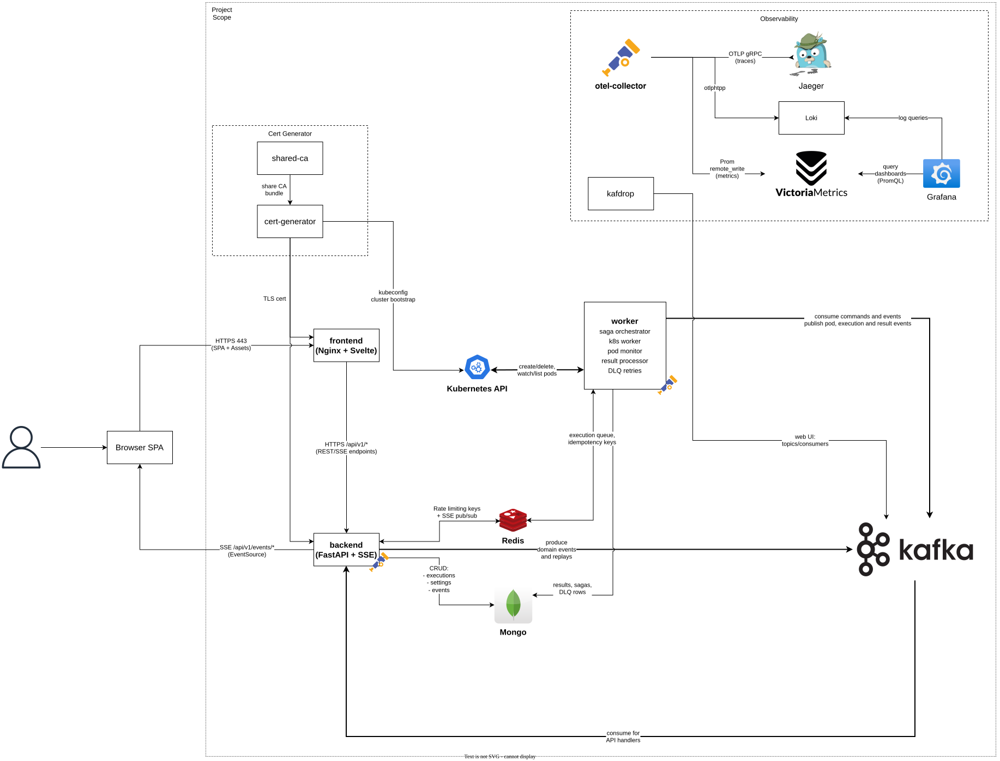

<p align="center">
 
 <h1 align="center"><b>Integr8sCode</b></h1>
</p>
<p align="center">
  <a href="https://github.com/HardMax71/Integr8sCode/actions/workflows/ci.yml">
    
  </a>
  <a href="https://github.com/HardMax71/Integr8sCode/actions/workflows/ci.yml">
    
  </a>
  <a href="https://github.com/HardMax71/Integr8sCode/actions/workflows/ci.yml">
    
  </a>
  <a href="https://github.com/HardMax71/Integr8sCode/actions/workflows/ci.yml">
    
  </a>
  <a href="https://github.com/HardMax71/Integr8sCode/actions/workflows/docker.yml">
    
  </a>
  <a href="https://github.com/HardMax71/Integr8sCode/actions/workflows/ci.yml">
    
  </a>
  <a href="https://github.com/HardMax71/Integr8sCode/actions/workflows/ci.yml">
    
  </a>
  <a href="https://github.com/HardMax71/Integr8sCode/actions/workflows/ci.yml">
    
  </a>
</p>
<p align="center">
  <a href="https://app.codecov.io/gh/HardMax71/Integr8sCode/components?component=backend">
    
  </a>
  <a href="https://app.codecov.io/gh/HardMax71/Integr8sCode/components?component=frontend">
    
  </a>
</p>
<p align="center">
  <a href="https://sonarcloud.io/dashboard?id=HardMax71_Integr8sCode">
    
  </a>
  <a href="https://sonarcloud.io/dashboard?id=HardMax71_Integr8sCode">
    
  </a>
  <a href="https://sonarcloud.io/dashboard?id=HardMax71_Integr8sCode">
    
  </a>
</p>

**Integr8sCode** runs your scripts online. Paste a Python, Node.js, Ruby, Bash or Go script, pick a version, and the platform runs it in its own Kubernetes pod with resource limits to keep things safe. You get the output back as soon as the pod finishes.

> [!NOTE]
> A deployed and working version of Integr8sCode is available at https://app.integr8scode.cc/.

<details>
<summary>How to deploy</summary>

### Prerequisites

- Docker and Docker Compose
- Kubernetes cluster (k3s, Docker Desktop K8s, or minikube) with `kubectl` configured

### Quick start

```bash
git clone https://github.com/HardMax71/Integr8sCode.git
cd Integr8sCode
./deploy.sh dev
```

Secrets (MongoDB, Redis, JWT) fall back to dev defaults, so local development needs no config. For production, set `SECRET_KEY`, `MONGO_USER`, `MONGO_PASSWORD` and `REDIS_PASSWORD` as env vars, plus `MONGO_MONITOR_PASSWORD` with `--observability`.

### Verify

```bash
curl -k https://localhost/api/v1/health/live
```

### Access

| Service            | URL                                              | Notes                                         |
|--------------------|--------------------------------------------------|-----------------------------------------------|
| Frontend           | [https://localhost:5001](https://localhost:5001) | `user` / `user123` or `admin` / `admin123`    |
| Backend API        | [https://localhost:443](https://localhost:443)   |                                               |
| Grafana            | [http://localhost:3000](http://localhost:3000)   | needs `--observability`; `admin` / `admin123` |
| Jaeger (Tracing)   | [http://localhost:16686](http://localhost:16686) | needs `--observability`                       |
| Kafdrop (Kafka UI) | [http://localhost:9000](http://localhost:9000)   | needs `--debug`                               |

`./deploy.sh dev --observability` adds Grafana, Jaeger, Victoria Metrics, Loki and the OTel Collector. `--debug` adds all of those plus Kafdrop.

Self-signed TLS certs are generated automatically, so accept the browser warning.

### Run tests

Unit tests need no running stack:

```bash
cd backend && uv run pytest tests/unit
cd ../frontend && npm ci && npm run test
```

The E2E suites need the full stack; [CONTRIBUTING.md](CONTRIBUTING.md) has the commands.

### Stop

```bash
./deploy.sh down
```

See the [full deployment guide](https://hardmax71.github.io/Integr8sCode/operations/deployment/) for Docker build strategy, troubleshooting, pre-built images, and more.

</details>

<details>
<summary>Sample test</summary>

This script uses the `type` statement, which arrived in Python 3.12. Running it on two versions shows that each run gets a pod with the version you picked.

1. Open `https://localhost:5001/` and log in as `user` / `user123`. You land in the editor.
2. Paste this script:

```python
import platform

type Pair[T] = tuple[T, T]  # the type statement needs Python 3.12+


def swap[T](pair: Pair[T]) -> Pair[T]:
    first, second = pair
    return second, first


print(f"Hello from Python {platform.python_version()}")
print(swap((1, 2)))
print(swap(("left", "right")))
```

3. Keep Python 3.14 (the default) and click Run Script. The output panel shows:

```
Status: completed
Output:
  Hello from Python 3.14.8
  (2, 1)
  ('right', 'left')
```

4. Switch to Python 3.11 and run it again. 3.11 can't parse the `type` line:

```
Status: completed
Errors:
  File "/scripts/main.py", line 3
    type Pair[T] = tuple[T, T]  # the type statement needs Python 3.12+
         ^^^^
SyntaxError: invalid syntax
```

The status stays completed because the pod itself ran fine. The script's own failure shows up as stderr and a non-zero exit code.

</details>


## Architecture Overview

> [!TIP]
> Full documentation is available at https://hardmax71.github.io/Integr8sCode/



A Svelte 5 frontend talks to a FastAPI backend, which keeps its state in MongoDB and Redis and publishes every execution request to Kafka. The worker takes it from there: its saga orchestrator schedules the run, the k8s worker starts a locked-down pod, the pod monitor watches it, and the result processor stores the output. The frontend follows each run live over SSE.

## License

This project is licensed under the MIT License. See the [LICENSE](LICENSE) file for details.
