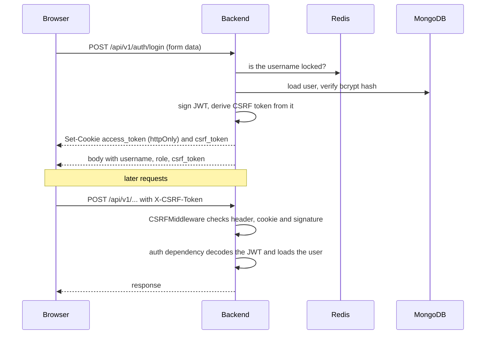

# Authentication

A session is a JWT in an httpOnly cookie. Every state-changing API call from a logged-in browser must also send a CSRF token that matches a second, readable cookie (the double-submit pattern). JavaScript never sees the JWT, and a cross-site page can't produce the header.



## Tokens and cookies

`AuthService.login` signs the JWT through `SecurityService`. The payload holds the username in `sub` plus an `exp` claim, signed with `SECRET_KEY` and `ALGORITHM` (HS256) via PyJWT:

```python
--8<-- "backend/app/core/security.py:create_access_token"
```

The lifetime is `SystemSettings.session_timeout_minutes`, which admins can change at runtime. `RuntimeSettingsLoader` reads it from MongoDB and caches it for 60 seconds. When no settings document exists yet, it's created from the TOML value `ACCESS_TOKEN_EXPIRE_MINUTES` (1440, so 24 hours), and the TOML value is also the fallback when the read fails. The same number sets the cookie `max_age`.

Login sets two cookies, both `secure`, `samesite=strict` and scoped to `/`:

```python
--8<-- "backend/app/api/routes/auth.py:login_cookies"
```

`access_token` is httpOnly and carries the JWT. `csrf_token` is readable so the frontend can echo it back in `X-CSRF-Token`. The login and `/auth/me` responses also set `Cache-Control: no-store`.

Routes get the caller through the `current_user` and `admin_user` dependencies in `app/api/dependencies.py`. Both call `AuthService`, which decodes the cookie, loads the user and answers 401 when the token is missing, invalid or expired, or when its `sub` no longer names an active user. A non-admin on an admin route gets 403 (`AdminAccessRequiredError`). Logout publishes `UserLoggedOutEvent` and deletes both cookies. Logout doesn't revoke the JWT itself, so a copied token keeps working until it expires, unless the account is deactivated, deleted or renamed first.

Passwords are hashed with bcrypt through pwdlib's `BcryptHasher`. `BCRYPT_ROUNDS` sets the cost (12, and 4 in `config.test.toml`):

```python
--8<-- "backend/app/core/security.py:password_hashing"
```

## CSRF

`CSRFMiddleware` runs on every HTTP request and calls `SecurityService.validate_csrf_from_request`:

```python
--8<-- "backend/app/core/security.py:csrf_validation"
```

The check is skipped for GET, HEAD and OPTIONS, for paths outside `/api/`, and for requests with no `access_token` cookie, since a forged request without one has no session to act on: routes that need a user answer 401, and logout, which has no auth dependency, only deletes cookies. Only two paths are exempt by name: `/api/v1/auth/login` and `/api/v1/auth/register`. Logout is not one of them. So every POST, PUT, PATCH and DELETE from a logged-in browser needs an `X-CSRF-Token` header that equals the `csrf_token` cookie (compared in constant time) and carries a valid signature for the current `access_token`.

The token has the form `{nonce}.{hmac}`, where the HMAC is SHA-256 over `nonce:access_token` keyed with `SECRET_KEY`. A token issued for one session fails against another. Any failure returns 403 with `{"status": 403, "detail": "CSRF validation failed"}` and adds to `csrf.validation.failures.total` with the reason (`missing_header`, `token_mismatch` or `invalid_signature`).

## Login lockout

Failed logins are counted per username in Redis. Each failure increments `login_lockout:attempts:{username}` and resets its TTL to `lockout_duration_minutes`. When the count reaches `max_login_attempts`, `login_lockout:locked:{username}` is set with the same TTL, and logins answer 423 until it expires. Both values live in `SystemSettings` (defaults 5 attempts and 15 minutes).

Unknown usernames are counted the same way, and a bcrypt check against a dummy hash keeps their response time close to a wrong password, so neither the status nor the timing tells an unknown username from a wrong password. Both of those failures also publish an `AuthFailedEvent`. A login refused because the name is already locked, or because the account is deactivated, publishes none. A successful login clears both keys, and an admin can clear them with `POST /api/v1/admin/users/{user_id}/unlock`.

## Errors

| Case | Status | `detail` |
|------|--------|----------|
| Wrong password or unknown user | 401 | `Invalid credentials` |
| Login while locked | 423 | `Account temporarily locked due to too many failed attempts` |
| The failed attempt that triggers the lock | 423 | `Account locked due to too many failed attempts` |
| Correct password, deactivated account | 403 | `Account '{username}' is deactivated` |
| Register with a taken username | 409 | `Username already registered` |
| Register with a taken email | 409 | `Email already registered` |
| Register loses an insert race (duplicate key) | 409 | `User already exists` |
| Password shorter than `password_min_length` | 422 | `Password must be at least {n} characters` |
| Password under 8 characters | 422 | FastAPI validation error list |

The password check order matters: a deactivated account with a wrong password gets 401 and counts toward the lockout. `UserCreate` enforces 8 characters in the schema, and `AuthService.register` then checks `SystemSettings.password_min_length` (default 8). Admins can raise the minimum but not lower it below 8.

## Frontend

The frontend keeps no session of its own. The root layout's load asks `/api/v1/auth/me` before any page renders, and every page gets the answer as `page.data.user`: the generated `UserResponse`, or `null` when the cookie is missing or rejected. The `(auth)` and admin layouts guard their pages from it ([Routing](../frontend/routing.md)). After login and logout the app navigates with `refreshAll`, so the load asks again.

The request interceptor in `frontend/src/lib/api-interceptors.ts` copies the `csrf_token` cookie into the header of every non-GET call:

```typescript
--8<-- "frontend/src/lib/api-interceptors.ts:csrf_injection"
```

The query client's error handler turns status codes into toasts. A 401 while someone is signed in, outside the login and register forms, shows "Session expired. Please log in again.", empties the query cache and reloads the layout data, so a protected page's guard sends the user to `/login` with the page to come back to:

```typescript
--8<-- "frontend/src/lib/api-interceptors.ts:error_handling"
```

A network failure at startup reads as signed out too, since the load can't tell it from a missing session, so a protected page sends the user to `/login`.

## Endpoints

<swagger-ui src="../reference/openapi.json" filter="authentication" docExpansion="none" defaultModelsExpandDepth="-1" supportedSubmitMethods="[]"/>
