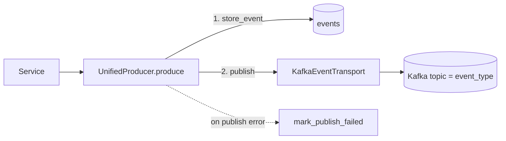

# Event storage

Every event the system produces is written to one MongoDB collection, `events`, before it goes to Kafka. Each document is an `EventDocument`. The base event fields sit at the top level, and so do the event-specific ones: there's no payload wrapper.

## EventDocument

```python
--8<-- "backend/app/db/docs/event.py:EventDocument"
```

The class declares the fields every event shares, plus `stored_at`, `ttl_expires_at` and `execution_id`. Everything else comes in through `extra="allow"`. A `PodCreatedEvent` stores `pod_name` and `namespace` next to `event_type`, a `UserSettingsUpdatedEvent` stores whichever settings changed. Only some event types have `execution_id` or `pod_name`, so both indexes are declared sparse. Only the `pod_name` one stays sparse in practice: `execution_id` is a declared field, so an event without one is stored with `execution_id: null`, and a sparse index still indexes nulls.

Queries hit event fields directly, with no prefix:

```python
query["execution_id"] = execution_id
query["metadata.user_id"] = user_id
```

## Write path



`UnifiedProducer.produce()` in `app/events/core/producer.py` does both steps. First `EventRepository.store_event()` dumps the event with `model_dump(exclude_none=True)`, sets `stored_at` and inserts it. A duplicate `event_id` hits the unique index, and the repository logs it and returns, so storing the same event twice is a no-op. Replayed events keep their `event_id`, so a replay doesn't create new rows.

Then `KafkaEventTransport.publish()` sends the event to the topic named after its `event_type`. If that fails, `mark_publish_failed()` sets `publish_failed` and `publish_failed_at` on the stored document and the exception goes back to the caller. Nothing re-publishes flagged events automatically, though a replay session with the Kafka target sends stored events again.

Services call the producer directly or through `KafkaEventService.publish_event()`, which wraps the same call in a trace span and records publish metrics.

## Read path

Reads turn documents back into typed events with `DomainEventAdapter.validate_python(doc)`. The adapter is a `TypeAdapter` over the `DomainEvent` union, discriminated by `event_type`, so each row comes back as its concrete class. `BaseEvent` has `from_attributes=True`, which lets it read the extra fields straight off the document.

Several repositories read the same collection:

| Repository | Reads events for |
|---|---|
| `EventRepository` | Execution event lists, user event history, statistics, aggregate replay info |
| `AdminEventsRepository` | Admin browse, detail, stats, export, replay preview |
| `ReplayRepository` | Counting and streaming events for replay sessions |
| `UserSettingsRepository` | Rebuilding settings from `user_settings_updated` events |

## Filters

Two filter dataclasses build the queries. Admin browse and export use `EventFilter` from `app/domain/events/event_models.py`. `AdminEventsRepository._event_filter_conditions()` turns it into Beanie conditions, and its `search_text` runs against the `idx_text_search` index.

Replay uses `ReplayFilter`, which builds a raw Mongo query itself:

```python
--8<-- "backend/app/domain/replay/models.py:ReplayFilter"
```

`ReplayRepository` uses `to_mongo_query()` to count and stream events for a replay session. `AdminEventsRepository` uses it for the admin replay endpoint: the dry-run preview, the event count and the related execution results.

## Retention

Each event expires 30 days after it's stored. `ttl_expires_at` defaults to now plus 30 days, and the `idx_ttl` index with `expireAfterSeconds=0` lets MongoDB delete the document at that time. The 30 days are hardcoded in `EventDocument`. `EVENT_RETENTION_DAYS` exists in settings but nothing reads it ([#293](https://github.com/HardMax71/Integr8sCode/issues/293)).

TTL expiry doesn't archive anything. Archiving only happens when an admin deletes an event through `DELETE /api/v1/admin/events/{event_id}`: `AdminEventsService.delete_event()` copies it into `events_archive` (`EventArchiveDocument`, same fields plus `deleted_at`, `deleted_by` and `deletion_reason`) and then deletes the original. The archive collection has no TTL index.

Related: [User Settings Events](user-settings-events.md) for an event-sourced read model built on this collection, and [Model Conversion](model-conversion.md) for how the other repositories convert documents.
