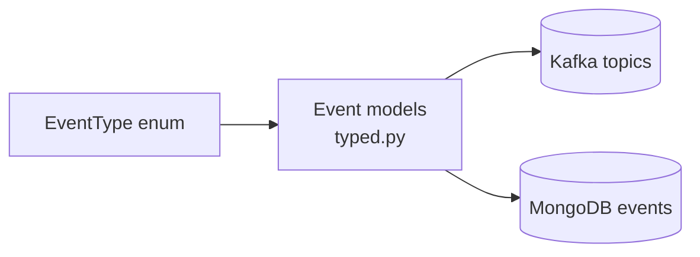
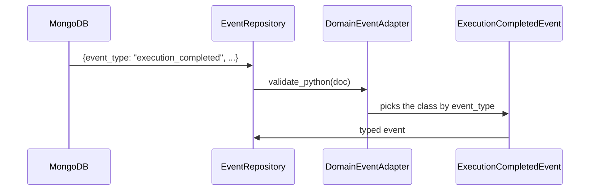
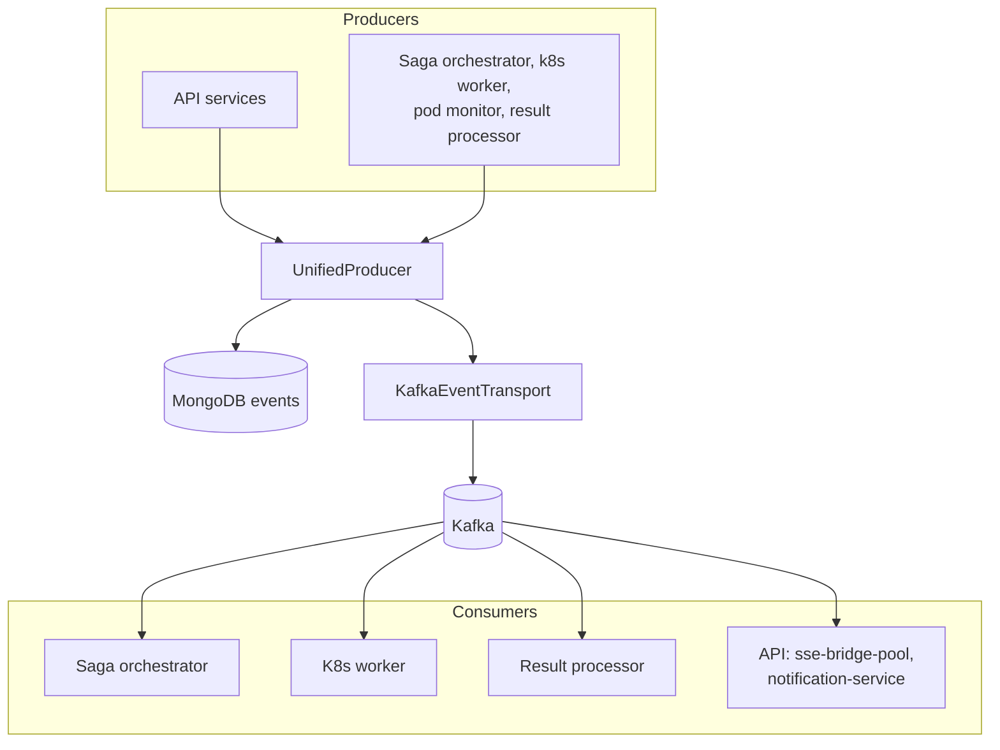

# Event system design

Each event is defined once, as a Pydantic model in `app/domain/events/typed.py`. The same class is stored in MongoDB, published to Kafka and handed to subscribers, so there is no separate Kafka schema and no mapping layer to keep in sync.



`EventType` in `app/domain/enums/events.py` lists every event type as a string, 57 of them. Each value is also the Kafka topic name, with no prefix. FastStream serializes the model to JSON on publish and validates it back into the model on consume.

## BaseEvent

Every event extends `BaseEvent`:

```python
class BaseEvent(BaseModel):
    """Base fields for all domain events."""

    model_config = ConfigDict(
        from_attributes=True,
        json_schema_extra={"required": ["event_id", "event_type", "event_version", "timestamp", "metadata"]},
    )

    event_id: str = Field(default_factory=lambda: str(uuid4()))
    event_type: EventType
    event_version: str = "1.0"
    timestamp: datetime = Field(default_factory=lambda: datetime.now(timezone.utc))
    aggregate_id: str | None = None
    metadata: EventMetadata
```

`EventMetadata` is a stdlib dataclass with `service_name`, `service_version`, `user_id` and `environment`. The `json_schema_extra` line marks the defaulted fields as required in the OpenAPI schema, so the generated TypeScript types don't make them optional. Storage fields such as `stored_at` and `ttl_expires_at` live on `EventDocument`, not on the event. See [Event Storage](event-storage.md).

## The DomainEvent union

Each event class pins its type with a `Literal`:

```python
class ExecutionCompletedEvent(BaseEvent):
    event_type: Literal[EventType.EXECUTION_COMPLETED] = EventType.EXECUTION_COMPLETED
    execution_id: str
    exit_code: int
    resource_usage: ResourceUsageDomain | None = None
    stdout: str = ""
    stderr: str = ""
```

`DomainEvent` is an `Annotated` union of all 57 classes with `Discriminator("event_type")`, and `DomainEventAdapter` is a `TypeAdapter` over it. Pydantic reads `event_type` first and validates against that one class, instead of trying every member until one fits.



`EventRepository` reads stored events this way. The SSE bridge does the same on the Kafka side: it subscribes to 17 topics with a single `body: DomainEvent` parameter and gets the right class for each message.

## Publishing

All publishing goes through `UnifiedProducer` in `app/events/core/producer.py`. It's a store-then-publish outbox: it writes the event to MongoDB, then hands it to `KafkaEventTransport`, which calls `broker.publish` with the event type as the topic.

```python
async def produce(self, event_to_produce: DomainEvent, key: str) -> None:
    await self._event_repository.store_event(event_to_produce)
    try:
        await self._transport.publish(event_to_produce, event_to_produce.event_type, key)
    except Exception:
        await self._event_repository.mark_publish_failed(event_to_produce.event_id)
        raise
```

`store_event` ignores a duplicate `event_id`, so storing the same event twice is a no-op. If Kafka fails, the stored event gets `publish_failed: true` and the exception goes back to the caller. Nothing re-sends those events later.



The pod monitor only publishes. The DLQ manager is the one place that skips the outbox: it calls `broker.publish` directly for retries and its `dlq_message_*` status events. See [Kafka Topics](kafka-topic-architecture.md) for the consumer groups.

## Adding an event type

1. Add the value to `EventType`.
2. Add the class to `typed.py` with the matching `Literal` default.
3. Add it to the `DomainEvent` union.

The topic needs no setup, since Kafka creates it on first use. `tests/unit/domain/events/test_event_schema_coverage.py` fails if an `EventType` has no class in the union, if a `BaseEvent` subclass has no `EventType` default for `event_type`, or if `DomainEventAdapter` doesn't recognize a type.
