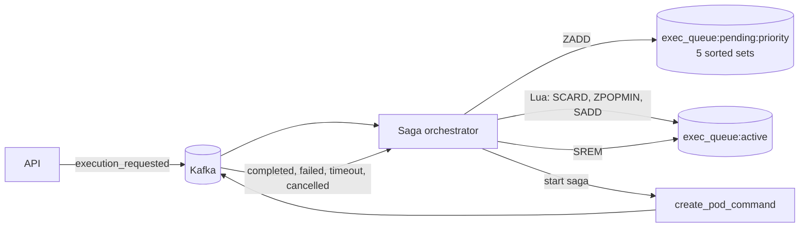

# Execution queue

The saga orchestrator owns scheduling. It keeps pending executions in Redis, one sorted set per priority, and starts a saga only while fewer than `max_concurrent_executions` are running. The queue itself is `ExecutionQueueService` in `backend/app/services/execution_queue.py`; the [saga orchestrator](../components/workers/saga_orchestrator.md) decides when to call it.

## Redis keys

| Key | Type | Holds | TTL |
|-----|------|-------|-----|
| `exec_queue:pending:{priority}` | Sorted set | Pending ids for one priority, scored by enqueue time (epoch seconds) | none |
| `exec_queue:active` | Set | Ids that hold a running slot | none |
| `exec_queue:event:{execution_id}` | String | The `ExecutionRequestedEvent` as JSON | 24 hours |
| `exec_queue:retries:{execution_id}` | Counter | Failed saga starts for that execution | 24 hours, refreshed on each increment |

There are five pending sets: `critical`, `high`, `normal`, `low` and `background`. A higher priority always goes first, and within one priority the oldest entry goes first.

Every execution submitted through `POST /api/v1/execute` starts as `normal`. Only an admin can change that, after the fact.

## Scheduling

`try_schedule` is one Lua script that gets the active set and the five pending sets as keys. If `SCARD` on the active set is already at the cap, it returns nothing. Otherwise it walks the pending sets from `critical` to `background`, pops the first entry it finds with `ZPOPMIN`, adds the id to the active set, and returns the id, its score and the priority index. The count check and the pop happen in one round trip, so two callers can't both squeeze past the cap.

The service then loads the stored event. If that key already expired, the execution is lost: the id leaves the active set, `queue.event_data_lost` goes up and nothing is scheduled.

`try_schedule_from_queue` reads `max_concurrent_executions` from the admin system settings (default 10, admins can set 1 to 100, cached for 60 seconds by `RuntimeSettingsLoader`). It calls `try_schedule` in a loop and starts a saga for each id it gets, until the queue is empty, the cap is reached or it pops an id whose event expired. That last case ends the pass even with entries still pending, and the next pass picks them up.

If starting a saga raises, the orchestrator bumps `exec_queue:retries:{id}`, releases the slot and puts the event back at the end of its priority. On the third failure it gives up: the saga is marked failed if one was created, no event goes out, and the execution stays `queued` in MongoDB. Either way that scheduling pass stops.

These events trigger a pass:

| Event | Queue action before scheduling |
|-------|--------------------------------|
| `execution_requested` | `enqueue` (guarded by [idempotency](idempotency.md)) |
| `execution_completed`, `execution_failed`, `execution_timeout` | mark the saga terminal, `release` |
| `execution_cancelled` | `remove` from every queue key, mark the saga cancelled, `release` |

`release` is an `SREM` plus deleting the event key, so it's safe on an id that holds no slot. On top of the events, the worker runs `try_schedule_from_queue` every 10 seconds through APScheduler (`run_saga_orchestrator.py`), which catches up after a restart or a lost event.

## Admin endpoints

All three need an admin user.

| Endpoint | What it does |
|----------|--------------|
| `GET /api/v1/admin/executions/` | Lists executions, filtered by status, priority or user |
| `PUT /api/v1/admin/executions/{execution_id}/priority` | Sets a new priority |
| `GET /api/v1/admin/executions/queue` | Returns `queue_depth`, `active_count`, `max_concurrent` and `by_priority` |

A priority change updates MongoDB first, then runs a second Lua script that finds the id in whichever pending set holds it and moves it to the new set with the same score. The entry keeps its age, so it lands among the new priority's entries by enqueue time. An execution that already left the queue only gets the MongoDB update.

The queue status reads Redis directly: `queue_depth` is the sum of `ZCARD` over the five pending sets, `active_count` is `SCARD` on the active set, and `by_priority` has the `ZCARD` of each non-empty set.

## Metrics

`QueueMetrics` in `backend/app/core/metrics/queue.py` defines these. The second column is the series name in VictoriaMetrics.

| Instrument | Series | Meaning |
|------------|--------|---------|
| `queue.depth` | `queue_depth` | Up-down counter: up on enqueue, down on schedule |
| `queue.active` | `queue_active` | Up-down counter: up on schedule, down on every `release` |
| `queue.enqueue.total` | `queue_enqueue_total` | Enqueues, including re-enqueues after a failed saga start |
| `queue.schedule.total` | `queue_schedule_total` | Executions popped from the queue |
| `queue.wait_time` | `queue_wait_time_seconds` | Histogram of enqueue to schedule, by `priority` |
| `queue.event_data_lost` | `queue_event_data_lost_total` | Scheduled ids whose stored event had expired |

`queue_depth` and `queue_active` are counted in the orchestrator process, so they start from zero after a restart. `release` also decrements `queue_active` for ids that never held a slot, like a cancelled pending execution, so the series drifts. `queue_depth` drifts the other way: an id popped with an expired event, or removed by a cancel, leaves the pending set without decrementing it. The admin queue endpoint is the number to trust. The [metrics reference](../operations/metrics-reference.md) lists the rest.
