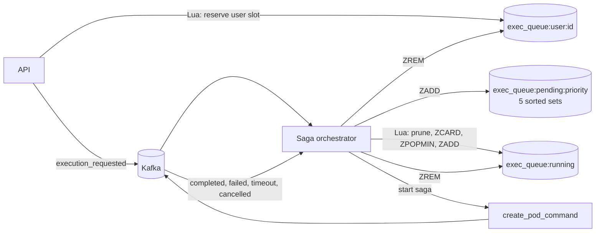

# Execution queue

The saga orchestrator owns scheduling. It keeps pending executions in Redis, one sorted set per priority, and starts a saga only while fewer than `max_concurrent_executions` are running. Before any of that, the API caps how many executions one user can have queued or running at once. The queue itself is `ExecutionQueueService` in `backend/app/services/execution_queue.py`; the [saga orchestrator](../components/workers/saga_orchestrator.md) decides when to call it.

## Redis keys

| Key | Type | Holds | TTL |
|-----|------|-------|-----|
| `exec_queue:pending:{priority}` | Sorted set | Pending ids for one priority, scored by enqueue time (epoch seconds) | none |
| `exec_queue:running` | Sorted set | Ids that hold a running slot, scored by the time the slot expires | none |
| `exec_queue:user:{user_id}` | Sorted set | One user's queued and running ids, scored by the time the reservation expires | 24 hours, refreshed on each reservation |
| `exec_queue:owner:{execution_id}` | String | The user an id was reserved for, so a release can find the user's set | 24 hours |
| `exec_queue:event:{execution_id}` | String | The `ExecutionRequestedEvent` as JSON | 24 hours |
| `exec_queue:retries:{execution_id}` | Counter | Failed saga starts for that execution | 24 hours, refreshed on each increment |

There are five pending sets: `critical`, `high`, `normal`, `low` and `background`. A higher priority always goes first, and within one priority the oldest entry goes first.

Every execution submitted through `POST /api/v1/execute` starts as `normal`. Only an admin can change that, after the fact.

## Per-user limit

`ExecutionService.execute_script` reserves a slot for the user before it writes the execution. The reservation is a Lua script on `exec_queue:user:{user_id}`: it drops entries whose time has passed, and if the user still holds `max_executions_per_user` (admin setting, default 100, 1 to 1000) it refuses, and the API answers 429 with `ExecutionLimitExceededError`. Otherwise it adds the new id, which is generated before the insert for this reason. Retries go through the same path. If the insert or the publish fails, the service gives the slot back.

A reservation lasts 24 hours, as long as a queued event does. The orchestrator gives it back when the execution reaches a terminal state, including when it gives up after three failed saga starts, but not when it requeues after a single failed start. A release that never happens only holds the slot until it expires.

## Scheduling

`try_schedule` is one Lua script that gets the running set and the five pending sets as keys. It first drops running entries whose expiry has passed. If `ZCARD` on the running set is then at the cap, it returns nothing. Otherwise it walks the pending sets from `critical` to `background`, pops the first entry it finds with `ZPOPMIN`, adds the id to the running set with its expiry, and returns the id, its score and the priority index. The count check and the pop happen in one round trip, so two callers can't both squeeze past the cap.

A running slot expires after the longest pod deadline (the admin timeout or the largest per-language minimum, whichever is longer) plus 300 seconds. A normal run releases it long before that, so expiry only matters when a release got lost, for example a saga that timed out without a terminal event.

The service then loads the stored event. If that key already expired, the execution is lost: the id leaves the running set, `queue.event_data_lost` goes up and nothing is scheduled.

`try_schedule_from_queue` reads `max_concurrent_executions` from the admin system settings (default 10, admins can set 1 to 100, cached for 60 seconds by `RuntimeSettingsLoader`). It calls `try_schedule` in a loop and starts a saga for each id it gets, until the queue is empty, the cap is reached or it pops an id whose event expired. That last case ends the pass even with entries still pending, and the next pass picks them up.

If starting a saga raises, the orchestrator bumps `exec_queue:retries:{id}`, releases the slot and puts the event back at the end of its priority. On the third failure it gives up: the saga is marked failed if one was created, no event goes out, and the execution stays `queued` in MongoDB. Either way that scheduling pass stops.

These events trigger a pass:

| Event | Queue action before scheduling |
|-------|--------------------------------|
| `execution_requested` | `enqueue` (guarded by [idempotency](idempotency.md)) |
| `execution_completed`, `execution_failed`, `execution_timeout` | mark the saga terminal, `release`, `release_user_slot` |
| `execution_cancelled` | `remove` from every queue key, mark the saga cancelled, `release`, `release_user_slot` |

`release` is a `ZREM` on the running set plus deleting the event key, and `release_user_slot` looks up the owner and removes the id from that user's set, so both are safe on an id that holds nothing. On top of the events, the worker runs `try_schedule_from_queue` every 10 seconds through APScheduler (`run_saga_orchestrator.py`), which catches up after a restart or a lost event.

## Admin endpoints

All three need an admin user.

| Endpoint | What it does |
|----------|--------------|
| `GET /api/v1/admin/executions/` | Lists executions, filtered by status, priority or user |
| `PUT /api/v1/admin/executions/{execution_id}/priority` | Sets a new priority |
| `GET /api/v1/admin/executions/queue` | Returns `queue_depth`, `active_count`, `max_concurrent` and `by_priority` |

A priority change updates MongoDB first, then runs a second Lua script that finds the id in whichever pending set holds it and moves it to the new set with the same score. The entry keeps its age, so it lands among the new priority's entries by enqueue time. An execution that already left the queue only gets the MongoDB update.

The queue status reads Redis directly: `queue_depth` is the sum of `ZCARD` over the five pending sets, `active_count` counts the running entries that haven't expired, and `by_priority` has the `ZCARD` of each non-empty set.

## Metrics

`QueueMetrics` in `backend/app/core/metrics/queue.py` defines these. The second column is the series name in VictoriaMetrics.

| Instrument | Series | Meaning |
|------------|--------|---------|
| `queue.depth` | `queue_depth` | Up-down counter: up on enqueue, down on schedule |
| `queue.active` | `queue_active` | Up-down counter: up on schedule, down when `release` or `remove` takes an id out of the running set |
| `queue.enqueue.total` | `queue_enqueue_total` | Enqueues, including re-enqueues after a failed saga start |
| `queue.schedule.total` | `queue_schedule_total` | Executions popped from the queue |
| `queue.wait_time` | `queue_wait_time_seconds` | Histogram of enqueue to schedule, by `priority` |
| `queue.event_data_lost` | `queue_event_data_lost_total` | Scheduled ids whose stored event had expired |

`queue_depth` and `queue_active` are counted in the orchestrator process, so they start from zero after a restart. `queue_depth` also drifts: an id popped with an expired event, or removed by a cancel, leaves the pending set without decrementing it. The admin queue endpoint is the number to trust. The [metrics reference](../operations/metrics-reference.md) lists the rest.
