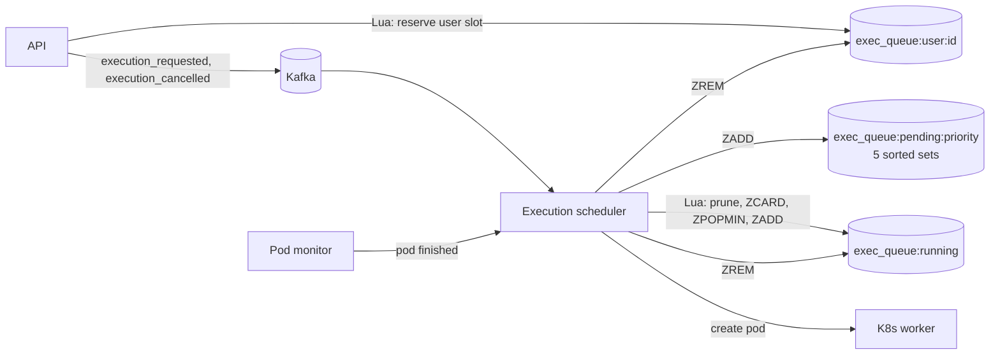

# Execution queue

The execution scheduler in the worker owns scheduling. It keeps pending executions in Redis, one sorted set per priority, and creates a pod only while fewer than `max_concurrent_executions` are running. Before any of that, the API caps how many executions one user can have queued or running at once. The queue itself is `ExecutionQueueService` in `backend/app/services/execution_queue.py`; the [execution scheduler](../components/workers/execution_scheduler.md) decides when to call it.

## Redis keys

| Key | Type | Holds | TTL |
|-----|------|-------|-----|
| `exec_queue:pending:{priority}` | Sorted set | Pending ids for one priority, scored by enqueue time (epoch seconds) | none |
| `exec_queue:running` | Sorted set | Ids that hold a running slot, scored by the time the slot expires | none |
| `exec_queue:user:{user_id}` | Sorted set | One user's queued and running ids, scored by the time the reservation expires | 24 hours, refreshed on each reservation |
| `exec_queue:owner:{execution_id}` | String | The user an id was reserved for, so a release can find the user's set | 24 hours |
| `exec_queue:event:{execution_id}` | String | The `ExecutionRequestedEvent` as JSON | 24 hours |

There are five pending sets: `critical`, `high`, `normal`, `low` and `background`. A higher priority always goes first, and within one priority the oldest entry goes first.

Every execution submitted through `POST /api/v1/execute` starts as `normal`. Only an admin can change that, after the fact.

## Per-user limit

`ExecutionService.execute_script` reserves a slot for the user before it writes the execution. The reservation is a Lua script on `exec_queue:user:{user_id}`: it drops entries whose time has passed, and if the user still holds `max_executions_per_user` (admin setting, default 100, 1 to 1000) it refuses, and the API answers 429 with `ExecutionLimitExceededError`. Otherwise it adds the new id, which is generated before the insert for this reason. Retries go through the same path. If the insert or the publish fails, the service gives the slot back.

A reservation lasts 24 hours, as long as a queued event does. The scheduler gives it back when the execution ends, a cancel or a pod that couldn't be created included. A release that never happens only holds the slot until it expires.

## Scheduling

`try_schedule` is one Lua script that gets the running set and the five pending sets as keys. It first drops running entries whose expiry has passed. If `ZCARD` on the running set is then at the cap, it returns nothing. Otherwise it walks the pending sets from `critical` to `background`, pops the first entry it finds with `ZPOPMIN`, adds the id to the running set with its expiry, and returns the id, its score and the priority index. The count check and the pop happen in one round trip, so two callers can't both squeeze past the cap.

Once the service has loaded the event, the slot gets the execution's own pod deadline plus 300 seconds: the timeout the execution was submitted with, raised to its language's minimum. The user's reservation moves to the same deadline, so a job that waited long in the queue keeps its place in the user's count while it runs. Until the event is loaded, the slot assumes the longest timeout an admin can set. A normal run releases the slot long before it expires, so expiry only matters when a release got lost, for example a pod deleted by hand while the worker was down.

The service then loads the stored event. If that key already expired, the request can't run: the id leaves the running set and its user's reservation, `queue.event_data_lost` goes up, and the scheduler has the result processor store the execution as `failed` with error type `system_error`, then moves on to the next one.

`schedule_pending` reads `max_concurrent_executions` from the admin system settings (default 10, admins can set 1 to 100, cached for 60 seconds by `RuntimeSettingsLoader`). It calls `try_schedule` in a loop and has the k8s worker create the pod for each id it gets, until the queue is empty, the cap is reached or it pops an id whose event expired. That last case ends the pass even with entries still pending, and the next pass picks them up.

If the pod can't be created, the scheduler stores the execution as `failed` with a `system_error`, releases both slots and goes on with the next id.

These trigger a pass:

| Trigger | Queue action before scheduling |
|---------|--------------------------------|
| `execution_requested` | `enqueue` (guarded by [idempotency](idempotency.md)) |
| the pod monitor sees a pod finish | `release`, `release_user_slot` |
| `execution_cancelled` | `remove` from every queue key, store `cancelled`, delete the pod, `release`, `release_user_slot` |

`release` is a `ZREM` on the running set plus deleting the event key, and `release_user_slot` looks up the owner and removes the id from that user's set, so both are safe on an id that holds nothing. On top of those, the worker runs `schedule_pending` every 10 seconds through APScheduler (`app/worker.py`), which catches up after a restart or a slot that expired.

## Admin endpoints

All three need an admin user.

| Endpoint | What it does |
|----------|--------------|
| `GET /api/v1/admin/executions/` | Lists executions, filtered by status, priority or user |
| `PUT /api/v1/admin/executions/{execution_id}/priority` | Sets a new priority |
| `GET /api/v1/admin/executions/queue` | Returns `queue_depth`, `active_count`, `max_concurrent` and `by_priority` |

A priority change updates MongoDB first, then runs a second Lua script that finds the id in whichever pending set holds it and moves it to the new set with the same score. The entry keeps its age, so it lands among the new priority's entries by enqueue time. An execution that already left the queue only gets the MongoDB update.

The queue status reads Redis directly: `queue_depth` is the sum of `ZCARD` over the five pending sets, `active_count` counts the running entries that haven't expired, and `by_priority` has the `ZCARD` of each non-empty set.

## Metrics

The queue's six series come from spans: `queue.enqueue` and `queue.schedule` from `ExecutionQueueService`, and `queue.schedule_pending` from every pass of the execution scheduler, which reads the depth and the running slots from Redis. So `queue_depth` and `queue_active` match the admin queue endpoint and survive restarts. The [metrics reference](../operations/metrics-reference.md#executions-and-queue) lists the series and their labels.
