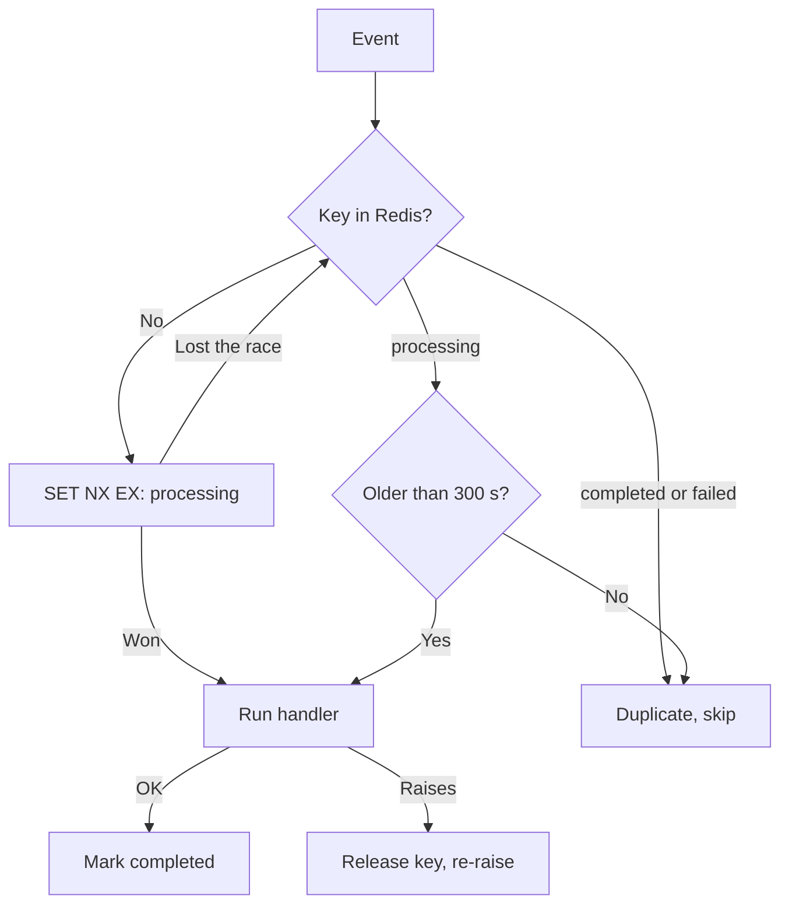

# Idempotency

Kafka delivers at least once, so a consumer can see the same event twice. Handlers that must not run twice go through `IdempotencyManager`, which keeps one Redis key per event and lets only the first caller through. The API reuses the same manager for the `Idempotency-Key` header on `POST /api/v1/execute`.

## Who uses it

| Caller | Events | Key strategy | TTL |
|--------|--------|--------------|-----|
| Execution scheduler | `execution_requested`, `execution_cancelled` | `EVENT_BASED` | 1 hour |
| API, `POST /api/v1/execute` with `Idempotency-Key` | none, see below | `CUSTOM` | 24 hours |

The other subscribers, `sse-bridge-pool` and `notification-service`, don't use it. The subscriptions live in `backend/app/events/handlers.py`, one `KafkaRouter` per consumer, and the guard is a middleware on the router, so it covers every subscriber on it.

Keys aren't scoped by consumer group, so two routers with the same strategy on the same event would skip each other's deliveries. Only one router uses the manager today.

Inside the worker, a finished pod doesn't need a key: the result processor's write only applies to an execution that is still active, so a pod reported twice stores its result once and publishes it once.

## Keys

The manager builds a key from the event in one of three ways:

```python
--8<-- "backend/app/services/idempotency/idempotency_manager.py:generate_key"
```

`EVENT_BASED` is `{event_type}:{event_id}` and is the default when a caller passes no strategy. `CONTENT_HASH` is a SHA-256 of the event JSON with `event_id`, `timestamp` and `metadata` removed, so an event published twice under two different ids still counts as one; no router uses it today. `CUSTOM` is `{event_type}:{custom_key}` with a key the caller picks. Every key gets the `idempotency:` prefix.

## How a check works



A record has one of three states:

```python
--8<-- "backend/app/domain/idempotency/models.py:IdempotencyStatus"
```

`check_and_reserve` reads the key first. If it's missing, the manager writes a `processing` record with `SET NX EX`, so of two racing consumers only one wins. The loser reads the key again and gets treated as a duplicate.

```python
--8<-- "backend/app/services/idempotency/redis_repository.py:insert_processing"
```

When `SET NX` loses, the repository raises pymongo's `DuplicateKeyError`, odd for a Redis store but it's what the manager catches. Each record is a JSON document with the status, the event type and id, timestamps, processing duration, the error and an optional cached result. Updates keep the key's remaining TTL, read with `TTL` in whole seconds. If that reads 0 because the key is about to expire, the rewrite sets no expiry at all and the key stays until something deletes it.

A `processing` record older than `processing_timeout_seconds` (300) is taken to be a crashed consumer. The manager resets its `created_at` and lets the new caller run. `completed` and `failed` records both count as duplicates until the key expires. Neither the Kafka middleware nor the HTTP path writes `failed` today: both release the key when the work raises.

Kafka handlers get the guard from `IdempotencyMiddleware`, which each router takes with its key strategy and TTL:

```python
--8<-- "backend/app/events/middlewares.py:IdempotencyMiddleware"
```

It runs before FastStream hands the message to the handler, so it parses the raw body into the `DomainEvent` union itself and takes the manager from the request container that the broker's Dishka middleware opens around it.

A duplicate is logged and skipped, and the message is acked as usual. A handler that raises gets its key released, so nothing is left to block the event. The router's `DeadLetterMiddleware` saves it to the [dead letter queue](../components/dead-letter-queue.md), and the retry runs the handler again.

## HTTP Idempotency-Key

`POST /api/v1/execute` takes an optional `Idempotency-Key` header. Without it the request runs as usual. With it, `ExecutionService.execute_script_idempotent` reserves the custom key `http:{user_id}:{key}` for 24 hours, so two users can reuse the same header value without clashing. The Redis key ends up as `idempotency:execution_requested:http:{user_id}:{key}`.

On success the manager stores the new execution as JSON in the record. A repeat with the same key gets one of these:

| Repeat request arrives | Response |
|------------------------|----------|
| After the first one succeeded | 200 with the cached execution, same `execution_id`, nothing new runs |
| While the first one is still running | 409, "Duplicate request '<key>' is still being processed" |
| After the first one failed | Runs again, since a failed request deletes its key |
| After the cached result went missing | 409, "Cached result for '<key>' is no longer available" |

A client that hits an error can retry with the same key.

## Configuration

```python
--8<-- "backend/app/services/idempotency/idempotency_manager.py:IdempotencyConfig"
```

The DI provider builds `IdempotencyConfig()` with these defaults; nothing in `config.toml` changes them. Every caller passes its own TTL, so `default_ttl_seconds` only applies to a caller that doesn't. Result caching is used by the HTTP path only. Event handlers mark keys completed without a result, and a result over `max_result_size_bytes` is logged and not stored.

## Metrics

`IdempotencyManager` puts each `check_and_reserve` on an `idempotency.check` span with a hit or miss, and leaves `idempotency.duplicate_blocked` and `idempotency.processed` spans for blocked duplicates and finished keys. The worker counts the `idempotency:*` keys in Redis with `SCAN` every 30 seconds for `idempotency_keys_active`. A miss is a lookup that found no record and went on to `SET NX`, whether or not it won it. The [metrics reference](../operations/metrics-reference.md#events-and-idempotency) lists the series and their labels.
