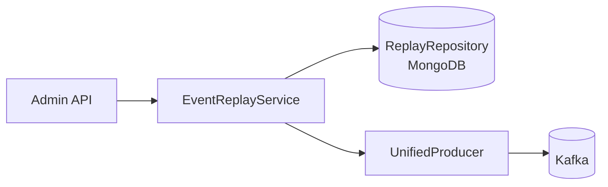

# Kafka topic architecture

Every event type has its own topic, and the topic name is the `EventType` value itself, with no prefix: `ExecutionRequestedEvent` goes to `execution_requested`. Since `EventType` is a `StringEnum`, the member already is that string, so neither side needs a lookup table or `.value`.

```python
await self._transport.publish(event_to_produce, event_to_produce.event_type, key)
```

That line in `UnifiedProducer.produce` is the whole routing layer. Subscribers name the same enum member:

```python
async def schedule_execution(body: ExecutionRequestedEvent, scheduler: FromDishka[ExecutionScheduler]) -> None:
    await scheduler.handle_execution_requested(body)

router.subscriber(EventType.EXECUTION_REQUESTED, group_id="saga-orchestrator")(schedule_execution)
```

Each handler gets exactly one typed model. Nobody decodes a message only to drop it because the type doesn't match.

## Topic configuration

No code creates topics. The broker has `KAFKA_AUTO_CREATE_TOPICS_ENABLE` on, so a topic appears the first time a client uses it, with the broker defaults from `docker-compose.yaml`: 3 partitions (`KAFKA_NUM_PARTITIONS`) and 7 days of retention (`KAFKA_LOG_RETENTION_HOURS: 168`). Every topic gets the same settings.

`EventType` has 47 members, but the code constructs fewer than half of them, so most of those topics never come into existence. `app/infrastructure/kafka/topics.py` groups event types into sets such as `EXECUTION_TYPES`, `POD_TYPES` and `RESULT_TYPES`. The DLQ uses those sets to choose a retry policy, and they have nothing to do with partitions or retention.

When the producer first publishes them, execution, pod and result events are keyed by execution ID. User events use the username, notifications the user ID and settings events `user_settings_{user_id}`. Within a topic, Kafka sends every message with the same key to the same partition, so they stay in order. Resends don't keep those keys: a DLQ retry keys the message by `event_id`, and a replay by `aggregate_id`, falling back to `event_id`. So a retried or replayed event can land on another partition and arrive out of order with the rest of its execution. Across topics there is no ordering at all, so a group that reads several topics, like the SSE bridge, can see one execution's events out of order. With 3 partitions, up to three consumers in one group can share a topic.

## Consumer groups

Group IDs are string literals in `app/events/handlers.py`. The `KAFKA_CONSUMER_GROUP_ID` setting in config.toml isn't read anywhere ([#293](https://github.com/HardMax71/Integr8sCode/issues/293)).

| Group | Runs in | Topics |
|-------|---------|--------|
| `saga-orchestrator` | worker | `execution_requested`, `execution_cancelled` |
| `notification-service` | API | `execution_completed`, `execution_failed`, `execution_timeout` |
| `sse-bridge-pool` | API | 17 types: every `execution_*` event except `execution_accepted`, all seven `pod_*` events, `result_stored` and `result_failed` |

The worker's group is the [execution scheduler](../components/workers/execution_scheduler.md). It kept the name of the saga orchestrator it replaced, so the offsets that group committed carried over. Kafka delivers each message to every group that subscribes to the topic, so one `execution_completed` reaches the notification service and the SSE bridge. Inside the worker the parts call each other directly. The pod monitor, the result processor and the DLQ job only publish.

Most subscribers use `AckPolicy.ACK`, which commits the offset after the handler returns, even when it raised. The SSE bridge uses `ACK_FIRST` and starts from the latest offset, since a browser only cares about events from now on.

## Request flow

The execution service publishes `ExecutionRequestedEvent` to `execution_requested`. Two groups receive it: the execution scheduler queues it, and the SSE bridge forwards it to the browser. When a slot is free, the scheduler creates the pod directly. From there the pod, execution and result events flow back through their own topics, as described in the [overview](overview.md#execution-lifecycle).

If the worker is down, `execution_requested` and `execution_cancelled` wait in Kafka for its group, and the API keeps answering.

## Replay



`EventReplayService` reads stored events that match a filter from MongoDB in batches and publishes them again through `UnifiedProducer`, so each one goes back to the topic of its own type. The event store ignores the duplicate `event_id`, so a replay doesn't double the stored history. A session can also write events to a file instead, or go nowhere for a dry test, and the admin can pause, resume or cancel it.

The service runs inside the API process, and a session's live state is kept in that process's memory. With more than one Gunicorn worker, a follow-up call for a session can land in a process that doesn't know it and get a 404. The `target_topics` field of a replay request is accepted and stored but never used. See [Event Replay](../components/event-replay.md).

## Dead letters

The DLQ is a MongoDB collection, `dlq_messages`, not a Kafka topic. `DLQManager.handle_message` stores a failed message there and schedules a retry by the event type's category: execution events get 5 retries with exponential backoff from 30 seconds, pod events 3 retries from 60 seconds, result events 3 immediate retries, and everything else 4 retries from 60 seconds. The worker's DLQ job republishes due messages to their original topic every 10 seconds and publishes `dlq_message_retried`.

`DeadLetterMiddleware` on the execution scheduler and notification routers calls `handle_message` when a handler raises. A retry goes back to the original topic with a header naming the failed consumer group, and every other group skips it. See [Dead Letter Queue](../components/dead-letter-queue.md).

## Key files

- `app/domain/enums/events.py` holds `EventType`, which doubles as the topic list.
- `app/domain/events/typed.py` holds the Pydantic event models and the `DomainEvent` union.
- `app/events/core/producer.py` and `transport.py` hold `UnifiedProducer` and `KafkaEventTransport`.
- `app/events/handlers.py` declares every subscriber, on one `KafkaRouter` per consumer.
- `app/infrastructure/kafka/topics.py` has the event type category sets.
