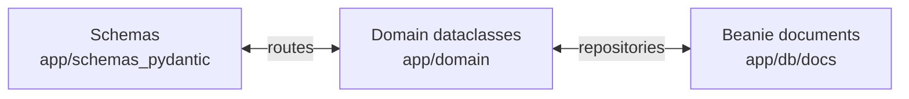

# Model conversion

Conversion happens in two places only. Routes convert between Pydantic schemas and domain dataclasses, and repositories convert between domain dataclasses and Beanie documents. Services sit in between and work with domain models. Events are the planned exception: the classes in `app/domain/events/typed.py` are Pydantic models, since FastStream serializes them, and services pass them around as they are. There's one leak today: `AdminEventsService` gets a raw `ReplaySessionDocument` from its repository to build replay status.



## Routes

A request schema goes into a domain dataclass with `model_dump()` and constructor unpacking. From `app/api/routes/saved_scripts.py`:

```python
create = DomainSavedScriptCreate(**saved_script.model_dump())
domain = await saved_script_service.create_saved_script(create, user.user_id)
return SavedScriptResponse.model_validate(domain)
```

On the way out, `model_validate()` reads attributes off the dataclass. That works because the response schema sets `from_attributes=True` in its `model_config`. The flag is never passed as a keyword to `model_validate()`.

```python
--8<-- "backend/app/schemas_pydantic/saved_script.py:SavedScriptResponse"
```

## Repositories

Repositories build a field set from the dataclass once, at module level, and use it to filter `model_dump()`. Writes go the other way with `dataclasses.asdict()`. From `app/db/repositories/user_repository.py`:

```python
_user_fields = set(User.__dataclass_fields__)

async def get_user_by_id(self, user_id: str) -> User | None:
    doc = await UserDocument.find_one(UserDocument.user_id == user_id)
    return User(**doc.model_dump(include=_user_fields)) if doc else None

async def create_user(self, create_data: DomainUserCreate) -> User:
    doc = UserDocument(**dataclasses.asdict(create_data))
    try:
        await doc.insert()
    except DuplicateKeyError as e:
        raise ConflictError("User already exists") from e
    return User(**doc.model_dump(include=_user_fields))
```

`include=` drops Beanie's `id` and `revision_id` and any other field the dataclass doesn't have, without listing them. Reads return None for a missing document, and the service decides whether that's a `NotFoundError`.

Partial updates use an update dataclass whose fields default to None. The repository keeps only the fields that aren't None, so None means "leave it as is" and a nullable field such as a saved script's `description` can't be set back to null this way:

```python
update_dict = {k: v for k, v in dataclasses.asdict(update_data).items() if v is not None}
if update_dict:
    update_dict["updated_at"] = datetime.now(timezone.utc)
    await doc.set(update_dict)
```

Enums need no special handling. Every enum is a `StringEnum`, which subclasses `str`, so `asdict()` output goes straight into documents and queries with no `.value`.

## Nested models

`model_dump()` turns embedded sub-documents into plain dicts, and a dataclass constructor won't turn them back. So repositories rebuild nested dataclasses by hand. `ExecutionRepository` does it for resource usage:

```python
def _to_domain(self, doc: ExecutionDocument) -> DomainExecution:
    data = doc.model_dump(include=_exec_fields)
    if data.get("resource_usage"):
        data["resource_usage"] = ResourceUsageDomain(**data["resource_usage"])
    return DomainExecution(**data)
```

`SagaRepository._to_domain()` does the same for `context_data`, `ReplayRepository._to_domain()` for the replay config, filter and errors, and `UserSettingsRepository._to_settings()` for the notification and editor settings.

## Events

Events don't use the dataclass idioms. `EventRepository.store_event()` dumps the event with `model_dump(exclude_none=True)` and builds an `EventDocument` from that dict. Reads go through `DomainEventAdapter.validate_python(doc)`, which picks the concrete event class from `event_type`. [Event Storage](event-storage.md) has the details.

## Quick reference

| From | To | How |
|---|---|---|
| Request schema | Domain dataclass | `Domain(**schema.model_dump())` |
| Domain dataclass | Response schema | `Schema.model_validate(domain)`, with `from_attributes=True` on the schema |
| Domain dataclass | Document | `Document(**dataclasses.asdict(domain))` |
| Document | Domain dataclass | `Domain(**doc.model_dump(include=_fields))`, nested dataclasses rebuilt by hand |
| Update dataclass | `doc.set()` dict | `{k: v for k, v in dataclasses.asdict(update).items() if v is not None}` |
| Event | Document | `EventDocument(**event.model_dump(exclude_none=True))`, plus `stored_at` |
| Document | Event | `DomainEventAdapter.validate_python(doc)` |
