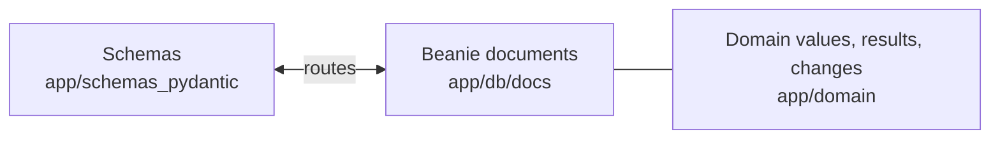

# Model conversion

There's one model per stored entity: its Beanie document. Services and repositories take and return documents, and request and response schemas stay in the routes, so the only conversions left are at the API edge. Domain dataclasses hold what isn't a stored entity on its own (value objects embedded in documents, results, filters), and a partial update's changes are a `TypedDict`. Events are their own case: the classes in `app/domain/events/typed.py` are Pydantic models, since FastStream serializes them, and one collection stores all of them.



## Routes

A route reads the request schema's fields and passes them to the service as keyword arguments, so mypy checks each one. The service builds the document with its constructor. From `app/services/saved_script_service.py`:

```python
--8<-- "backend/app/services/saved_script_service.py:create_saved_script"
```

On the way out, `model_validate()` reads attributes off the document. That works because the response schema sets `from_attributes=True` in its `model_config`. The flag is never passed as a keyword to `model_validate()`. Internal fields like `hashed_password` aren't on the response schema, so they never reach the API.

```python
--8<-- "backend/app/schemas_pydantic/saved_script.py:SavedScriptResponse"
```

## Partial updates

An update's changes are a `TypedDict` with `total=False` in `app/domain`. The route builds it from the fields the client sent, with a module-level `TypeAdapter`. The adapter checks names and types at runtime and gives mypy the `TypedDict` type. From `app/api/routes/saved_scripts.py`:

```python
_saved_script_changes = TypeAdapter(SavedScriptChanges)

try:
    changes = _saved_script_changes.validate_python(script_update.model_dump(exclude_unset=True))
except ValidationError as e:
    raise RequestValidationError(e.errors()) from e
```

A key the client left out stays out, so the stored value stays. A `null` clears a nullable field such as a script's `description`, and a `null` for a field that can't be empty answers 422. The repository applies the changes as they are:

```python
await script.set({**changes, "updated_at": datetime.now(timezone.utc)})
```

The user settings update is the one exception: the settings page sends `null` for the sections it didn't change, and no settings field can be empty, so that route builds its changes with `exclude_none=True`.

## Repositories

Reads return the document or None, and the service decides whether None is a `NotFoundError`. Creates take the document the service built and insert it. From `app/db/repositories/user_repository.py`:

```python
async def get_user_by_id(self, user_id: str) -> UserDocument | None:
    return await UserDocument.find_one(UserDocument.user_id == user_id)

async def create_user(self, user: UserDocument) -> None:
    try:
        await user.insert()
    except DuplicateKeyError as e:
        raise ConflictError("User already exists") from e
```

A result that holds documents, like `UserListResult`, is a dataclass next to the repository that returns it, since `app/domain` never imports `app/db/docs`.

Enums need no special handling. Every enum is a `StringEnum` and subclasses `str`, so it goes straight into documents and queries with no `.value`.

## Embedded values

A value embedded in a document is a domain dataclass: `ExecutionDocument.resource_usage` is a `ResourceUsageDomain`, and `ReplaySessionDocument.config` is a `ReplayConfig`. Pydantic validates a stored dict back into the dataclass on read. On write, the document lists the dataclass in `Settings.bson_encoders` with `dataclasses.asdict`, so Beanie can encode it, in raw `$set` updates too:

```python
class Settings:
    name = "executions"
    bson_encoders = {ResourceUsageDomain: dataclasses.asdict}
```

## Typing gaps

`Document` inherits `LazyModel` from lazy-model ahead of `BaseModel`, and lazy-model ships no `py.typed` ([BeanieODM/lazy_model#15](https://github.com/BeanieODM/lazy_model/issues/15)). Until a release has it, mypy sees a document's constructor as taking any keyword arguments, and its Pydantic methods (`model_validate`, `model_dump`) as returning `Any`. Beanie's own query methods (`find_one`, `find`, `insert`) are typed. Code assigns the results of the Pydantic methods to annotated variables, so `--strict` keeps the types from there on.

## Events

`EventRepository.store_event()` dumps the event with `model_dump(exclude_none=True)`, adds `stored_at` and validates the dict into an `EventDocument`. Its `extra="allow"` keeps the event-specific fields at the top level. Reads go through `DomainEventAdapter.validate_python(doc)`, and the adapter picks the concrete event class from `event_type`. [Event Storage](event-storage.md) has the details.

## Quick reference

| From | To | How |
|---|---|---|
| Request schema | Service call | Keyword arguments read off the schema |
| Service arguments | Document | The document's constructor, in the service |
| Request schema | Changes `TypedDict` | `TypeAdapter(Changes).validate_python(body.model_dump(exclude_unset=True))` |
| Changes `TypedDict` | Stored document | `doc.set({**changes, "updated_at": now})` |
| Document | Response schema | `Schema.model_validate(doc)`, with `from_attributes=True` on the schema |
| Event | Document | `EventDocument.model_validate(event.model_dump(exclude_none=True) \| {"stored_at": now})` |
| Document | Event | `DomainEventAdapter.validate_python(doc)` |
