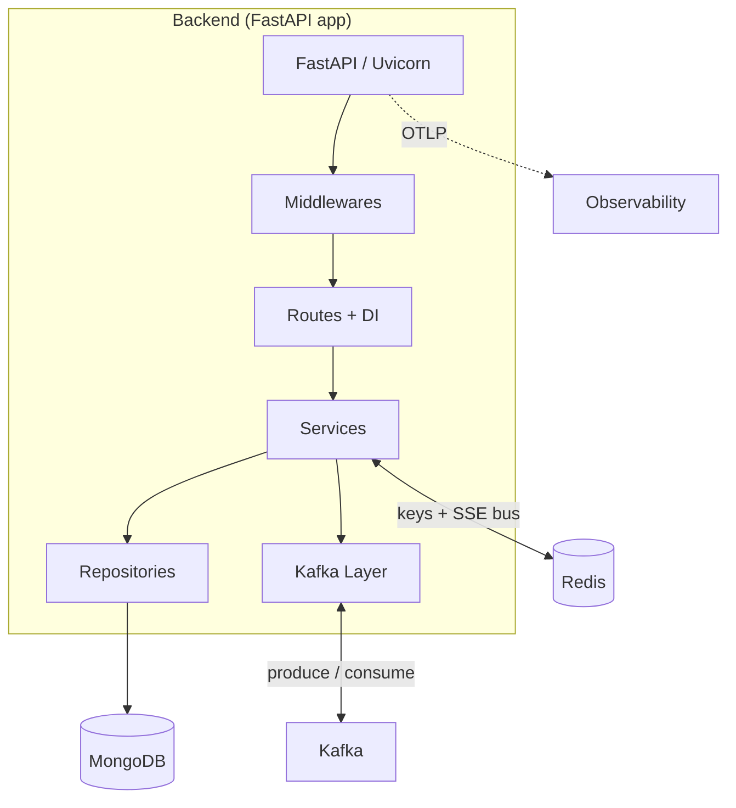
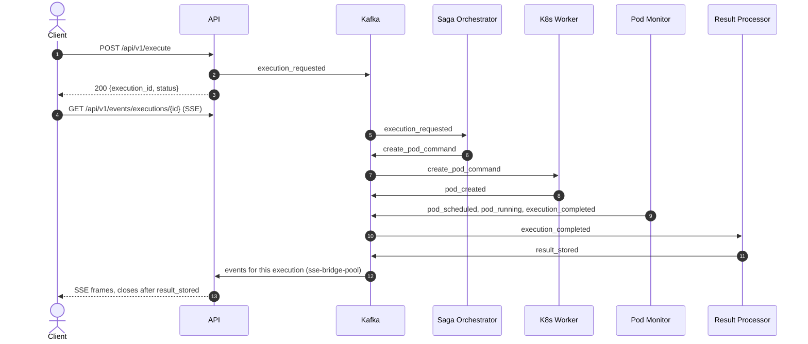
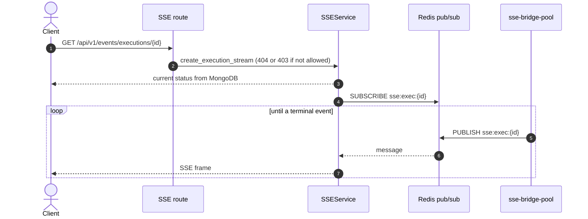
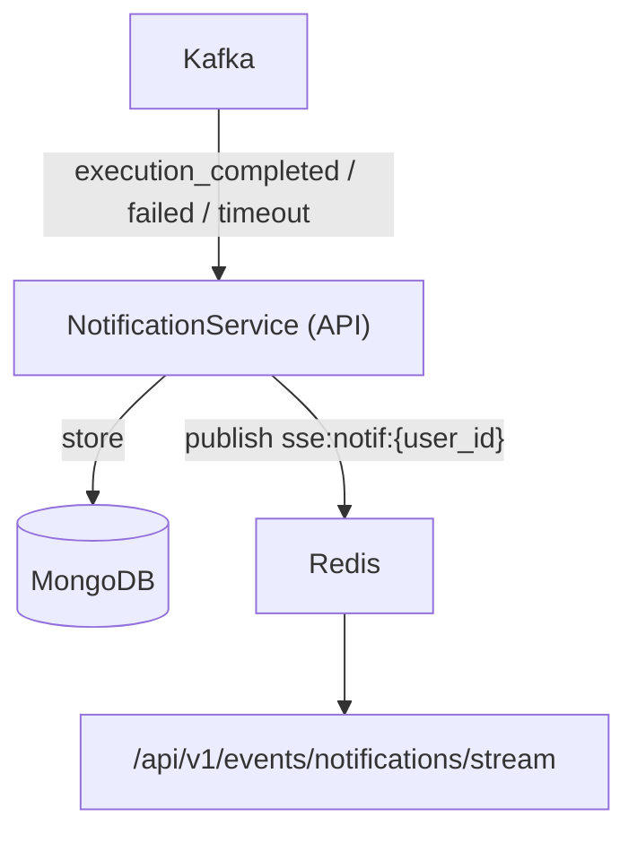

# Architecture overview

Integr8sCode runs user scripts in Python, Node.js, Ruby, Bash or Go, each in its own short-lived Kubernetes pod. A Svelte SPA submits the script to a FastAPI backend. The backend stores the execution, publishes an event to Kafka and returns right away. Workers pick the event up, run the pod and store the result, and the browser follows progress over SSE.

-   :material-layers-outline:{ .lg .middle } **[Middleware](middleware.md)**

    The seven layers every request passes through before it reaches a route

-   :material-cog-outline:{ .lg .middle } **[Services](services-overview.md)**

    What lives in `backend/app/services/` and what each part of the worker consumes and publishes

-   :material-transit-connection-variant:{ .lg .middle } **[Kafka Topics](kafka-topic-architecture.md)**

    One topic per event type, consumer groups, replay and the DLQ

-   :material-broadcast:{ .lg .middle } **[SSE](../components/sse/sse-architecture.md)**

    How Kafka events reach the browser through Redis pub/sub

-   :material-robot-industrial-outline:{ .lg .middle } **[Worker](../components/workers/index.md)**

    The one background process that runs next to the API

## System overview

The browser loads the SPA from the frontend container, an nginx that serves HTTPS on port 5001 and proxies `/api` to the backend over plain http inside the compose network. The backend runs FastAPI under Gunicorn with Uvicorn workers and serves both REST and SSE. Kafka runs in KRaft mode and creates topics on first use, so there is no topic setup step. Events travel as JSON that FastStream serializes from the Pydantic models.

The worker is one more container from the same backend image, running `python -m app.worker`. Inside it, the k8s worker creates pods through the Kubernetes API, the pod monitor watches them, the result processor writes results to MongoDB, and the saga orchestrator schedules executions with a Redis-backed queue and tracks sagas in MongoDB. A DLQ job retries failed events every 10 seconds.

The observability profile adds an OpenTelemetry Collector that ships traces to Jaeger, metrics to VictoriaMetrics and logs to Loki, with Grafana on top of all three. Kafdrop is under the debug profile. No container runs once and exits. nginx makes its own TLS certificate when it starts, the backend seeds the users before it serves, and k3s applies the repo's `k8s/` folder (the `integr8scode` namespace, Kueue and its queues) by itself. The worker reads k3s's own kubeconfig.

## Backend wiring

??? note "Legend"
    - Middlewares, outermost first: CORS, CacheControl, SecurityHeaders, RequestSizeLimit, CSRF, RateLimit, Metrics
    - Routes + DI: REST and SSE endpoints, with services injected by Dishka
    - Services: auth, execution, events, SSE, idempotency, notifications, user settings, rate limits, saved scripts, replay, sagas, admin
    - Kafka layer: `UnifiedProducer` on the way out, FastStream subscribers on the way in
    - Observability: the OTel Collector, which forwards to VictoriaMetrics, Jaeger and Loki

A request passes through seven middlewares before it reaches a route handler. Handlers get their services from Dishka, services read and write MongoDB through repositories, and the event-driven flows (executions, auth, user settings, notifications) publish events through `UnifiedProducer`, which stores the event in MongoDB first and then sends it to Kafka. Saved scripts and admin changes to users and system settings write to MongoDB without an event. Redis holds rate limit counters, idempotency keys, the execution queue and the SSE pub/sub channels.

The API process also consumes Kafka. On startup it registers two subscriber groups: `sse-bridge-pool`, which copies execution events into Redis for SSE, and `notification-service`, which turns finished executions into notifications.

## Execution lifecycle

The rate limit middleware has already run by the time the route sees the request. If the client sent an `Idempotency-Key` header it used before, the [idempotency](idempotency.md) layer returns the earlier execution instead of creating a new one, or 409 while that first request is still in flight. Otherwise the execution service checks the language and version against the [runtime registry](runtime-registry.md) and rejects an unknown pair with 422. Then it stores the execution in MongoDB, publishes `execution_requested` and answers with the execution ID and its status.

The saga orchestrator puts the request into the [execution queue](execution-queue.md) and, once a slot is free, runs the saga steps, the last of which publishes `create_pod_command`. The k8s worker creates a ConfigMap with the script and a hardened pod, then publishes `pod_created`, or `execution_failed` if the Kubernetes API refused. The pod monitor watches the pod and publishes `pod_scheduled`, `pod_running` and finally one of `execution_completed`, `execution_failed` or `execution_timeout`. Then it deletes the pod, which frees the Kueue quota, and Kubernetes garbage-collects the ConfigMap through its owner reference.

The result processor writes the final state and output to MongoDB and publishes `result_stored`, or `result_failed` if it couldn't. The saga orchestrator also listens for the terminal events: it marks the saga done, releases the queue slot and schedules the next execution.

## SSE

SSE goes through Redis so that any API process can serve any client. All API processes share the `sse-bridge-pool` consumer group, so Kafka hands each event to exactly one of them. That process publishes the event to the Redis channel `sse:exec:{execution_id}`, and Redis delivers it to whichever process holds the client's connection. The bridge forwards 17 event types: the execution, pod and result events.

The stream opens with the execution's current status read from MongoDB, since events published before the subscription aren't replayed. When `result_stored` arrives, the service loads the stored result and attaches it to that frame. The stream ends after `result_stored`, `result_failed`, `execution_failed` or `execution_timeout`, or when the client disconnects. Leaving the generator closes the Redis subscription.

Notifications use the same bus on `sse:notif:{user_id}` through `GET /api/v1/events/notifications/stream`. That stream stays open until the client goes away and sends a ping every 30 seconds.

## Kafka, sagas and replay

Kafka carries all asynchronous work, with [one topic per event type](kafka-topic-architecture.md). [Sagas](../components/workers/saga_orchestrator.md) run the execution steps and publish compensating commands when a step fails. The [replay system](../components/event-replay.md) lets admins re-publish stored events. A failed handler's event goes to the [dead letter queue](../components/dead-letter-queue.md) and is retried for the consumer group that failed.

## Notifications

`NotificationService` runs inside the API under the `notification-service` consumer group. For each completed, failed or timed-out execution it stores a notification in MongoDB and pushes it to the user's SSE channel. It also has webhook and Slack handlers, and users can set up subscriptions for them, but every notification the code creates today uses the in-app channel, so those handlers never fire.

## API surface

The public surface is the REST and SSE endpoints under `/api/v1/`. MongoDB, Redis, Kafka, the Kubernetes API and the worker stay internal. The frontend talks to the backend with fetch and EventSource and [cookie-based auth](authentication.md). The [admin routes](../operations/admin-api.md) under `/api/v1/admin/` and the replay routes under `/api/v1/replay/` require the admin role. The OpenAPI schema and the Swagger UI are served only when `DEVELOPMENT_MODE` is on. See the [API Reference](../reference/api-reference.md) for the full list.
