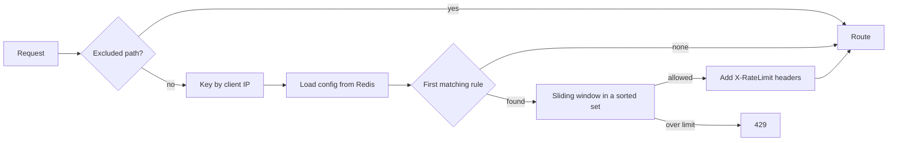

# Rate limiting

Rate limiting is a Redis-backed check in `RateLimitMiddleware`, and today it keys every request by client IP. The middleware runs before authentication, so it never knows the user. That has a side effect: the per-user overrides admins can set never match anything ([#290](https://github.com/HardMax71/Integr8sCode/issues/290)).



## Which requests are checked

Every HTTP request goes through the middleware except these:

```python
--8<-- "backend/app/core/middlewares/rate_limit.py:excluded_paths"
```

Login, register and logout are skipped by exact path, and the health prefix covers `/api/v1/health/live`. Setting `RATE_LIMIT_ENABLED = false` turns the whole check off, which `config.test.toml` does.

The bucket key comes from the client IP:

```python
--8<-- "backend/app/core/middlewares/rate_limit.py:extract_user_id"
```

`get_client_ip` uses the socket peer address. It reads `X-Forwarded-For` (first entry) or `X-Real-IP` only when the peer is a loopback or private address, which is the case behind the frontend nginx.

## Rules

`RateLimitService` loads a `RateLimitConfig` from the Redis key `rate_limit:config`. If the key is missing, it writes `RateLimitConfig.get_default_config()` there with a 300 second TTL. Rules are sorted by priority, highest first, and the first pattern that matches the path wins:

| Pattern | Group | Limit | Priority |
|---------|-------|-------|----------|
| `^/api/v1/execute` | execution | 10 per 60s | 10 |
| `^/api/v1/auth/.*` | auth | 20 per 60s | 7 |
| `^/api/v1/admin/.*` | admin | 100 per 60s | 5 |
| `^/api/v1/events/.*` | sse | 5 per 60s | 3 |
| `^/api/v1/ws` | websocket | 5 per 60s | 3 |
| `^/api/v1/.*` | api | 60 per 60s | 1 |

All six use the sliding window. The middleware matches the raw path before routing, so a rule also counts requests to URLs that don't exist. Since login, register and logout are excluded, `/api/v1/auth/me` is the only real route the auth rule covers. No route lives under `/api/v1/ws`, so the websocket rule only counts requests that end in 404.

The counter key is `rate_limit:sw:ip:<addr>:<path>` with the raw request path. A limit therefore applies to each URL separately, not to the group: two different execution IDs under `/api/v1/events/executions/` get two separate budgets of 5.

## Algorithms

The sliding window keeps one sorted-set entry per request, with the timestamp as both member and score. Two requests with the exact same timestamp therefore share one entry and count once. Each check drops entries older than the window, adds the current one, counts, and refreshes the TTL to twice the window:

```python
--8<-- "backend/app/services/rate_limit_service.py:check_sliding_window"
```

If the count is over the limit, the request is rejected and `retry_after` is computed from the oldest entry still in the window.

The token bucket runs as a Lua script that refills `limit / window` tokens per second up to `limit * burst_multiplier` and stores the state as JSON:

```python
--8<-- "backend/app/services/rate_limit_service.py:check_token_bucket"
```

No default rule uses it. The only way to add a token bucket rule is a per-user override, so today nothing reaches this path.

## Responses

Allowed requests that go through the check get three headers. Requests where no rule matched get them too, with a limit of 999999. Excluded paths skip the check and get none, and so does every request while `RATE_LIMIT_ENABLED` is off.

| Header | Value |
|--------|-------|
| `X-RateLimit-Limit` | limit of the matched rule |
| `X-RateLimit-Remaining` | requests left in the window |
| `X-RateLimit-Reset` | Unix timestamp of the window end |
| `Retry-After` | seconds to wait, on 429 only (60 if unknown) |

A rejected request gets 429 with this body:

```json
{"detail": "Rate limit exceeded", "retry_after": 45, "reset_at": "2026-01-15T10:30:00+00:00"}
```

The service also counts `rate_limit.requests.total`, `rate_limit.allowed.total`, `rate_limit.rejected.total` and `rate_limit.bypass.total`, labelled with the path after IDs are replaced by `*`.

## Per-user overrides

The admin API (`/api/v1/admin/rate-limits/{user_id}`) stores a `UserRateLimit` in `RateLimitConfig.user_overrides`, keyed by the real user ID:

```python
--8<-- "backend/app/domain/rate_limit/rate_limit_models.py:UserRateLimit"
```

The check looks overrides up by the `ip:<addr>` key, so bypass, multiplier and custom rules never apply. The usage stats in the same admin view read counters indexed under `rate_limit:index:{user_id}`, which the middleware never writes, so they come back empty. Both are tracked in [#290](https://github.com/HardMax71/Integr8sCode/issues/290).

Overrides are also short-lived. `update_config` writes the whole config back with the same 300 second TTL, so five minutes later the key expires and the defaults are written again without the override.

## Failure mode

Nothing catches Redis errors in the middleware or the service. When Redis is down, every checked request fails with 500 instead of passing through ([#290](https://github.com/HardMax71/Integr8sCode/issues/290)).

## Settings

Only two settings are read. `RATE_LIMIT_ENABLED` switches the middleware on or off, and `RATE_LIMIT_REDIS_PREFIX` (default `rate_limit:`) prefixes every key. `RATE_LIMITS`, `RATE_LIMIT_ALGORITHM`, `RATE_LIMIT_DEFAULT_REQUESTS`, `RATE_LIMIT_DEFAULT_WINDOW` and `RATE_LIMIT_BURST_MULTIPLIER` exist in `Settings` but nothing uses them ([#293](https://github.com/HardMax71/Integr8sCode/issues/293)). The limits come from `get_default_config()`.
