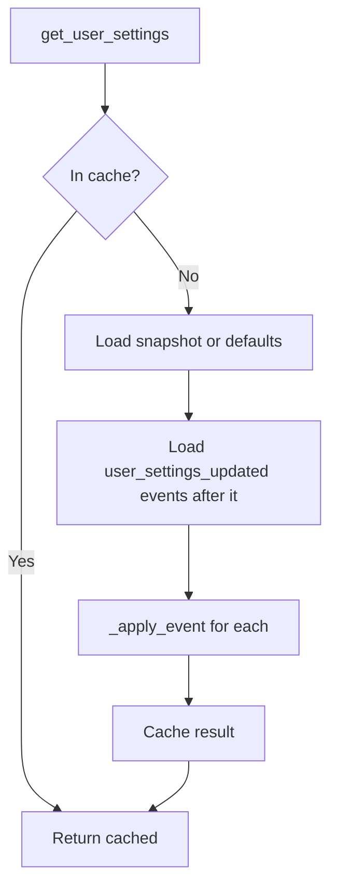

# User settings events

User settings are event-sourced. Every change publishes one `UserSettingsUpdatedEvent`, and current settings are rebuilt from the latest snapshot plus the events after it. Merging is a plain dict merge, with the nested settings objects converted back by hand. `UserSettingsService` in `app/services/user_settings_service.py` owns all of it.

## The event

There's one event type for every kind of change, theme, editor, notifications or custom keys alike:

```python
--8<-- "backend/app/domain/events/typed.py:UserSettingsUpdatedEvent"
```

The changed values aren't declared fields. The model has `extra="allow"`, and `_publish_settings_event()` passes the changes as keyword arguments, so `theme`, `editor` and the rest ride along as top-level fields. They stay top level on Kafka and in the `events` collection, since `EventDocument` allows extras too (see [Event Storage](event-storage.md)). `changed_fields` lists the keys. The aggregate id and the Kafka key are both `user_settings_{user_id}`.

## Updating

```python
--8<-- "backend/app/services/user_settings_service.py:update_user_settings"
```

`changes` holds the non-None fields of `DomainUserSettingsUpdate`. `dataclasses.asdict()` turns nested dataclasses into dicts on the way, so a notifications update arrives as a dict and replaces the whole notifications object. The service merges current settings, changes, a bumped `version` and a new `updated_at` into one dict and hands it to `_build_settings()`:

```python
@staticmethod
def _build_settings(data: dict[str, Any]) -> DomainUserSettings:
    filtered = {k: v for k, v in data.items() if k in _settings_fields}
    if isinstance(filtered.get("notifications"), dict):
        filtered["notifications"] = DomainNotificationSettings(**filtered["notifications"])
    if isinstance(filtered.get("editor"), dict):
        filtered["editor"] = DomainEditorSettings(**filtered["editor"])
    return DomainUserSettings(**filtered)
```

`_settings_fields` is the field set of `DomainUserSettings`, so keys like `changed_fields` or `event_id` drop out. The two nested objects are rebuilt explicitly because stdlib dataclasses don't convert nested dicts (see [Domain Dataclasses](domain-dataclasses.md)).

After publishing, the service caches the new settings. Once there are 10 or more events since the last snapshot, it writes a snapshot to the `user_settings` collection.

## Rebuilding

```python
--8<-- "backend/app/services/user_settings_service.py:get_user_settings_fresh"
```



`UserSettingsRepository.get_settings_events()` reads events by aggregate id and builds `DomainUserSettingsChangedEvent` dataclasses with `model_dump(include=_event_fields)`. Nested values are still dicts at that point. `_apply_event()` drops the None fields and merges the rest, and `_build_settings()` converts them:

```python
--8<-- "backend/app/services/user_settings_service.py:apply_event"
```

## Cache

```python
--8<-- "backend/app/services/user_settings_service.py:cache_init"
```

It's a `cachetools.TTLCache` with up to 1000 entries. The TTL is a hardcoded 5 minutes (`self._cache_ttl = timedelta(minutes=5)`). The service is app-scoped, so each API process has its own cache, and only the process that handled an update refreshes it. Other processes keep serving their cached copy until it expires.

## History and restore

```python
--8<-- "backend/app/services/user_settings_service.py:get_settings_history"
```

`GET /api/v1/user/settings/history` returns one entry per changed field. `new_value` is read off the event, and `old_value` is always None. It reads the newest `limit` events (default 50) and returns them newest first.

`POST /api/v1/user/settings/restore` replays events up to the given timestamp onto defaults, saves the result as a snapshot, caches it, and publishes a `UserSettingsUpdatedEvent` with empty `changed_fields` and the restore as its `reason`. The snapshot's `updated_at` is the restore event's timestamp, so a later rebuild from that snapshot (a cache miss, or another process) skips everything up to the restore and applies only changes made after it.

The replay only sees events that still exist, and events expire 30 days after they're stored ([Event Storage](event-storage.md)). A field whose last change before the restore point has already expired comes back as its default, and nothing reports it.
