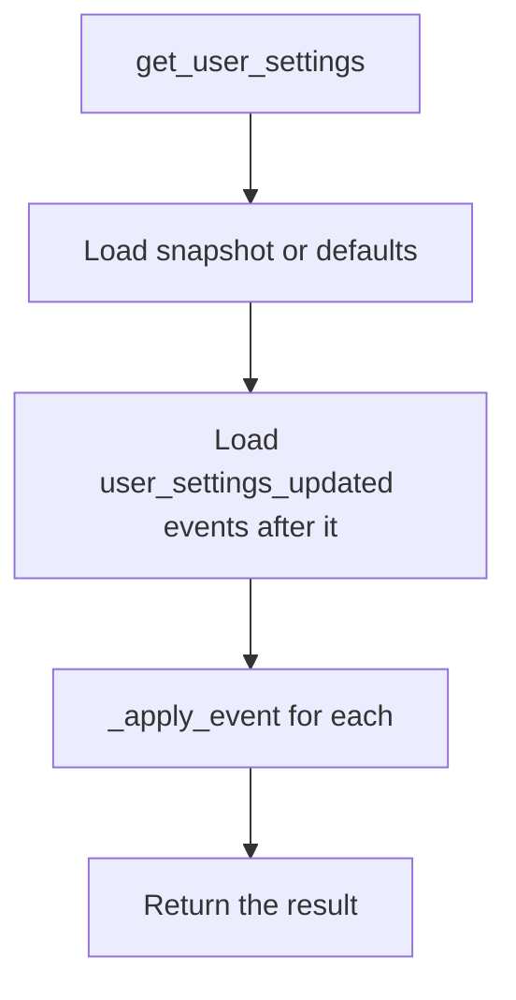

# User settings events

User settings are event-sourced. Every change publishes one `UserSettingsUpdatedEvent`, and current settings are rebuilt from the latest snapshot plus the events after it, one field at a time. The settings themselves are a `UserSettingsDocument`, the same type for a stored snapshot and for a rebuilt result. `UserSettingsService` in `app/services/user_settings_service.py` owns all of it.

## The event

There's one event type for every kind of change, theme, editor, notifications or custom keys alike:

```python
--8<-- "backend/app/domain/events/typed.py:UserSettingsUpdatedEvent"
```

The changed values aren't declared fields. The model has `extra="allow"`, and `_publish_settings_event()` validates a dict that holds the changes next to the declared fields, so `theme`, `editor` and the rest ride along as top-level fields. They stay top level on Kafka and in the `events` collection, since `EventDocument` allows extras too (see [Event Storage](event-storage.md)). `changed_fields` lists the keys. The aggregate id and the Kafka key are both `user_settings_{user_id}`.

## Updating

```python
--8<-- "backend/app/services/user_settings_service.py:update_user_settings"
```

`changes` is a `UserSettingsChanges`, a `TypedDict` that holds only the fields the request set. The route builds it with `exclude_none=True`, since the settings page sends `null` for the sections it didn't change. A notifications or editor update replaces the whole object. After publishing, the service applies the same change to the current settings with `_apply_event()`, the code a rebuild runs, and bumps `version`.

Once there are 10 or more events since the last snapshot, the service writes a snapshot to the `user_settings` collection.

## Rebuilding

```python
--8<-- "backend/app/services/user_settings_service.py:get_user_settings"
```



Every read rebuilds, which costs two MongoDB queries and at most ten events, since a snapshot follows every ten. There's no cache. The API runs several worker processes, and a per-process cache served the old settings for up to 5 minutes whenever an update had gone through another worker.

`UserSettingsRepository.get_settings_events()` reads events by aggregate id and validates each into a `DomainUserSettingsChangedEvent` with a `TypeAdapter`. The adapter also turns the stored notification and editor dicts back into their dataclasses. `_apply_event()` sets each field the event carries and moves `updated_at` to the event's timestamp:

```python
--8<-- "backend/app/services/user_settings_service.py:apply_event"
```

## History and restore

```python
--8<-- "backend/app/services/user_settings_service.py:get_settings_history"
```

`GET /api/v1/user/settings/history` returns one entry per changed field. `new_value` is read off the event, and `old_value` is always None. It reads the newest `limit` events (default 50) and returns them newest first.

`POST /api/v1/user/settings/restore` replays events up to the given timestamp onto defaults, saves the result as a snapshot, and publishes a `UserSettingsUpdatedEvent` with empty `changed_fields` and the restore as its `reason`. The snapshot's `updated_at` is the restore event's timestamp, so a later rebuild from that snapshot skips everything up to the restore and applies only changes made after it.

The replay only sees events that still exist, and events expire 30 days after they're stored ([Event Storage](event-storage.md)). A field whose last change before the restore point has already expired comes back as its default, and nothing reports it.
