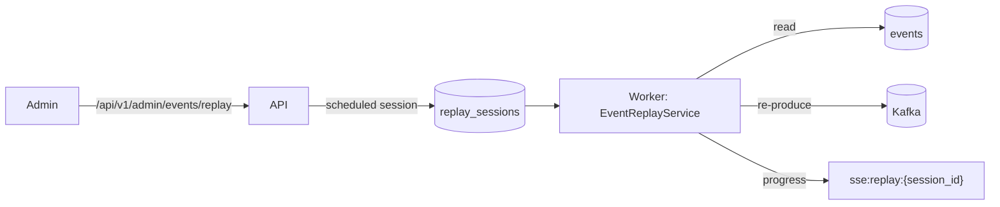

# Event replay

An admin replays stored events from the admin events page. The API only stores the session, and the worker sends the events to Kafka again in `EventReplayService`. MongoDB cleans up after them: a TTL index on `completed_at` drops a finished session from the `replay_sessions` collection 48 hours after it ends.

## Starting a replay

`POST /api/v1/admin/events/replay` takes a filter (`event_ids`, `aggregate_id`, `start_time`, `end_time`) and `dry_run`, which defaults to true. A dry run only counts the matching events and returns a preview of up to 100. A real run refuses more than 1000 events and stores a `scheduled` session. Progress streams over SSE from `GET /api/v1/admin/events/replay/{session_id}/status`, which reads the session from MongoDB and then follows Redis, so any API worker can serve it.

## What a replay does

The worker's `replay_run_next_session` job runs every 2 seconds. It takes the oldest scheduled session, marks it `running` and reads the matching events from the `events` collection in batches of 100, oldest first. It sends them one after another, up to 1000. Each event goes out through `UnifiedProducer` with its own `event_id` and payload and a new timestamp, and nothing marks it as a replay. An event that no longer validates, or that Kafka refuses, counts as failed with an entry in the session's `errors`, and the replay goes on. An unexpected error ends the session as `failed`.

Consumers treat a replayed event like a new one. Handlers behind an idempotency key skip it as a duplicate while that key lives, one hour for `execution_requested` and `execution_cancelled` in the execution scheduler. After that, a replayed `execution_requested` runs the script again in a new pod, and a replayed `execution_completed` sends the user's notification again. The dry-run preview is the check before a real run.

The worker saves the session after every event. It runs as one replica, so nothing else runs a session. When it starts, it fails every session still `running`, since a restart cut that replay off and a replay doesn't pick up where it stopped.

## Key files

| File | Purpose |
|------|---------|
| [`db/docs/replay.py`](https://github.com/HardMax71/Integr8sCode/blob/main/backend/app/db/docs/replay.py) | `replay_sessions` document and its TTL index |
| [`replay_service.py`](https://github.com/HardMax71/Integr8sCode/blob/main/backend/app/services/event_replay/replay_service.py) | Runs a scheduled session in the worker |
| [`replay_repository.py`](https://github.com/HardMax71/Integr8sCode/blob/main/backend/app/db/repositories/replay_repository.py) | Sessions, and the events a session sends |
| [`events.py`](https://github.com/HardMax71/Integr8sCode/blob/main/backend/app/api/routes/admin/events.py) | `/api/v1/admin/events/replay` routes |
| [`worker.py`](https://github.com/HardMax71/Integr8sCode/blob/main/backend/app/worker.py) | The replay jobs and the startup check |
