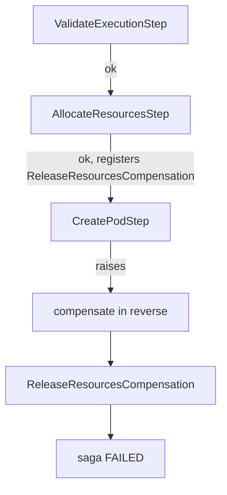

# Resource allocation

The execution saga books a row in `resource_allocations` for every execution and refuses to start a 101st one per language while 100 are active. Those rows are released only by compensation, which a normal run never triggers, so they pile up until every new run of that language fails. [#287](https://github.com/HardMax71/Integr8sCode/issues/287) tracks it.

The limit that actually controls concurrency is elsewhere. Before a saga exists, the [saga orchestrator](../workers/saga_orchestrator.md) holds each execution in a Redis queue and starts it only while fewer than `max_concurrent_executions` (an admin system setting, 10 by default) are active.

## The steps

The execution saga in `app/services/saga/execution_saga.py` has three steps:

```text
execution popped from the Redis queue
  ValidateExecutionStep    script at most 1 MiB, timeout at most 300 s
  AllocateResourcesStep    count active allocations for the language, insert one
  CreatePodStep            publish create_pod_command
```

`AllocateResourcesStep` counts allocations with status `active` for the language and raises "Resource limit exceeded" at 100. Otherwise it inserts an allocation with a fresh uuid4 `allocation_id`, the execution id, the language and the CPU and memory requests and limits from the event, and stores the id in the saga context.

`ValidateExecutionStep` rejects any timeout above 300 seconds. The admin settings accept a `max_timeout_seconds` up to 3600, and every execution carries that value, so setting it above 300 makes every saga fail at this step.

## Compensation

A step's compensation is registered only after the step succeeds. `AllocateResourcesStep` registers `ReleaseResourcesCompensation`, which sets the row to `released` with a `released_at` time. `CreatePodStep` registers `DeletePodCompensation`, which publishes `delete_pod_command`. `ValidateExecutionStep` has none.

When a step fails, the registered compensations run in reverse:



A saga that fails this way publishes nothing about the execution. The execution stays `queued`, its SSE stream never closes, and its slot in the Redis queue stays taken, since only a terminal execution event releases it.

`CreatePodStep` only fails if storing or publishing the command fails, and then its own compensation isn't registered yet, so only the allocation is released. The other path that compensates is `POST /api/v1/sagas/{saga_id}/cancel`, which runs the compensations of every completed step: it sends `delete_pod_command` and releases the allocation.

Every other ending skips compensation. `execution_completed`, `execution_failed`, `execution_timeout`, `execution_cancelled` and the orchestrator's own timeout check mark the saga terminal and leave the allocation `active`.

## Data model

| Field | Description |
|-------|-------------|
| `allocation_id` | uuid4, unique |
| `execution_id` | The execution it belongs to |
| `language` | Used for the per-language count |
| `cpu_request`, `cpu_limit` | From the `execution_requested` event |
| `memory_request`, `memory_limit` | From the `execution_requested` event |
| `status` | `active` or `released` |
| `allocated_at`, `released_at` | Timestamps |

`allocation_id`, `execution_id`, `language` and `status` are indexed. There's no TTL, so released rows stay too.

## Key files

| File | Purpose |
|------|---------|
| [`execution_saga.py`](https://github.com/HardMax71/Integr8sCode/blob/main/backend/app/services/saga/execution_saga.py) | Steps and compensations |
| [`resource_allocation_repository.py`](https://github.com/HardMax71/Integr8sCode/blob/main/backend/app/db/repositories/resource_allocation_repository.py) | Count, create, release |
| [`resource.py`](https://github.com/HardMax71/Integr8sCode/blob/main/backend/app/db/docs/resource.py) | `resource_allocations` document |
