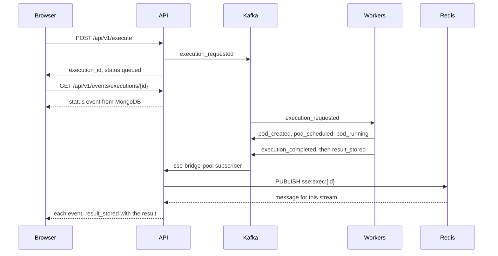

# Execution SSE flow

After `POST /api/v1/execute` returns an execution id, the editor opens `GET /api/v1/events/executions/{execution_id}` and renders events until the stream closes. The stream closes on `result_stored`, `result_failed`, `execution_failed` or `execution_timeout` (`EXECUTION_PIPELINE_TERMINAL_EVENT_TYPES` in `app/infrastructure/kafka/topics.py`).

The API writes the execution document and publishes `execution_requested`. The worker's execution scheduler queues it in Redis and, once a slot is free, has the k8s worker create the pod, which publishes `pod_created`. The pod monitor turns pod phases into `pod_scheduled` and `pod_running`. When the pod ends, the result processor writes the outcome onto the execution document and publishes `execution_completed`, `execution_failed` or `execution_timeout`, then `result_stored`, or `result_failed` if it couldn't. Each of these goes through the Kafka bridge described in [SSE architecture](sse-architecture.md).

The first event on the stream is a `status` control event built from the execution document. It holds the last status written to MongoDB, which the result processor moves to `scheduled` and `running` as the pod gets there. The SSE bridge sets the same `status` on the `pod_scheduled` and `pod_running` events it forwards, so the editor follows the pod. Redis doesn't replay what a browser missed, so when the opening status is already terminal the stream sends the stored result as `result_stored` and closes. `result_stored` itself carries only a storage reference, so the SSE service reads the result from MongoDB and attaches it before sending. The result processor publishes `result_stored` after its write returns, even when the write changed nothing because the execution was already terminal. Either way the browser gets what MongoDB holds, never a result that isn't stored.

`execution_failed` and `execution_timeout` close the stream as soon as they arrive, without waiting for the result processor's write. The pod monitor publishes both, and the k8s worker also publishes `execution_failed` when it can't create the pod. Their `result` field is null, and the editor shows a failure or timeout message instead of output. A pod whose status reason is `DeadlineExceeded` maps to `execution_timeout`, unless all its containers already exited with code 0.

`execution_cancelled` passes through the bridge but doesn't close the stream.

The pod monitor page has the [phase mapping](../workers/pod_monitor.md), and the result processor page covers the [terminal write](../workers/result_processor.md).
