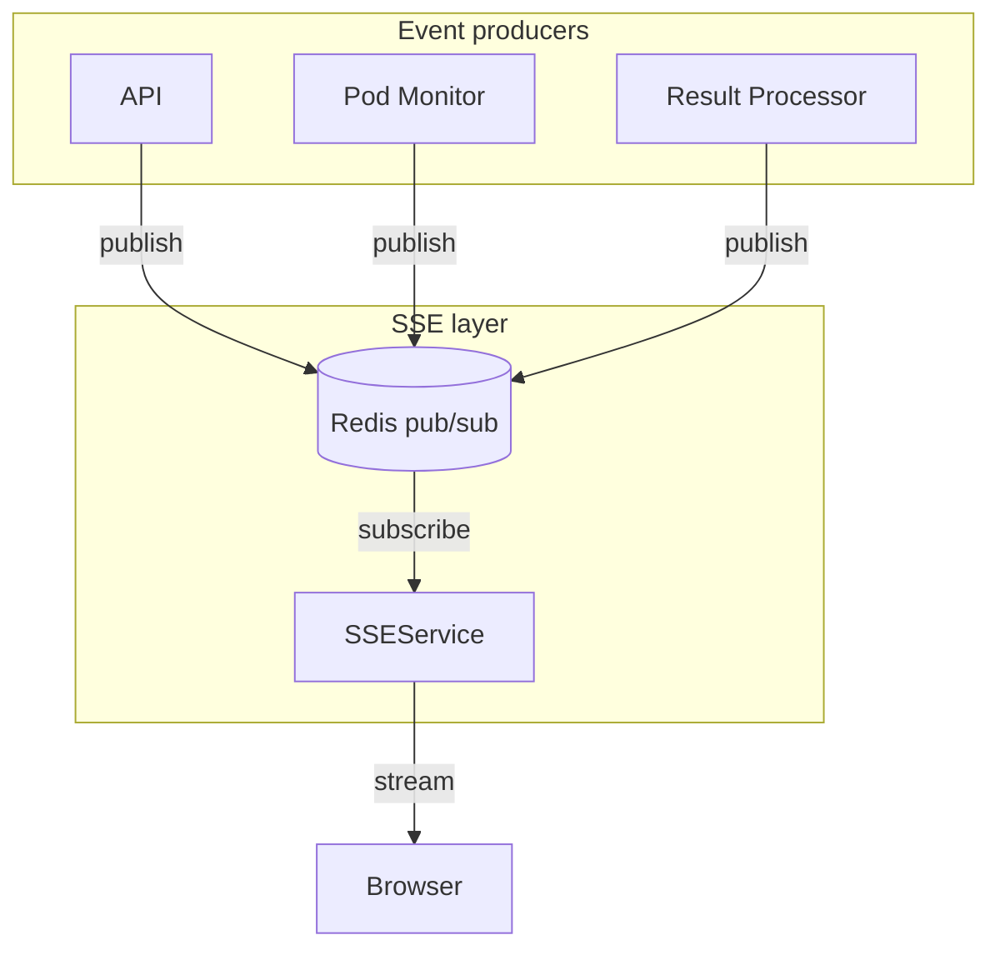

# SSE architecture

Server-Sent Events is the real-time communication channel between backend and frontend. Think of it as a one-way street where the server pushes updates to the browser whenever something interesting happens. Unlike WebSockets (which were removed), SSE is simpler, more reliable, and perfect for server-to-client communication.

## Event flow



When a user submits code, the API returns an execution ID and the frontend opens an SSE connection to `/api/v1/events/executions/{id}`. The SSEService subscribes to a Redis channel keyed by execution ID (`sse:exec:{id}`). Events from producers (API, Pod Monitor, Result Processor) are published to Redis. The SSEService receives them and streams to the browser.

Events include: `execution.requested`, `execution.queued`, `pod.created`, `pod.running`, `execution.completed`, `execution.failed`, `result_stored`.

## Components

### SSE service

`app/services/sse/sse_service.py` manages client connections and streams events. When a client connects, it subscribes to a Redis channel via SSERedisBus and yields events as they arrive. Handles connection lifecycle, initial status fetch from repository, and terminal event detection (`result_stored`, `execution_failed`, `execution_timeout`).

### Redis bus

`app/services/sse/redis_bus.py` wraps Redis pub/sub operations. Provides `publish_event(execution_id, event)` and `open_subscription(execution_id)` for execution streams, plus `publish_notification(user_id, payload)` and `open_notification_subscription(user_id)` for user notification streams. Channels are named `sse:exec:{id}` and `sse:notif:{user_id}`.

## Operations

Browsers automatically reconnect dropped SSE connections. Every SSE connection requires authentication via JWT token, validated before establishing connection. Users can only subscribe to their own executions (ownership verified, admin users exempt).

## Why not WebSockets?

WebSockets were initially implemented but removed because SSE is sufficient for server-to-client communication, simpler connection management, better proxy compatibility (many corporate proxies block WebSockets), excellent browser support with automatic reconnection, and works great with HTTP/2 multiplexing.

## Testing SSE endpoints

E2E tests run the FastAPI app in-process through an httpx2 client. httpx2's `ASGITransport` waits for the whole response body before returning (inherited from httpx, [encode/httpx#2186](https://github.com/encode/httpx/issues/2186)), and an SSE stream never ends, so a plain request hangs.

`tests/e2e/conftest.py` has a small `StreamingASGITransport` that returns as soon as the response headers arrive and feeds body chunks through a queue. `streaming_client(app, user)` builds a client on it with the same cookies and CSRF header as an existing test client, and httpx2's `client.sse()` parses the events:

```python
async with (
    streaming_client(app, test_user) as client,
    client.sse(f"/api/v1/events/executions/{execution_id}") as source,
):
    event = await asyncio.wait_for(anext(aiter(source)), timeout=5.0)

data = SSEExecutionEventSchema.model_validate_json(event.data)
assert data.event_type == SSEControlEvent.STATUS
```

Leaving the `async with` closes the stream: the transport delivers `http.disconnect`, gives the app a second to wind down on its own, then cancels whatever is left, so the SSE generator's cleanup always runs. If the app crashes after sending headers, reading the stream raises that error instead of hanging. Responses that aren't streams, like a 403 for someone else's execution, go through the normal test clients.

## Key files

| File                                                                                                                | Purpose                |
|---------------------------------------------------------------------------------------------------------------------|------------------------|
| [`sse_service.py`](https://github.com/HardMax71/Integr8sCode/blob/main/backend/app/services/sse/sse_service.py)     | Client connections     |
| [`redis_bus.py`](https://github.com/HardMax71/Integr8sCode/blob/main/backend/app/services/sse/redis_bus.py)         | Redis pub/sub wrapper  |
