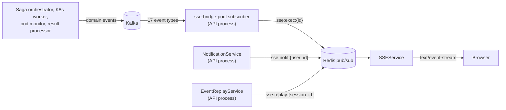

# SSE architecture

The browser gets live updates over Server-Sent Events, and every SSE stream reads from a Redis pub/sub channel. Workers never write to Redis for SSE. They publish to Kafka, and a subscriber inside the API process copies the relevant events into Redis.



## The Kafka bridge

`register_sse_subscriber` in `app/events/handlers.py` registers one FastStream subscriber with group id `sse-bridge-pool` on 17 topics, listed in `_SSE_EVENT_TYPES`:

- `execution_requested`, `execution_queued`, `execution_started`, `execution_running`
- `execution_completed`, `execution_failed`, `execution_timeout`, `execution_cancelled`
- `result_stored`, `result_failed`
- `pod_created`, `pod_scheduled`, `pod_running`, `pod_succeeded`, `pod_failed`, `pod_terminated`, `pod_deleted`

For each event that has an `execution_id`, it keeps the fields `SSEExecutionEventData` knows about and publishes them to `sse:exec:{execution_id}`. Other fields are dropped. The subscriber uses `AckPolicy.ACK_FIRST` and `auto_offset_reset="latest"`, so it skips history on a fresh group and acks before handling: if the Redis publish fails, that event never reaches the browser.

The only pool is this subscriber. `SSE_CONSUMER_POOL_SIZE` (10 in config.toml) is passed as FastStream's `max_workers`, which lets one Kafka consumer handle up to that many events at once. Every API worker process (gunicorn runs `WEB_CONCURRENCY` of them) joins the same group, so each event lands in exactly one process. That's why Redis sits in the middle: the process that consumed the event is often not the one holding the browser's connection.

## Channels and streams

`SSERedisBus` (`app/services/sse/redis_bus.py`) owns the three channel prefixes and one listener per stream type: `listen_execution`, `listen_notifications` and `listen_replay`.

| Endpoint | Channel | Published by |
|----------|---------|--------------|
| `GET /api/v1/events/executions/{execution_id}` | `sse:exec:{execution_id}` | the Kafka bridge |
| `GET /api/v1/events/notifications/stream` | `sse:notif:{user_id}` | `NotificationService` |
| `GET /api/v1/admin/events/replay/{session_id}/status` | `sse:replay:{session_id}` | `EventReplayService` |

All three need a logged-in user. The execution stream returns 404 for an unknown execution and 403 when the execution belongs to someone else, unless the caller is an admin. Those checks run before streaming starts, so they come back as normal HTTP errors.

Redis pub/sub keeps nothing. An event published before the browser subscribes is gone, which is why the execution stream opens with a `status` event built from the execution document in MongoDB. The execution flow is described in [Execution SSE flow](execution-sse-flow.md).

Event names on the wire are the `EventType` values, with underscores: `execution_requested`, `pod_running`, `result_stored` and so on. The notification stream sets the SSE event name to `notification` and pings every 30 seconds. The execution and replay streams ping every 15 seconds. `SSE_HEARTBEAT_INTERVAL` exists in Settings but nothing reads it ([#293](https://github.com/HardMax71/Integr8sCode/issues/293)).

## Scaling

Any number of API processes or replicas can serve SSE connections, since each one subscribes to Redis for the clients it holds and Redis fans the message out. The bridge scales with the API too: more processes means more consumers in `sse-bridge-pool`, up to the partition count of each topic.

## Testing SSE endpoints

E2E tests run the FastAPI app in-process through an httpx2 client. httpx2's `ASGITransport` waits for the whole response body before returning (inherited from httpx, [encode/httpx#2186](https://github.com/encode/httpx/issues/2186)), and an SSE stream never ends, so a plain request hangs.

`tests/e2e/conftest.py` has a small `StreamingASGITransport` that returns as soon as the response headers arrive and feeds body chunks through a queue. `streaming_client(app, user)` builds a client on it with the same cookies and CSRF header as an existing test client, and httpx2's `client.sse()` parses the events:

```python
async with (
    streaming_client(app, test_user) as client,
    client.sse(f"/api/v1/events/executions/{execution_id}") as source,
):
    event = await asyncio.wait_for(anext(aiter(source)), timeout=5.0)

data = SSEExecutionEventSchema.model_validate_json(event.data)
assert data.event_type == SSEControlEvent.STATUS
```

Leaving the `async with` closes the stream: the transport delivers `http.disconnect`, gives the app a second to wind down on its own, then cancels whatever is left, so the SSE generator's cleanup always runs. If the app crashes after sending headers, reading the stream raises that error instead of hanging. Responses that aren't streams, like a 403 for someone else's execution, go through the normal test clients.

## Key files

| File | Purpose |
|------|---------|
| [`handlers.py`](https://github.com/HardMax71/Integr8sCode/blob/main/backend/app/events/handlers.py) | `sse-bridge-pool` subscriber |
| [`redis_bus.py`](https://github.com/HardMax71/Integr8sCode/blob/main/backend/app/services/sse/redis_bus.py) | Redis channels and listeners |
| [`sse_service.py`](https://github.com/HardMax71/Integr8sCode/blob/main/backend/app/services/sse/sse_service.py) | Stream generators |
| [`sse.py`](https://github.com/HardMax71/Integr8sCode/blob/main/backend/app/api/routes/sse.py) | Execution and notification routes |
