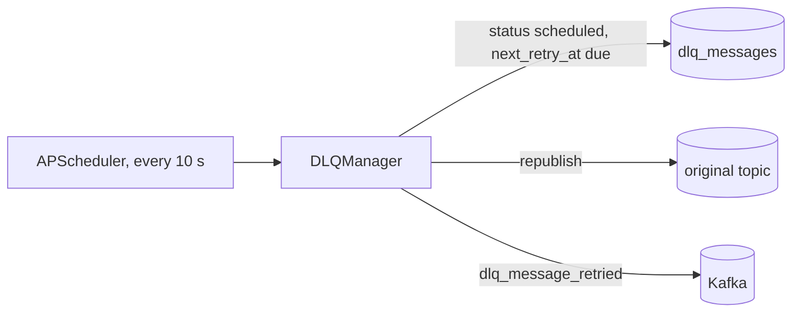

# DLQ processor

The DLQ processor has no Kafka subscriber and today has nothing to do. Nothing writes to the `dlq_messages` collection it reads, because failed events never reach the DLQ ([#288](https://github.com/HardMax71/Integr8sCode/issues/288)). [Dead letter queue](../dead-letter-queue.md) explains why and what the stored rows would look like.

Every 10 seconds `process_monitoring_cycle` does two things. First it loads up to 100 rows with status `scheduled` whose `next_retry_at` has passed, republishes each event to its original topic keyed by event id, sets the row to `retried` with `retry_count` plus one, and publishes `dlq_message_retried`. Then it updates the DLQ queue size metric per topic. A `retried` row is terminal and stays that way.

Retry policies are hardcoded in `app/dlq/models.py`, and the `DLQ_*` settings are never read ([#293](https://github.com/HardMax71/Integr8sCode/issues/293)). There's no admin API for the DLQ.

## Key files

| File | Purpose |
|------|---------|
| [`run_dlq_processor.py`](https://github.com/HardMax71/Integr8sCode/blob/main/backend/workers/run_dlq_processor.py) | Entry point and APScheduler job |
| [`manager.py`](https://github.com/HardMax71/Integr8sCode/blob/main/backend/app/dlq/manager.py) | `process_due_retries`, `retry_message` |
