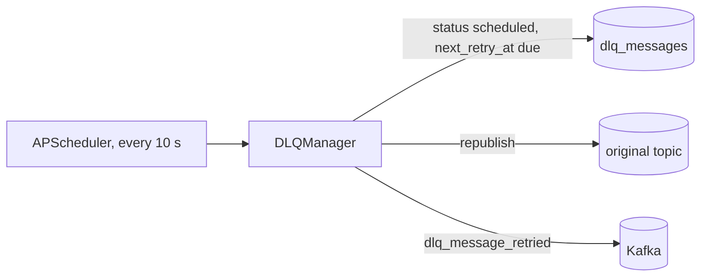

# DLQ processor

The DLQ processor has no Kafka subscriber. It retries the failed events that the consumer routers, in the worker and the API, save to the `dlq_messages` collection. [Dead letter queue](../dead-letter-queue.md) covers how they get there.

Every 10 seconds `process_monitoring_cycle` does two things. First it loads up to 100 rows with status `scheduled` whose `next_retry_at` has passed. For each one it sets the row to `retried` with `retry_count` plus one, republishes the event to its original topic keyed by event id, with headers naming the consumer group that failed and the retry count, and publishes `dlq_message_retried`. Then it updates the DLQ queue size metric per topic. A retry that fails again comes back as a new failure for the same row.

Retry policies are hardcoded in `app/dlq/models.py`, and the `DLQ_*` settings are never read ([#293](https://github.com/HardMax71/Integr8sCode/issues/293)). There's no admin API for the DLQ.

## Key files

| File | Purpose |
|------|---------|
| [`worker.py`](https://github.com/HardMax71/Integr8sCode/blob/main/backend/app/worker.py) | Entry point and APScheduler job |
| [`manager.py`](https://github.com/HardMax71/Integr8sCode/blob/main/backend/app/dlq/manager.py) | `process_due_retries`, `retry_message` |
