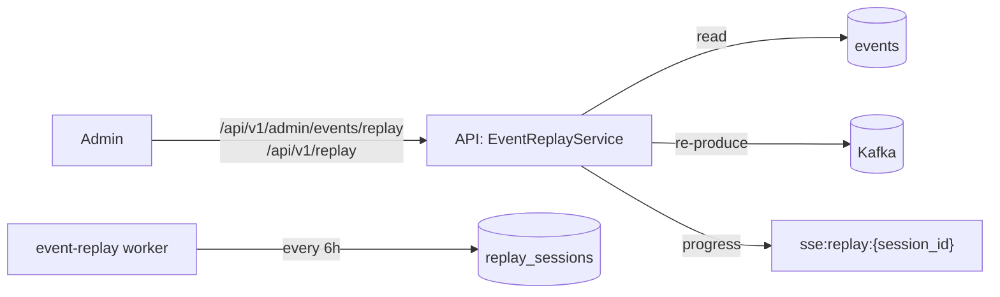

# Event replay

Replays don't run in this worker. They run inside the API process, in `EventReplayService`, and the event replay worker only cleans up after them: every 6 hours it calls `cleanup_old_sessions(older_than_hours=48)`, which deletes finished replay sessions older than 48 hours from the `replay_sessions` collection.

## Starting a replay

There are two admin-only ways in.

`POST /api/v1/admin/events/replay` takes a filter (`event_ids`, `aggregate_id`, `start_time`, `end_time`), an optional `target_service` and `dry_run`, which defaults to true. A dry run only counts the matching events and returns a preview of up to 100. A real run refuses more than 1000 events, creates a session and starts it with FastAPI `BackgroundTasks` after the response is sent. Without `target_service` the session uses the `test` target, which reads and counts the events but publishes nothing. Progress streams over SSE from `GET /api/v1/admin/events/replay/{session_id}/status`.

`/api/v1/replay` exposes the full session API: create a session from a `ReplayRequest` (target `kafka`, `file` or `test`, filter, speed multiplier, batch size, max events, error handling), then start, pause, resume, cancel, list and clean up sessions.

## What a replay does

The service reads matching events from the MongoDB `events` collection in batches and dispatches them one at a time. With a speed multiplier below 100 it keeps the original spacing between events, divided by the multiplier. The `kafka` target re-produces each stored event with the same `event_id` and the same payload, and no marker says it's a replay. Its timestamp is set to now unless `preserve_timestamps` is on. Handlers behind an idempotency key skip it as a duplicate while that key lives (one hour for `execution_requested` in the saga orchestrator and for the k8s worker, two hours for the result processor). The `file` target appends each event as a JSON line to `target_file_path` on the API host.

Session state lives in a dict in the API process and is mirrored to `replay_sessions`. A session started in one gunicorn worker can't be paused or read from another, and an API restart drops the in-memory sessions.

## Key files

| File | Purpose |
|------|---------|
| [`run_event_replay.py`](https://github.com/HardMax71/Integr8sCode/blob/main/backend/workers/run_event_replay.py) | Worker: the cleanup job |
| [`replay_service.py`](https://github.com/HardMax71/Integr8sCode/blob/main/backend/app/services/event_replay/replay_service.py) | Sessions, dispatch, targets |
| [`replay.py`](https://github.com/HardMax71/Integr8sCode/blob/main/backend/app/api/routes/replay.py) | `/api/v1/replay` routes |
| [`events.py`](https://github.com/HardMax71/Integr8sCode/blob/main/backend/app/api/routes/admin/events.py) | `/api/v1/admin/events/replay` routes |
