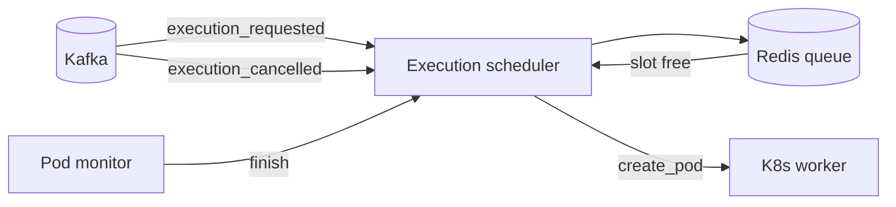

# Execution scheduler

The execution scheduler decides when an execution may start. It keeps no state of its own: the queue and the slots live in Redis, and an execution's status lives on its document in MongoDB.

## How it works

An `execution_requested` event goes into a Redis priority queue (`ExecutionQueueService`), then `schedule_pending` runs. That loop calls a Lua script that pops the highest priority execution only while the running set holds fewer than `max_concurrent_executions` entries, and asks the [k8s worker](k8s_worker.md) to create its pod. The limit is an admin system setting with a default of 10, and it's the concurrency gate for the whole platform. The [execution queue](../../architecture/execution-queue.md) page has the Redis keys.

`schedule_pending` also runs when an execution ends and every 10 seconds from APScheduler. The timer covers a slot that frees itself: each running entry carries a deadline a little past the pod's own timeout, so a slot whose release got lost expires, and nothing announces that.

If the pod can't be created, the scheduler stores the execution as `failed` with a `system_error` through the [result processor](result_processor.md), frees its slots and goes on with the next one.

When the [pod monitor](pod_monitor.md) sees a pod finish, it calls `finish`: the scheduler frees the execution's queue slot and its user slot, then runs `schedule_pending`.

## Cancel

`execution_cancelled` comes from `POST /api/v1/executions/{id}/cancel`, and from a delete of an execution. The scheduler takes the execution out of the queue, stores it as `cancelled`, deletes its pod with no grace period and frees its slots. The cancel is stored before the pod goes, so when the deleted pod reports its failure, the execution has already ended and the result processor publishes nothing for it.

## Topics

The scheduler consumes `execution_requested` and `execution_cancelled` in the `saga-orchestrator` group, the name the removed saga orchestrator used, so the committed offsets carried over. The router has the Redis idempotency middleware and the DLQ middleware. It publishes nothing itself: the k8s worker publishes `pod_created`, and the result processor publishes the terminal events.

## Key files

| File | Purpose |
|------|---------|
| [`worker.py`](https://github.com/HardMax71/Integr8sCode/blob/main/backend/app/worker.py) | Entry point and APScheduler jobs |
| [`execution_scheduler.py`](https://github.com/HardMax71/Integr8sCode/blob/main/backend/app/services/execution_scheduler.py) | Queueing, starting, cancelling and freeing slots |
| [`execution_queue.py`](https://github.com/HardMax71/Integr8sCode/blob/main/backend/app/services/execution_queue.py) | Redis priority queue |
| [`handlers.py`](https://github.com/HardMax71/Integr8sCode/blob/main/backend/app/events/handlers.py) | The scheduler's Kafka router |
