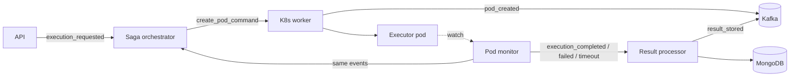

# Worker

One background process runs next to the API: `python -m app.worker`, in the `worker` container built from the backend image. Four parts of it carry an execution from request to stored result, and a fifth retries dead-lettered events. They share one broker connection and one Dishka container, but each consumer keeps its own Kafka consumer group, so every part still gets every event it subscribes to.

The parts talk to each other only through Kafka, one topic per event type, even inside the one process. The event names on the arrows below travel as those topics. MongoDB holds the durable state and Redis holds the execution queue and idempotency keys.



| Part | What it does | How it runs |
|------|--------------|-------------|
| [Saga orchestrator](saga_orchestrator.md) | Queues executions, runs the execution saga, sends pod commands | `saga-orchestrator` group; `try_schedule_from_queue` every 10s, `check_timeouts` every 30s |
| [K8s worker](k8s_worker.md) | Creates the script ConfigMap and the executor pod | `k8s-worker` group |
| [Pod monitor](pod_monitor.md) | Watches executor pods and publishes pod and execution events | watch cycle every 5s |
| [Result processor](result_processor.md) | Writes the result onto the execution document | `result-processor` group |
| [DLQ processor](dlq_processor.md) | Republishes DLQ rows whose retry time has come | job every 10s |

The entry point is [`backend/app/worker.py`](https://github.com/HardMax71/Integr8sCode/blob/main/backend/app/worker.py). It loads `config.toml` plus the `config.worker.toml` override, initializes Beanie, builds the container with `create_worker_container`, registers the three routers and starts the FastStream app. On startup it applies the executor NetworkPolicy and the image pre-puller DaemonSet, then starts the scheduler.

Replays run in the API, not here. See [Event replay](../event-replay.md).

## Running locally

`./deploy.sh dev` starts it. To debug it from your shell, stop the container and run it with uv from `backend/`:

```bash
docker compose stop worker
cd backend
uv run python -m app.worker
```

The worker reads the same `config.toml` as the container, so it connects to the compose hostnames `mongo`, `redis` and `kafka`. Map those to `127.0.0.1` in `/etc/hosts`, since compose publishes their ports on localhost. It also reads the kubeconfig from `KUBERNETES_CONFIG_PATH`, which is `/app/kubeconfig.yaml`, a path that exists only inside the container. Set it in `config.worker.toml` to a kubeconfig the host can use, such as `~/.kube/config`.

## Scaling

Compose runs one worker, and it has to stay at one. The pod monitor keeps the last seen phase of each pod in memory, so a second replica would watch the same pods and publish every event twice, and the scheduled jobs would run once per replica. The consumers alone would scale, since they go through consumer groups and guard each handler with a Redis idempotency key. The saga orchestrator keeps saga state in MongoDB and the queue in Redis, so both survive a restart, but nothing resumes a saga that was halfway through its steps when the process died.

A crash in any part restarts the whole container (`restart: unless-stopped`), and the consumers pick up from their committed offsets.
