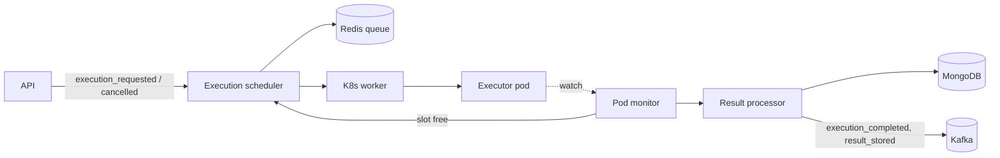

# Worker

One background process runs next to the API: `python -m app.worker`, in the `worker` container built from the backend image. It runs executions: it takes them from the queue when a slot is free, creates their pods, watches the pods and stores what they print. A DLQ job retries events whose handler failed, and a replay job runs the replay sessions admins schedule.

The parts are plain services in one process, and they call each other directly. Only the requests come in over Kafka: `execution_requested` and `execution_cancelled`, in the `saga-orchestrator` consumer group. The group keeps the name from before the saga was removed, so its committed offsets carried over. Everything the worker learns goes out as events for the API's SSE stream, its notifications and the event history. MongoDB holds the executions and Redis holds the queue and idempotency keys.



| Part | What it does | How it runs |
|------|--------------|-------------|
| [Execution scheduler](execution_scheduler.md) | Queues executions, starts them while slots are free, cancels them | `saga-orchestrator` group; `schedule_pending` every 10s |
| [K8s worker](k8s_worker.md) | Creates the script ConfigMap and the executor pod, deletes a cancelled pod | called by the scheduler |
| [Pod monitor](pod_monitor.md) | Watches executor pods, hands what they report to the result processor, deletes finished pods | one 30 s watch after another |
| [Result processor](result_processor.md) | Writes the status and result onto the execution document, then publishes the events | called by the pod monitor and the scheduler |
| [DLQ processor](dlq_processor.md) | Republishes DLQ rows whose retry time has come | job every 10s |
| [Event replay](../event-replay.md) | Sends the events of the oldest scheduled replay session to Kafka again | job every 2s; at startup it fails sessions a restart cut off |

The entry point is [`backend/app/worker.py`](https://github.com/HardMax71/Integr8sCode/blob/main/backend/app/worker.py). It loads `config.toml` plus the `config.worker.toml` override, initializes Beanie, builds the container with `create_worker_container`, registers the scheduler's router and starts the FastStream app. On startup it applies the executor namespace, NetworkPolicy, ResourceQuota and the image pre-puller DaemonSet, fails the replay sessions a restart cut off, then starts the scheduled jobs.

## Running locally

`docker compose up -d` starts it. To debug it from your shell, stop the container and run it with uv from `backend/`:

```bash
docker compose stop worker
cd backend
uv run python -m app.worker
```

The worker reads the same `config.toml` as the container, so it connects to the compose hostnames `mongo`, `redis` and `kafka`. Map those to `127.0.0.1` in `/etc/hosts`, since compose publishes their ports on localhost. It also reads the kubeconfig from `KUBERNETES_CONFIG_PATH` (`/etc/rancher/k3s/k3s.yaml`) and sends requests to `KUBERNETES_API_SERVER` (`https://host.docker.internal:6443`). On the host, set the second to `https://127.0.0.1:6443` in `config.worker.toml`.

## Scaling

Compose runs one worker, and it has to stay at one. The pod monitor keeps the last seen phase of each pod in memory, so a second replica would watch the same pods and store every result twice, and the scheduled jobs would run once per replica. The queue lives in Redis and the results in MongoDB, so both survive a restart. A pod that finished while the worker was down is picked up by the pod monitor's first list after the restart.

A crash in any part restarts the whole container (`restart: unless-stopped`), and the consumers pick up from their committed offsets.
