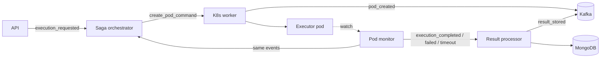

# Workers

Six background processes sit next to the API, each in its own container built from the backend image. Four of them carry an execution from request to stored result. The other two run scheduled jobs: the DLQ processor retries dead-lettered messages and the event replay worker prunes old replay sessions.

Workers talk to each other only through Kafka, one topic per event type. MongoDB holds the durable state and Redis holds the execution queue and idempotency keys.



| Worker | What it does | Entry point |
|--------|--------------|-------------|
| [Saga orchestrator](saga_orchestrator.md) | Queues executions, runs the execution saga, sends pod commands | `run_saga_orchestrator.py` |
| [K8s worker](k8s_worker.md) | Creates the script ConfigMap and the executor pod | `run_k8s_worker.py` |
| [Pod monitor](pod_monitor.md) | Watches executor pods and publishes pod and execution events | `run_pod_monitor.py` |
| [Result processor](result_processor.md) | Writes the result onto the execution document | `run_result_processor.py` |
| [Event replay](event_replay.md) | Deletes replay sessions older than 48 hours, every 6 hours | `run_event_replay.py` |
| [DLQ processor](dlq_processor.md) | Republishes DLQ rows whose retry time has come | `run_dlq_processor.py` |

All entry points live in [`backend/workers/`](https://github.com/HardMax71/Integr8sCode/tree/main/backend/workers). Each one loads `config.toml` plus its own `config.<worker>.toml` override, initializes Beanie, builds its Dishka container, registers its Kafka subscribers if it has any, and starts the FastStream app.

## Running locally

`./deploy.sh dev` starts all six. To debug one from your shell, stop its container and run it with uv from `backend/`:

```bash
docker compose stop saga-orchestrator
cd backend
uv run python -m workers.run_saga_orchestrator
```

The worker reads the same `config.toml` as the containers, so it connects to the compose hostnames `mongo`, `redis` and `kafka`. Map those to `127.0.0.1` in `/etc/hosts`, since compose publishes their ports on localhost. The k8s worker and pod monitor also read the kubeconfig from `KUBERNETES_CONFIG_PATH`, which is `/app/kubeconfig.yaml` inside the containers.

## Scaling

Compose runs one container of each worker, with fixed container names. The pod monitor has to stay at one replica: it keeps the last seen phase of each pod in memory, and a second replica would watch the same pods and publish every event twice. The k8s worker and result processor consume through Kafka consumer groups and guard each handler with a Redis idempotency key, so extra replicas would split the partitions between them. The saga orchestrator keeps saga state in MongoDB and the queue in Redis, so both survive a restart, but nothing resumes a saga that was halfway through its steps when the process died.
