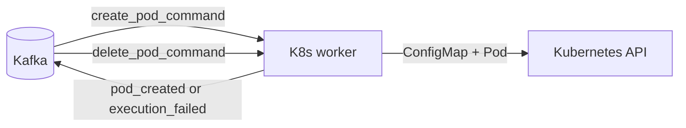

# K8s worker

The k8s worker turns saga commands into Kubernetes objects. It consumes `create_pod_command` and `delete_pod_command` with group id `k8s-worker`, and each handler runs behind a Redis idempotency key, so a redelivered command doesn't create a second pod.



## Creating a pod

For `create_pod_command` the worker creates a ConfigMap `script-{execution_id}` holding the user's script and `entrypoint.sh`, then a pod `executor-{execution_id}`. Once the pod exists, it patches the ConfigMap with an ownerReference to the pod, so Kubernetes deletes the ConfigMap together with the pod. If the Kubernetes API rejects that patch, the worker only logs a warning and the ConfigMap outlives the pod. Then it publishes `pod_created`. If anything else in that sequence fails, it publishes `execution_failed` with error type `system_error` and exit code -1 instead.

The image and command come from the command event, which the API filled in from the runtime registry (`app/runtime_registry.py`). The registry can also give a language its own pod settings: extra env vars, a bigger `/tmp`, and minimum CPU, memory and timeout. The pod builder takes the larger of the configured value and the language minimum. Only Go uses this today:

```python
--8<-- "backend/app/runtime_registry.py:LANGUAGE_SPECS"
```

CPU and memory limits and the timeout arrive in the command, taken from the admin system settings when the execution was requested. Requests come from `K8S_POD_CPU_REQUEST` and `K8S_POD_MEMORY_REQUEST`. The timeout becomes the pod's `activeDeadlineSeconds`.

For `delete_pod_command`, which only the API's saga cancel route sends today, the worker deletes the pod with a 30 second grace period and lets the ownerReference take the ConfigMap with it.

## Pod security

| Control | Setting |
|---------|---------|
| User | `runAsNonRoot`, UID and GID 1000, `hostUsers: false` (user namespace) |
| Filesystem | Read-only root; writable `/output` (10Mi) and `/tmp` (10Mi, 64Mi for Go) emptyDirs |
| Privileges | `allowPrivilegeEscalation: false`, all capabilities dropped |
| Seccomp | `RuntimeDefault` |
| API access | `automountServiceAccountToken: false`, `enableServiceLinks: false` |
| Host namespaces | No host network, PID or IPC |
| Runtime class | `K8S_POD_RUNTIME_CLASS_NAME` if set (for example gVisor) |

The worker refuses to start if `K8S_NAMESPACE` is `default`.

## Startup

Before it consumes anything, the worker applies two things to the executor namespace. The first is the `executor-deny-all` NetworkPolicy, which selects pods labeled `component=executor` and allows no ingress and no egress, DNS included. The second is the Pod Security Admission labels for the `restricted` profile (enforce, warn and audit). The worker is the only thing that writes this policy, and it takes effect only if the cluster's network plugin enforces NetworkPolicy.

It also applies the `runtime-image-pre-puller` DaemonSet, which pulls every image in the runtime registry on each node. The worker doesn't wait for those pulls, so an execution that arrives before they finish still waits for its image.

Executor pods also carry the label `kueue.x-k8s.io/queue-name: executor-queue`, which points at the Kueue LocalQueue that `k8s/integr8scode.yaml` defines in the `integr8scode` namespace. k3s applies that file by itself. It sets up no other namespace, so a different `K8S_NAMESPACE` needs its own LocalQueue there.

## Key files

| File | Purpose |
|------|---------|
| [`worker.py`](https://github.com/HardMax71/Integr8sCode/blob/main/backend/app/worker.py) | Entry point, startup setup |
| [`worker.py`](https://github.com/HardMax71/Integr8sCode/blob/main/backend/app/services/k8s_worker/worker.py) | Command handlers, namespace policy, pre-puller |
| [`pod_builder.py`](https://github.com/HardMax71/Integr8sCode/blob/main/backend/app/services/k8s_worker/pod_builder.py) | ConfigMap and pod spec |
| [`runtime_registry.py`](https://github.com/HardMax71/Integr8sCode/blob/main/backend/app/runtime_registry.py) | Languages, images, per-language pod settings |
