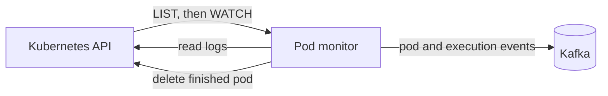

# Pod monitor

The pod monitor watches executor pods and turns what Kubernetes reports into events. It's the only component that reads a pod's output, and it publishes the events that end an execution.

## Watching

The monitor uses list-then-watch on pods matching `app=integr8s,component=executor` in `K8S_NAMESPACE`. On the first run, and again after the Kubernetes API answers 410 Gone, it LISTs all matching pods, handles each one as if it had just been added, and keeps the list's resource version. After that it WATCHes from that version. Each watch is bounded to 30 seconds, and APScheduler starts the next one every 5 seconds (never two at once), so a dropped connection just means the next cycle picks up from the saved version.

## Mapping

`PodEventMapper` maps each pod update by phase:

| Phase or watch event | Event |
|----------------------|-------|
| Pending with the PodScheduled condition | `pod_scheduled` |
| Running | `pod_running` |
| Succeeded | `execution_completed` |
| Failed | `execution_failed`, or `execution_completed` if all containers exited 0 |
| status reason `DeadlineExceeded` | `execution_timeout` (unless all containers exited 0) |
| watch event DELETED | `pod_terminated` |

It remembers the last phase seen per pod and drops an update with the same phase, so a watch restart doesn't publish duplicates. That check runs before the DELETED mapping, so a pod deleted after its final phase was already seen produces no `pod_terminated`. The memory is per process, which is why the monitor runs as a single replica.

For terminal events the mapper reads the container's logs, where the entrypoint writes stdout and stderr as length-prefixed frames, and the termination message, which carries the exit code, wall time, CPU jiffies and peak memory. If the logs can't be read, a succeeded or timed-out pod publishes nothing at all, while a failed pod still publishes `execution_failed` with the error taken from the pod status.

Every event goes through the producer, which stores it in the MongoDB `events` collection before sending it to Kafka.

## Cleanup

After publishing `execution_completed`, `execution_failed` or `execution_timeout`, the monitor deletes the pod with no grace period. The ConfigMap goes with it through its ownerReference.

## Key files

| File | Purpose |
|------|---------|
| [`run_pod_monitor.py`](https://github.com/HardMax71/Integr8sCode/blob/main/backend/workers/run_pod_monitor.py) | Entry point, watch scheduling, 410 handling |
| [`monitor.py`](https://github.com/HardMax71/Integr8sCode/blob/main/backend/app/services/pod_monitor/monitor.py) | List-then-watch and pod deletion |
| [`event_mapper.py`](https://github.com/HardMax71/Integr8sCode/blob/main/backend/app/services/pod_monitor/event_mapper.py) | Phase mapping and log parsing |
