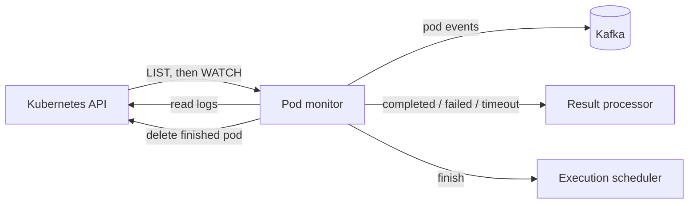

# Pod monitor

The pod monitor watches executor pods and turns what Kubernetes reports into events. It's the only component that reads a pod's output. Executor pods have no network, so the output can't come any other way.

## Watching

The monitor uses list-then-watch on pods matching `app=integr8s,component=executor` in `K8S_NAMESPACE`. On the first run, and again after the Kubernetes API answers 410 Gone, it LISTs all matching pods, handles each one as if it had just been added, and keeps the list's resource version. After that it WATCHes from that version. Each watch is bounded to 30 seconds. `PodMonitor.run()`, a task the worker starts and cancels at shutdown, opens the next watch as soon as the last one ends, or after `watch_retry_seconds` (5) when it failed, so a dropped connection just means the next watch picks up from the saved version.

## Mapping

`PodEventMapper` maps each pod update by phase:

| Phase or watch event | Event |
|----------------------|-------|
| Pending with the PodScheduled condition | `pod_scheduled` |
| Running | `pod_running` |
| Succeeded | `execution_completed` |
| Failed | `execution_failed`, or `execution_completed` if all containers exited 0 |
| status reason `DeadlineExceeded` | `execution_timeout` (unless all containers exited 0) |
| watch event DELETED | `pod_terminated` |

It remembers, per pod, the last phase that produced an event and drops a later update with that phase, so a watch restart doesn't publish duplicates. A phase that produced nothing isn't remembered, so the next update in it tries again: the first Pending update often comes before the pod is placed, and the next one carries the PodScheduled condition. A DELETED event skips the check. It maps whatever the pod's phase hasn't sent yet, then `pod_terminated`, and forgets the pod. The memory holds up to 10,000 pods and then forgets the oldest half, so a late update for a forgotten pod can publish again. It's per process, which is why the monitor runs as a single replica.

For terminal events the mapper reads the container's logs, where the entrypoint writes stdout and stderr as length-prefixed frames, and the termination message, which carries the exit code, wall time, CPU jiffies and peak memory. If the logs can't be read, the terminal event still goes out with the exit code and usage from the termination message, empty stdout and a note in stderr. Kubernetes sends no further update for a finished pod, so waiting for one would leave the execution and the pod behind. A timed-out pod stays `execution_timeout` either way.

`pod_scheduled`, `pod_running` and `pod_terminated` go straight to the producer, which stores each one in the MongoDB `events` collection before sending it to Kafka; the first two also move the stored status forward through the [result processor](result_processor.md). The three terminal events go to the result processor, which writes the result and only then publishes them.

## Cleanup

After a terminal event, the monitor deletes the pod with no grace period, and the ConfigMap goes with it through its ownerReference. Then it tells the [execution scheduler](execution_scheduler.md) the execution finished, so its slot frees and the next queued execution starts.

## Key files

| File | Purpose |
|------|---------|
| [`worker.py`](https://github.com/HardMax71/Integr8sCode/blob/main/backend/app/worker.py) | Entry point and watch scheduling |
| [`monitor.py`](https://github.com/HardMax71/Integr8sCode/blob/main/backend/app/services/pod_monitor/monitor.py) | List-then-watch and pod deletion |
| [`event_mapper.py`](https://github.com/HardMax71/Integr8sCode/blob/main/backend/app/services/pod_monitor/event_mapper.py) | Phase mapping and log parsing |
