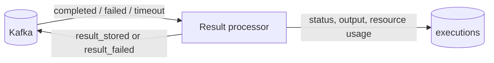

# Result processor

The result processor is the single writer of an execution's final state. It consumes `execution_completed`, `execution_failed` and `execution_timeout` with group id `result-processor`, one message per poll, and each handler runs behind a Redis idempotency key.

For each event it loads the execution, records metrics, and writes the status, exit code, stdout, stderr, resource usage and error type onto the execution's document in the `executions` collection. There's no separate results collection. The write is conditional: it only applies while the execution is still in an active status, so a late or duplicate event can't overwrite a result that's already stored. A timeout is stored with exit code -1.

After the write it publishes `result_stored`, which carries a storage reference rather than the output. The SSE service reads the output back from MongoDB when it forwards that event. If the MongoDB write or the Kafka publish fails, the processor publishes `result_failed` instead.

The result processor doesn't touch Kubernetes. The [pod monitor](pod_monitor.md) deletes finished pods, and their ConfigMaps go with them.

## Key files

| File | Purpose |
|------|---------|
| [`run_result_processor.py`](https://github.com/HardMax71/Integr8sCode/blob/main/backend/workers/run_result_processor.py) | Entry point |
| [`processor.py`](https://github.com/HardMax71/Integr8sCode/blob/main/backend/app/services/result_processor/processor.py) | Event handlers |
| [`execution_repository.py`](https://github.com/HardMax71/Integr8sCode/blob/main/backend/app/db/repositories/execution_repository.py) | `write_terminal_result` |
