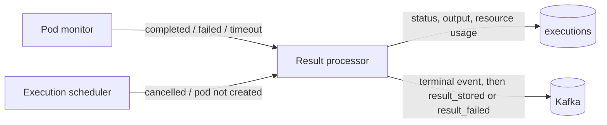

# Result processor

The result processor writes the final state of every execution that reaches the worker. The only other writer is the API, which marks an execution `error` when it can't publish `execution_requested`. The [pod monitor](pod_monitor.md) calls it with `execution_completed`, `execution_failed` or `execution_timeout`, and the [execution scheduler](execution_scheduler.md) with a cancel or a pod that couldn't be created. For `pod_scheduled` and `pod_running` it moves the stored status forward to `scheduled` or `running`; that update only applies from an earlier active status, so it never goes back and never overwrites a terminal one.

For each event it loads the execution, records metrics, and writes the status, exit code, stdout, stderr, resource usage and error type onto the execution's document in the `executions` collection. There's no separate results collection. The write is conditional: it only applies while the execution is still in an active status. When it doesn't apply, because the execution already ended another way, nothing is published. That keeps the failure a cancelled pod reports when it's deleted from overwriting the cancel or sending a notification. A timeout is stored with exit code -1, and a cancel with none.

After the write it publishes the terminal event (`execution_completed`, `execution_failed` or `execution_timeout`; a cancel has its event from the API already), then `result_stored`, which carries a storage reference rather than the output. The SSE service reads the output back from MongoDB when it forwards that event. If the MongoDB write or the Kafka publish fails, the processor tries to publish `result_failed` instead. That goes through the same producer, which stores the event in MongoDB first, so it fails too while MongoDB is down.

The result processor doesn't touch Kubernetes. The [pod monitor](pod_monitor.md) deletes finished pods, and their ConfigMaps go with them.

## Key files

| File | Purpose |
|------|---------|
| [`processor.py`](https://github.com/HardMax71/Integr8sCode/blob/main/backend/app/services/result_processor/processor.py) | Writes and publishes results |
| [`execution_repository.py`](https://github.com/HardMax71/Integr8sCode/blob/main/backend/app/db/repositories/execution_repository.py) | `write_terminal_result` |
