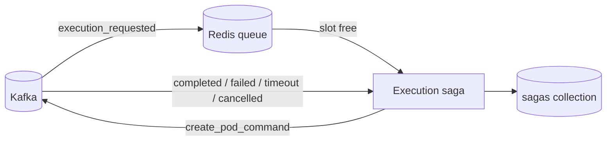
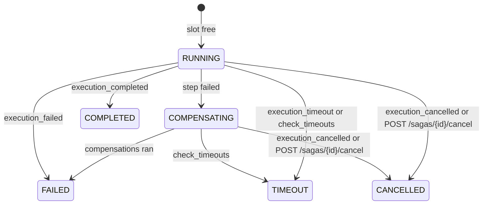

# Saga orchestrator

The saga orchestrator decides when an execution may start and sends the command that creates its pod. It keeps one saga document per execution in MongoDB and saves it after every step. There's no event sourcing: a saga's state is whatever that document says.

## How it works

An `execution_requested` event doesn't start a saga right away. The orchestrator first puts it in a Redis priority queue (`ExecutionQueueService`), then calls `try_schedule_from_queue`. That runs a Lua script which pops the highest priority execution only if the active set holds fewer than `max_concurrent_executions` entries. The limit is an admin system setting with a default of 10, and it's the real concurrency gate for the whole platform. The same scheduling runs every 10 seconds from APScheduler, and again whenever an execution finishes.

When an execution is popped, the orchestrator creates its saga document directly in the `RUNNING` state (a unique index on `execution_id` and `saga_name` stops a second saga for the same execution), publishes `saga_started`, and runs the three steps of the execution saga: validate, allocate resources, create pod. [Resource allocation](../saga/resource-allocation.md) covers the steps in detail. Before each step the document gets `current_step`. After a step succeeds, the document gets the step name in `completed_steps` plus the saga context, and only then is the step's compensation registered.

If a step raises or returns false, the registered compensations run in reverse order. The saga moves to `COMPENSATING` and ends as `FAILED`. Compensation only ever runs on this path and when someone cancels the saga through the API.

After the last step the saga stays `RUNNING` and waits. `execution_completed`, `execution_failed`, `execution_timeout` and `execution_cancelled` each move it to the matching terminal state, release the execution's slot in the Redis queue, and try to schedule the next one. None of these runs compensation.

## Saga states

The `SagaState` enum has `CREATED`, `RUNNING`, `COMPENSATING`, `COMPLETED`, `FAILED`, `TIMEOUT` and `CANCELLED`. The last four are terminal. Nothing creates a saga in `CREATED`.

`check_timeouts` runs every 30 seconds. It marks any `RUNNING` or `COMPENSATING` saga created more than 300 seconds ago as `TIMEOUT`. It only writes the state: it doesn't compensate and doesn't release the queue slot.

`POST /api/v1/sagas/{saga_id}/cancel` runs in the API process, not in this worker. It sets `CANCELLED` atomically, publishes `saga_cancelled`, and runs the compensations of the steps that had completed: it releases the allocation if one was made, and publishes `delete_pod_command` only if `CreatePodStep` finished. Unlike `execution_cancelled`, it doesn't release the execution's slot in the Redis queue or schedule the next one, so the slot stays taken until a terminal event arrives for that execution.

## Topics

The orchestrator consumes `execution_requested`, `execution_completed`, `execution_failed`, `execution_timeout` and `execution_cancelled`, all with group id `saga-orchestrator`. It produces `saga_started` and `create_pod_command`. The worker never sends `delete_pod_command` in practice: create pod is the last step, so its compensation is never registered when a step fails. Only the API's cancel route sends it.

## Key files

| File | Purpose |
|------|---------|
| [`worker.py`](https://github.com/HardMax71/Integr8sCode/blob/main/backend/app/worker.py) | Entry point and APScheduler jobs |
| [`saga_orchestrator.py`](https://github.com/HardMax71/Integr8sCode/blob/main/backend/app/services/saga/saga_orchestrator.py) | Queueing, step loop, compensation, timeouts |
| [`execution_saga.py`](https://github.com/HardMax71/Integr8sCode/blob/main/backend/app/services/saga/execution_saga.py) | Steps and compensations |
| [`execution_queue.py`](https://github.com/HardMax71/Integr8sCode/blob/main/backend/app/services/execution_queue.py) | Redis priority queue |
| [`saga_repository.py`](https://github.com/HardMax71/Integr8sCode/blob/main/backend/app/db/repositories/saga_repository.py) | Saga persistence |
