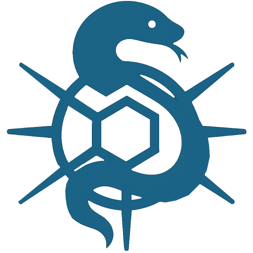

<div style="text-align: center;" markdown>

{ width="150" }

# Integr8sCode

[GitHub :material-github:](https://github.com/HardMax71/Integr8sCode){ .md-button }
[Live Demo :material-play:](https://app.integr8scode.cc/){ .md-button .md-button--primary }

Run Python, Node.js, Ruby, Go and Bash scripts in isolated Kubernetes pods and watch the output stream back live.

</div>

## Quick start

You need Docker with Compose and a reachable Kubernetes cluster. [Getting started](getting-started.md) shows how to set up k3s.

```bash
git clone https://github.com/HardMax71/Integr8sCode.git
cd Integr8sCode
cp .env.example .env
docker compose up -d
```

Then open [https://localhost:5001](https://localhost:5001) and log in as `user` / `user123`.

## What it does

Every script runs in its own pod: non-root, read-only root filesystem, no capabilities, no service account token, and a NetworkPolicy that blocks all traffic in and out wherever the cluster's network plugin enforces it. CPU, memory and timeout limits are system-wide admin settings, and a language can raise them for its own pods. Status updates and the result reach the browser over Server-Sent Events.

The API and the worker talk through Kafka, one topic per event type. Every event is also stored in MongoDB for 30 days, where admins can browse and replay it.

## Documentation

<div class="grid cards" markdown>

-   :material-rocket-launch: **[Getting Started](getting-started.md)**

    ---

    Set up k3s, start the stack and run your first script

-   :material-sitemap: **[Architecture](architecture/overview.md)**

    ---

    System design, service interactions, and event flows

-   :material-api: **[API Reference](reference/api-reference.md)**

    ---

    Every REST and SSE endpoint, rendered from the OpenAPI spec

-   :material-cog: **[Components](components/workers/index.md)**

    ---

    Workers, SSE, the DLQ and MongoDB indexes

-   :material-wrench: **[Operations](operations/deployment.md)**

    ---

    Deployment, tracing, and monitoring

-   :material-shield: **[Security](SECURITY.md)**

    ---

    Policies, network isolation, and supply chain

-   :material-cog: **[Configuration Reference](reference/configuration.md)**

    ---

    Every TOML setting and secret

-   :material-monitor: **[Frontend](frontend/routing.md)**

    ---

    Frontend routing and components

-   :material-github: **[Contributing](https://github.com/HardMax71/Integr8sCode/blob/main/CONTRIBUTING.md)**

    ---

    Development setup, pre-commit hooks, and PR guidelines

</div>
