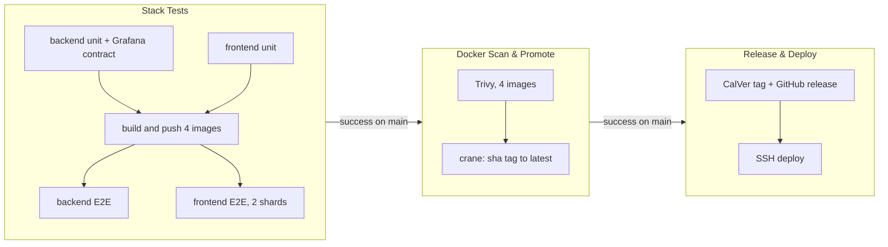

# CI/CD pipeline

CI is ten GitHub Actions workflows, two composite actions and a Dependabot config. Three of the workflows form the release chain: Stack Tests builds and tests the images, Docker Scan & Promote scans them and moves `latest`, and Release & Deploy tags a CalVer release and deploys it. Production only changes when the whole chain succeeds on `main`.



## Workflows

| Workflow                       | File                   | Runs on                                                                 |
|--------------------------------|------------------------|-------------------------------------------------------------------------|
| Stack Tests                    | stack-tests.yml      | push to `main`, tags `v*`, PRs to `main`, when backend, frontend, cert-generator, compose, deploy.sh or CI files change; manual |
| Docker Scan & Promote          | docker.yml           | after Stack Tests completes; manual with an optional SHA                |
| Release & Deploy               | release-deploy.yml   | after Docker Scan & Promote completes; manual on `main` with `skip_deploy` |
| Ruff Linting                   | ruff.yml             | push and PRs to `main`; manual                                          |
| MyPy Type Checking             | mypy.yml             | push and PRs to `main`; manual                                          |
| Dead Code Detection            | grimp.yml            | push and PRs to `main`; manual                                          |
| Security Scanning              | security.yml         | push and PRs to `main`; manual                                          |
| SBOM & Supply Chain Security   | sbom-compliance.yml  | push and PRs to `main`; Sundays at midnight                             |
| Frontend CI                    | frontend-ci.yml      | push and PRs to `main` touching `frontend/`; manual                     |
| docs                           | docs.yml             | push and PRs to `main` touching `docs/`, mkdocs.yml or the workflow; manual |

The lint workflows are one job each. Ruff runs `ruff check`. MyPy runs `mypy --strict` with `SECRET_KEY` from the `TEST_SECRET_KEY` secret. Grimp runs `python -m scripts.check_orphan_modules`, which fails on any module nothing imports. Security Scanning runs `uvx --no-build bandit==1.9.4 -r backend/ -x backend/tests/ -ll`. Frontend CI runs ESLint, Stylelint, the Prettier check, `svelte-check --fail-on-warnings` and a production build. The SBOM workflow generates SPDX SBOMs for backend and frontend with `anchore/sbom-action`, scans them with Grype through `anchore/scan-action` (cutoff `high`, `fail-build: false`) and uploads SARIF to the Security tab.

The docs workflow installs the backend dependencies, runs `./deploy.sh openapi`, builds with `mkdocs build --strict` and deploys to GitHub Pages on pushes to `main`.

## Stack Tests

The backend unit job installs with `uv sync --frozen --group test --no-dev --no-install-project --no-build` and runs `pytest tests/unit` with coverage. The pytest config adds `-n auto --dist=loadgroup`, so tests run in parallel with xdist and tests that share a group stay on one worker. The same job then runs the [Grafana contract tests](../testing/contract-testing.md) with `pytest tests/contract -m grafana_contract`. The frontend unit job runs `npm ci --ignore-scripts` and `npm run test:coverage`. Coverage goes to Codecov with the flags `backend-unit`, `frontend-unit` and later `backend-e2e`.

Once both pass, one job builds the four images and pushes them to GHCR as `sha-<7 chars>`:

| Image            | Dockerfile                  | Build                                                         |
|------------------|-----------------------------|---------------------------------------------------------------|
| `base`           | `backend/Dockerfile.base`   | cached as a zstd tarball keyed on `Dockerfile.base`, pyproject.toml and uv.lock; GHA layer cache on a miss |
| `backend`        | `backend/Dockerfile`        | plain `docker build` on top of the local base image           |
| `cert-generator` | `cert-generator/Dockerfile` | GHA layer cache                                               |
| `frontend`       | `frontend/Dockerfile`       | GHA layer cache                                               |

The pushes run in parallel and each failure is reported on its own. Fork PRs can't push to GHCR, so for them the push and both E2E jobs are skipped. Workers reuse the backend image, so there are no worker images.

### E2E

Each E2E job gets its own runner with k3s and the full compose stack, pulling the images it just built. Two composite actions set that up, and the frontend job installs Node and Playwright between them so that work overlaps with k3s booting.

`e2e-boot` logs in to GHCR, starts `docker compose pull` and then `mongo redis shared-ca kafka` in the background, and installs k3s. Also in the background, it downloads the Kueue manifest and pre-pulls `python:3.11-slim` and `python:3.14-slim` into k3s with crictl, so the first executor pods don't wait on an image pull.

`e2e-ready` writes `backend/kubeconfig.yaml` pointing at `host.docker.internal:6443` and creates the `integr8scode` namespace. Unless `install-kueue` is `false`, it applies the Kueue manifest, waits for the controller and creates the `ResourceFlavor`, `ClusterQueue` and `LocalQueue` (`kueue.x-k8s.io/v1beta2`), then waits for the image pre-pulls. It copies config.test.toml over config.toml, waits for the background infra start, runs `docker compose up -d --no-build` and polls `/api/v1/health/live` (and the frontend, when asked).

The backend E2E job runs `pytest tests/e2e` inside the backend container after `uv sync --group test --no-dev --frozen --no-install-project --no-build`. The frontend E2E job runs as two shards. It caches Playwright browsers by package-lock.json, always runs `npm run test:e2e:deps`, runs `npm run test:e2e:browsers` on a cache miss, skips Kueue, and runs `npm run test:e2e -- --shard=N/2`. On failure both jobs upload compose logs; the backend one adds `kubectl get events`.

## Docker Scan & Promote

The jobs run only when Stack Tests succeeded on `main`, or on a manual run. A matrix scans `base`, `backend`, `frontend` and `cert-generator` with Trivy v0.75.0 (`CRITICAL,HIGH`, unfixed ignored, `backend/.trivyignore`) and uploads SARIF to the Security tab. No `exit-code` is set, so findings show up there without failing the job. The promote job then copies each `sha-` tag to `latest` with `crane copy`, a registry-side manifest copy with no rebuild.

## Release & Deploy

The release job computes a CalVer version `YYYY.M.PATCH`, where `PATCH` is one more than the highest tag of the current month, starting at 0. It copies `latest` to that tag for all four images with crane, pushes an annotated git tag and creates a GitHub release with generated notes.

The deploy job runs `appleboy/ssh-action` against the production server. It's skipped on a manual run with `skip_deploy`. What it runs on the server is in [Deployment](deployment.md#production).

### Required secrets

| Secret                                         | Used by                     | For                                         |
|------------------------------------------------|-----------------------------|---------------------------------------------|
| `DEPLOY_HOST`, `DEPLOY_USER`, `DEPLOY_SSH_KEY` | Release & Deploy            | SSH to the production server                |
| `DEPLOY_GHCR_TOKEN`                            | Release & Deploy            | PAT with `read:packages` for `docker login` |
| `JWT_SECRET_KEY`                               | Release & Deploy            | the backend's `SECRET_KEY`                  |
| `MONGO_USER`, `MONGO_PASSWORD`                 | Release & Deploy            | MongoDB root credentials                    |
| `MONGO_MONITOR_PASSWORD`                       | Release & Deploy            | password of the collector's MongoDB user    |
| `REDIS_PASSWORD`                               | Release & Deploy            | Redis password                              |
| `GRAFANA_ADMIN_USER`, `GRAFANA_ADMIN_PASSWORD` | Release & Deploy            | Grafana admin login                         |
| `MAILJET_HOST`, `MAILJET_API_KEY`, `MAILJET_SECRET_KEY`, `MAILJET_FROM_ADDRESS` | Release & Deploy | Grafana alert mail over SMTP |
| `GRAFANA_ALERT_RECIPIENTS`                     | Release & Deploy            | who gets alert mail                         |
| `CODECOV_TOKEN`                                | Stack Tests                 | coverage upload                             |
| `TEST_SECRET_KEY`                              | MyPy Type Checking          | exported as `SECRET_KEY` for the mypy step |

## Supply chain

Every action, the composite ones included, is pinned to a full commit SHA with the version in a comment, for example `actions/checkout@3d3c42e5... # v7.0.1`. The Trivy action is pinned to the commit of v0.36.0 because the older tags were deleted upstream.

Tools are pinned exactly: mkdocs 1.6.1 with material 9.7.7, mermaid2 1.2.3 and swagger-ui-tag 0.8.1; bandit 1.9.4; Trivy v0.75.0. Python installs use `uv sync --frozen` with `--no-build`, so only wheels from the lockfile get installed, and `--no-install-project`. `uvx` calls also pass `--no-build`. npm installs use `npm ci --ignore-scripts`, in CI and in the frontend image.

k3s comes from the install script in the k3s repo at the pinned tag (`v1.37.1+k3s1`), not from get.k3s.io, and the script's SHA256 is checked before it runs. The Kueue manifest (`v0.20.1`) is checked the same way. All these downloads use `curl --proto =https --tlsv1.2`.

`latest` is only ever set by the promote job, so it always points at images that passed the tests. Any build stays pullable by its `sha-` tag.

## Dependabot

Dependabot checks weekly and opens one grouped PR per ecosystem: uv in `backend/`, npm in `frontend/`, the three Dockerfiles, the images in docker-compose.yaml, and GitHub Actions including the composite actions. It ignores TypeScript 7 and later, because typescript-eslint and svelte-check need the compiler API that 7 dropped, and Jaeger 2.21 and later, because Grafana can't search it yet.

## Running checks locally

```bash
cd backend
uv run ruff check . --config pyproject.toml
uv run mypy --config-file pyproject.toml --strict .
uv run python -m scripts.check_orphan_modules
uvx --no-build bandit==1.9.4 -r . -x tests/ -ll
uv run pytest tests/unit
uv run pytest tests/contract -m grafana_contract
```

```bash
cd frontend
npm run lint
npm run stylelint
npm run format:check
npm run check
npm run test
```

For E2E, do what CI does: copy `backend/config.test.toml` over `backend/config.toml`, start the stack with `./deploy.sh dev --wait`, then run the suites.

```bash
docker compose exec -T backend sh -c 'uv sync --group test --no-dev --frozen --no-install-project --no-build && pytest tests/e2e'
cd frontend && npm run test:e2e
```

`./deploy.sh test` and `./deploy.sh check` don't work right now ([#292](https://github.com/HardMax71/Integr8sCode/issues/292)).
