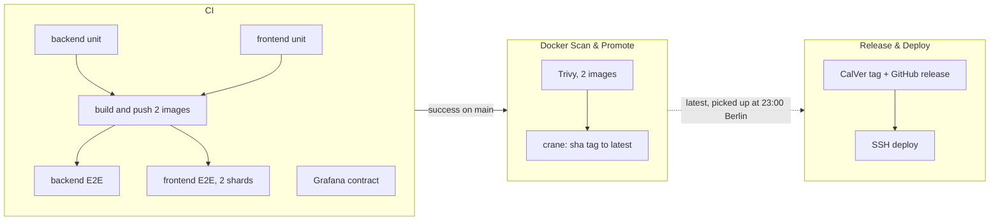

# CI/CD pipeline

CI is eight GitHub Actions workflows, two composite actions and a Dependabot config. Three of the workflows form the release chain: CI checks the code and builds and tests the images, Docker Scan & Promote scans them and moves `latest`, and Release & Deploy tags a CalVer release and deploys it. The first two run on every merge to `main`, so `latest` is always the newest build that passed both. Release & Deploy doesn't follow them: it runs once a day at 23:00 Europe/Berlin, or by hand, and releases whatever `latest` is then. A manual run of Docker Scan & Promote or Release & Deploy starts partway along the chain, without the steps before it.



## Workflows

| Workflow                       | File                   | Runs on                                                                 |
|--------------------------------|------------------------|-------------------------------------------------------------------------|
| CI                             | ci.yml               | push to `main` and tags `v*` (every job); PRs to `main` (the jobs whose files changed); manual |
| Docker Scan & Promote          | docker.yml           | after CI completes; manual with an optional SHA                         |
| Release & Deploy               | release-deploy.yml   | daily at 23:00 Europe/Berlin; manual on `main` with `skip_deploy`       |
| SBOM & Supply Chain Security   | sbom-compliance.yml  | push to `main`; PRs to `main` that change a dependency manifest; Sundays at midnight |
| Registry Cleanup               | registry-cleanup.yml | Sundays at 03:00 UTC; manual, a dry run unless you untick it            |
| Labels                         | labels.yml           | PRs opened or updated (`pull_request_target`), issues opened or edited  |
| Label Sync                     | label-sync.yml       | push and PRs to `main` touching the label files or issue forms; Mondays at 03:00; manual |
| Dependabot Auto-merge          | dependabot-auto-merge.yml | Dependabot's PRs to `main`                                         |

Besides the tests, CI runs one job per check. Ruff runs `ruff check`. MyPy runs `mypy --strict` with `SECRET_KEY` from the `TEST_SECRET_KEY` secret. Grimp runs `python -m scripts.check_orphan_modules`, which fails on any module nothing imports except `app.main` and `__init__.py` files that hold only a docstring. Security Scanning runs `uvx --no-build --python 3.14 bandit==1.9.4 -r backend/ -x backend/tests/ -ll`. Bandit parses with the Python it runs on, so on anything older it skips the files that use 3.14 syntax such as `except A, B:` without failing. The frontend job runs ESLint, Stylelint, the Prettier check, `svelte-check --fail-on-warnings` and a production build. The SBOM workflow generates SPDX SBOMs for backend and frontend with `anchore/sbom-action`, scans them with Grype through `anchore/scan-action` (cutoff `high`, `fail-build: false`) and uploads SARIF to the Security tab.

The docs job installs the backend dependencies, runs `./deploy.sh openapi` and builds with `mkdocs build --strict`. On pushes to `main`, Deploy Docs publishes the result to GitHub Pages and then deletes the `github-pages` deployments before it, so the repository lists only the live one.

Labels adds `area:` labels. On a PR, `actions/labeler` matches the changed paths against `.github/labeler.yml`; it runs on `pull_request_target` so fork PRs can be labeled too, and it never checks out the PR's code. On an issue, `github/issue-labeler` matches the Component answer of the issue form against `.github/issue-labeler.yml` and adds the label. It never removes one, so labels added by hand stay.

Label Sync keeps labels as code. `.github/labels.yml` lists every label in the repo, and `crazy-max/ghaction-github-labeler` makes the repo match it: it creates and updates labels, renames one that has `from_name`, and deletes any label the file doesn't list, which also takes it off every issue. On a PR it only prints what it would change. Before that, a `yq` step fails the run when `.github/labeler.yml`, `.github/issue-labeler.yml` or an issue form uses a label the file doesn't declare. A new area needs its label in `.github/labels.yml`, a path rule in `.github/labeler.yml`, an option in both issue forms and a pattern in `.github/issue-labeler.yml`.

The `Spec and client match the code` job enforces that `docs/reference/openapi.json` and `frontend/src/lib/api/` only ever come from the generators. It runs `./deploy.sh openapi` and `npm run generate:api` on the checked-out code and fails if either leaves a difference, which catches a hand edit and a spec or client someone forgot to regenerate.

## Pull requests and merging

CI is the only workflow a PR has to pass, and it runs only what the PR can affect. Its first job, Changed Areas, runs `dorny/paths-filter` on the PR's files:

| Changed                                                         | Jobs                                                                 |
|-----------------------------------------------------------------|----------------------------------------------------------------------|
| `backend/`                                                      | ruff, mypy, grimp, bandit, backend unit tests, Grafana contract tests |
| `grafana/`, `host-metrics/`, `loki/`, `opensearch/`, `otel-collector/`, `victoria-metrics/` | Grafana contract tests, Docs Build |
| `frontend/`                                                     | frontend lint and type check, frontend unit tests                    |
| `backend/`, `frontend/`, `.env.example`, compose, deploy.sh or the composite actions | the images and frontend E2E; backend E2E unless only `frontend/` changed |
| `backend/`, the spec, the generated client or its generator config | Spec and client match the code                                    |
| `docs/`, mkdocs.yml, or `backend/`, `frontend/` and the service config folders, since the docs include snippets of them | Docs Build |

A change to ci.yml itself runs every job, and so does every push to `main`. The last job, All checks pass, runs `re-actors/alls-green` over the others: a job skipped because its files didn't change counts as passed, and a failed or cancelled one fails it. FastAPI, pydantic and CPython gate their PRs the same way. All checks pass is the one required status check, so a PR that only touches the docs waits for the docs build and nothing else, and a new job only needs adding to its `needs`.

The `integr8scode_main` ruleset protects `main`: changes arrive through a PR, merged by squash only; `main` can't be force-pushed or deleted; and All checks pass from GitHub Actions has to succeed. Nobody can bypass it, admins included, so the merge box never offers to merge before the checks pass. Auto-merge is on: enable it on a PR (`gh pr merge --auto --squash`, or the button) and GitHub merges it once All checks pass. Merged branches are deleted, and a PR that was based on one moves to `main`.

Stacked PRs come from `gh stack`. CI runs for every PR in a stack, each against the PR below it, and `main`'s rules apply to every one of them. `gh stack merge` lands a stack, or its lower part, in one step once those PRs pass; GitHub then rebases the PRs above onto `main`. Auto-merge doesn't cover stacks yet.

## Tests and images

The backend unit job installs with `uv sync --frozen --group test --no-dev --no-install-project --no-build` and runs `pytest tests/unit` with coverage. The pytest config adds `-n auto --dist=loadgroup`, so tests run in parallel with xdist and tests that share a group stay on one worker. A job of its own runs the [Grafana contract tests](../testing/contract-testing.md) with `pytest tests/contract -m grafana_contract` when `backend/` or a service config folder changed, so a dashboard edit doesn't build the images or run E2E. The frontend unit job runs `npm ci --ignore-scripts` and `npm run test:coverage`. Coverage goes to Codecov with the flags `backend-unit`, `frontend-unit` and later `backend-e2e`.

Once both pass, or are skipped because only one side changed, one job builds the two images and pushes them to GHCR as `sha-<7 chars>`:

| Image      | Dockerfile            | Build                                                         |
|------------|-----------------------|---------------------------------------------------------------|
| `backend`  | `backend/Dockerfile`  | the `base` stage (Python, system packages, locked dependencies) is built on its own and cached as a zstd tarball keyed on the Dockerfile, pyproject.toml and uv.lock, with the GHA layer cache on a miss; then `docker build --build-context base=docker-image://...` builds only the app layers on top |
| `frontend` | `frontend/Dockerfile` | GHA layer cache                                               |

The pushes run in parallel and each failure is reported on its own. Fork PRs can't push to GHCR, so for them the push and both E2E jobs are skipped. Both E2E jobs check `!cancelled()` and the build's result in their own `if`. Without a status function, GitHub skips every job below a skipped one in the `needs` chain, so a backend-only PR, which skips the frontend unit job, would skip both E2E jobs. Workers reuse the backend image, so there are no worker images.

### E2E

Each E2E job gets its own runner with k3s and the full compose stack, pulling the images it just built. Two composite actions set that up, and the frontend job installs Node and Playwright between them so that work overlaps with k3s booting.

`e2e-boot` logs in to GHCR, copies `.env.example` to `.env`, starts `docker compose pull` and then `mongo redis kafka` in the background, and starts k3s in a privileged container named `k3s`, from the `rancher/k3s` image, with its network policy controller off. No E2E test checks policy enforcement, and the worker still creates the NetworkPolicy object. The container publishes 6443 and mounts the runner's `/etc/rancher/k3s`, so the kubeconfig lands where the worker reads it, the same as with a host install. k3s runs in a container because its pods then get their network interfaces inside it. With k3s on the runner itself, every executor pod changed the runner's network, and Chromium aborted Playwright navigations in flight with `net::ERR_NETWORK_CHANGED`. Also in the background, once k3s has written its kubeconfig, it pre-pulls `python:3.14-slim`, the default runtime and the only one the tests execute, into k3s with `docker exec k3s crictl`, so the first executor pods don't wait on an image pull. Nothing execs into the container before that kubeconfig exists: at startup k3s moves every process out of the container's root cgroup and then enables the cgroup controllers there, and a `docker exec` landing in between made that fail with "device or resource busy", so the kubelet exited and the node never came up.

`e2e-ready` copies k3s's kubeconfig for the runner's kubectl, waits for the node and then for the image pre-pull. The worker creates the `integr8scode` namespace, its NetworkPolicy and its ResourceQuota itself when it starts. It copies config.test.toml over config.toml, waits for the background infra start, runs `docker compose up -d --no-build` and polls `/api/v1/health/live` (and the frontend, when asked). It then waits until the five Kafka consumer groups report `Stable` in `kafka-consumer-groups --describe --state`. On a fresh Kafka most of them start at the newest message, so a request sent while they were still joining would never be read, and an execution test would time out.

The backend E2E job runs `pytest tests/e2e` inside the backend container after `uv sync --group test --no-dev --frozen --no-install-project --no-build`. The frontend E2E job runs as two shards. It caches Playwright browsers by package-lock.json, always runs `npm run test:e2e:deps`, runs `npm run test:e2e:browsers` on a cache miss, and runs `npm run test:e2e -- --shard=N/2`. On failure both jobs upload compose logs, the k3s container's log and `kubectl describe nodes`; the backend one adds `kubectl get events`.

## Docker Scan & Promote

The jobs run only when CI succeeded on `main`, or on a manual run. A matrix scans `backend` and `frontend` with Trivy v0.75.0 (`CRITICAL,HIGH`, unfixed ignored, `.trivyignore`) and uploads SARIF to the Security tab. A finding fails the scan job, and `promote` needs every scan to pass, so an image with a fixable `CRITICAL` or `HIGH` vulnerability never becomes `latest`. `limit-severities-for-sarif` keeps the SARIF to those two levels; without it the action drops the severity filter for SARIF and the gate would trip on everything. The promote job then copies each `sha-` tag to `latest` with `crane copy`, a registry-side manifest copy with no rebuild. CI runs finish in any order, so promotes run one at a time (`concurrency: promote-latest`), and each first checks the commits on `main` after its own: when `latest` already holds the image of one of them, it leaves `latest` alone and the Summary job is skipped. Without that check, an older merge whose CI finished last moved `latest` back a commit on 2026-10-22.

## Release & Deploy

The release job first finds the commit `latest` was built from, by matching the digest of `backend:latest` against the `sha-` tags of the last 100 commits on `main`. That commit can be behind `main`'s head when a later merge is still in CI or failed it. If the commit already has a CalVer tag, nothing new passed since the last release: a scheduled run stops there, and a manual run deploys that release again. Otherwise the job computes a CalVer version `YYYY.M.PATCH`, where `PATCH` is one more than the highest tag of the current month, starting at 0. It copies the commit's `sha-` images to that tag for both images with crane, pushes an annotated git tag on that commit and creates a GitHub release with generated notes. Then it deletes every release older than the newest 3, with its git tag, so the newest release and two to roll back to are left.

The deploy job runs `appleboy/ssh-action` against the production server. It's skipped on a manual run with `skip_deploy`, and on a scheduled run with nothing new. What it runs on the server is in [Deployment](deployment.md#production).

Registry Cleanup deletes old versions of the backend and frontend images on GHCR with [ghcr-cleanup-action](https://github.com/dataaxiom/ghcr-cleanup-action). It keeps `latest`, the images of the 3 releases that still exist, everything pushed in the last 7 days, and the 3 newest tagged images before that, so a week without merges deletes nothing new. A multi-arch or attested image goes with its platform and attestation children, never apart from them. A manual run is a dry run unless you untick `dry_run`; the schedule deletes for real.

### Required secrets

| Secret                                         | Used by                     | For                                         |
|------------------------------------------------|-----------------------------|---------------------------------------------|
| `DEPLOY_HOST`, `DEPLOY_USER`, `DEPLOY_SSH_KEY` | Release & Deploy            | SSH to the production server                |
| `JWT_SECRET_KEY`                               | Release & Deploy            | the backend's `SECRET_KEY`                  |
| `MONGO_USER`, `MONGO_PASSWORD`                 | Release & Deploy            | MongoDB root credentials                    |
| `MONGO_MONITOR_PASSWORD`                       | Release & Deploy            | password of the collector's MongoDB user    |
| `REDIS_PASSWORD`                               | Release & Deploy            | Redis password                              |
| `ADMIN_USER_PASSWORD`, `DEFAULT_USER_PASSWORD` | Release & Deploy            | passwords the backend sets for `admin` and `user` on start |
| `GRAFANA_ADMIN_USER`, `GRAFANA_ADMIN_PASSWORD` | Release & Deploy            | Grafana admin login                         |
| `MAILJET_HOST`, `MAILJET_API_KEY`, `MAILJET_SECRET_KEY`, `MAILJET_FROM_ADDRESS` | Release & Deploy | Grafana alert mail over SMTP |
| `GRAFANA_ALERT_RECIPIENTS`                     | Release & Deploy            | who gets alert mail                         |
| `ALERT_HEARTBEAT_URL`                          | Release & Deploy            | the outside monitor's heartbeat URL, which Grafana pings every 5 minutes |
| `CODECOV_TOKEN`                                | CI                          | coverage upload                             |
| `TEST_SECRET_KEY`                              | CI                          | exported as `SECRET_KEY` for the mypy step |

Compose falls back to public defaults for `SECRET_KEY`, the MongoDB and Redis credentials, the monitor password and the two account passwords, so the deploy script stops before it touches the server when any of those secrets is empty. The deploy job's first step does the same for alert delivery: it fails when `MAILJET_HOST`, `MAILJET_API_KEY`, `MAILJET_SECRET_KEY`, `MAILJET_FROM_ADDRESS`, `GRAFANA_ALERT_RECIPIENTS` or `ALERT_HEARTBEAT_URL` is empty, since Grafana would run and its alerts would reach nobody.

## Supply chain

Every action, the composite ones included, is pinned to a full commit SHA with the version in a comment, for example `actions/checkout@3d3c42e5... # v7.0.1`. The Trivy action is pinned to the commit of v0.36.0 because the older tags were deleted upstream.

Tools are pinned exactly: mkdocs 1.6.1 with material 9.7.7, mermaid2 1.2.3 and swagger-ui-tag 0.8.1; bandit 1.9.4; Trivy v0.75.0. Python installs use `uv sync --frozen` with `--no-build`, so only wheels from the lockfile get installed, and `--no-install-project`. `uvx` calls also pass `--no-build`. npm installs use `npm ci --ignore-scripts`, in CI and in the frontend image.

k3s is the `rancher/k3s:v1.37.1-k3s1` image, pinned by digest in `K3S_IMAGE` in ci.yml.

`latest` is only ever set by the promote job, so after an automatic promote it points at images that passed the tests and the Trivy scan. A manual promote still needs the scan but can pick a SHA whose E2E jobs failed, since the build job pushes the `sha-` tags before E2E runs. Any build stays pullable by its `sha-` tag.

## Dependabot

Dependabot checks weekly and opens one grouped PR per ecosystem: uv in `backend/`, npm in `frontend/`, the two Dockerfiles, the images in docker-compose.yaml, and GitHub Actions including the composite actions. It ignores TypeScript 7 and later, because typescript-eslint and svelte-check need the compiler API that 7 dropped, and Jaeger 2.21 and later, because Grafana can't search it yet.

Each update waits 7 days after its release (`cooldown`), so a broken or malicious release has time to get yanked before a PR picks it up. Security updates skip the wait.

Dependabot Auto-merge turns on auto-merge for every Dependabot PR, majors included, so it merges once All checks pass and goes out with the next nightly release. It does that with `AUTOMERGE_TOKEN`, a fine-grained token stored as a Dependabot secret, since a merge enabled with `GITHUB_TOKEN` starts no workflows on `main`: CI wouldn't build images for it and `latest` wouldn't move. The token has Contents, Pull requests and Workflows read and write on this repo only, Workflows because the Actions group edits workflow files. When it expires, the job fails and the PRs wait for a manual merge.

## Running checks locally

```bash
cd backend
uv run ruff check . --config pyproject.toml
uv run mypy --config-file pyproject.toml --strict .
uv run python -m scripts.check_orphan_modules
uvx --no-build --python 3.14 bandit==1.9.4 -r . -x ./tests,./.venv -ll
uv run pytest tests/unit
uv run pytest tests/contract -m grafana_contract
```

```bash
cd frontend
npm run lint
npm run stylelint
npm run format:check
npm run check
npm run test
```

For E2E, do what CI does: copy `backend/config.test.toml` over `backend/config.toml`, start the stack with `./deploy.sh dev --wait`, then run the suites.

```bash
docker compose exec -T backend sh -c 'uv sync --group test --no-dev --frozen --no-install-project --no-build && pytest tests/e2e'
cd frontend && npm run test:e2e
```

`./deploy.sh test` and `./deploy.sh check` don't work right now ([#292](https://github.com/HardMax71/Integr8sCode/issues/292)).
