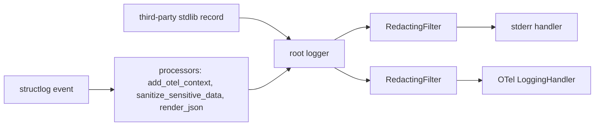

# Logging

Every process logs one JSON object per line to stderr through structlog. Secrets and emails are redacted before anything is written, for our own events and for third-party library records alike. With `OTEL_EXPORTER_OTLP_ENDPOINT` set, the same records also go to the OTel Collector and on to [Loki](loki.md).



## Setup

[`setup_logger`](https://github.com/HardMax71/Integr8sCode/blob/main/backend/app/core/logging.py) configures structlog and the root logger. The backend calls it in `create_app`, the DI container calls it for the logger it injects, and each worker calls it at the top of `main()`.

```python
--8<-- "backend/app/core/logging.py:setup_logger"
```

The processor chain:

```python
--8<-- "backend/app/core/logging.py:log_processors"
```

`add_otel_context` adds `trace_id` and `span_id` when there's a recording span. `sanitize_sensitive_data` redacts every string value in the event. `render_json` renders the event and marks the result as already redacted, so the filter further down passes it through untouched.

A line looks like this:

```json
{"username": "alice", "email": "ali***@example.com", "event": "User logged in", "logger": "integr8scode", "level": "info", "timestamp": "2026-10-10T21:53:14.065299Z"}
```

There is no request context processor. Method, path and client address are never added to log lines.

## Redaction

The same rules apply in two places. `sanitize_sensitive_data` runs them on structlog events, field by field. `RedactingFilter` sits on the stderr handler and on the OTel handler and runs them on every other stdlib record: it renders the message, traceback and stack info to text, redacts that, and replaces the record's message, so no handler after it sees the raw text.

| Matches                                                   | Becomes                                   |
|-----------------------------------------------------------|-------------------------------------------|
| `key`, `token`, `secret`, `password`, `pwd` and friends followed by `:` or `=` | `***API_KEY_OR_TOKEN_REDACTED***` |
| `Bearer <token>`                                          | `Bearer ***BEARER_TOKEN_REDACTED***`      |
| JWTs (`eyJ...`)                                           | `***JWT_REDACTED***`                      |
| `mongodb://user:pass@`                                    | `mongodb://user:***MONGODB_REDACTED***@`  |
| `http(s)://user:pass@`                                    | `https://user:***URL_CREDS_REDACTED***@`  |
| email addresses                                           | first 3 characters of the local part, then `***@domain` |

The patterns match values, not field names. `logger.info("x", password="hunter2")` writes `hunter2` as is, so never pass a secret as its own keyword argument.

## Third-party loggers

Libraries that are chatty below WARNING, or that dump whole payloads (Mongo command documents, Kubernetes API responses, SSE chunks), are pinned in `_QUIET_LOGGERS`: aiohttp, aiokafka, apscheduler, asyncio, grpc, httpcore2, httpx2, kubernetes_asyncio, pymongo, python_multipart, redis, sse_starlette and urllib3. Each one is set to WARNING or the root level, whichever is higher. Their warnings and errors still go through `RedactingFilter`.

## Log level

`LOG_LEVEL` is `INFO` in `config.toml` and `WARNING` in `config.test.toml`. It used to be `DEBUG`, which logged every Mongo command without redaction. With the quiet list in place, `DEBUG` now only affects our own loggers and libraries outside that list.

## Structured arguments

Messages are static strings. Everything variable goes in keyword arguments, which become top-level JSON fields:

```python
self.logger.info("Execution created", execution_id=exec_id, user_id=user_id)
```

That keeps fields queryable, and it stops log injection. If user input goes into the message itself, a value like `abc\n[CRITICAL] System compromised` forges a second log line. As a keyword argument the JSON renderer escapes it into a harmless string. Treat path and query parameters, request bodies, Kafka payloads, anything read back from user data, and exception messages as user-controlled.

## OTLP export

`setup_log_exporter` adds an OTel `LoggingHandler` to the root logger, with a `BatchLogRecordProcessor` and a gRPC `OTLPLogExporter` pointed at `OTEL_EXPORTER_OTLP_ENDPOINT`. It's a no-op when that setting is empty. The backend calls it in `create_app` and each worker right after `setup_logger`. See [Loki](loki.md) for the rest of the path.
