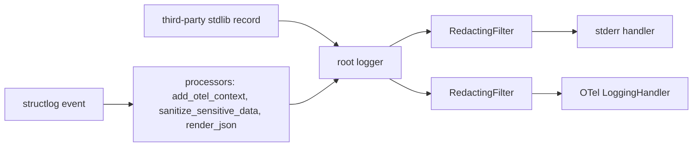

# Logging

Every process logs to stderr. Our own events go through structlog as one JSON object per line; third-party library records are plain message text. Secrets and emails are redacted before anything is written, for our own events and for third-party library records alike. With `OTEL_EXPORTER_OTLP_ENDPOINT` set, the same records also go to the OTel Collector and on to [Loki](loki.md).



## Setup

[`setup_logger`](https://github.com/HardMax71/Integr8sCode/blob/main/backend/app/core/logging.py) configures structlog and the root logger. The backend calls it in `create_app`, the DI container calls it for the logger it injects, and the worker calls it at the top of `main()`.

```python
--8<-- "backend/app/core/logging.py:setup_logger"
```

The processor chain:

```python
--8<-- "backend/app/core/logging.py:log_processors"
```

`add_otel_context` adds `trace_id` and `span_id` when there's a recording span. `sanitize_sensitive_data` replaces the value of any sensitive-looking key whole and redacts every other top-level string value. Strings nested inside a dict or list pass through unredacted, so our own secrets are typed `SecretStr` (see [Redaction](#redaction)). `render_json` renders the event and marks the result as already redacted, so the filter further down passes it through untouched.

A line looks like this:

```json
{"username": "alice", "email": "ali***@example.com", "event": "User logged in", "logger": "integr8scode", "level": "info", "timestamp": "2026-10-10T21:53:14.065299Z"}
```

There is no request context processor. Method, path and client address are never added to log lines.

## Redaction

The same rules apply in two places. `sanitize_sensitive_data` runs them on structlog events, field by field. `RedactingFilter` sits on the stderr handler and on the OTel handler and runs them on every other stdlib record: it renders the message, traceback and stack info to text, redacts that, and replaces the record's message, so no handler after it sees the raw text.

| Matches                                                   | Becomes                                   |
|-----------------------------------------------------------|-------------------------------------------|
| `key`, `token`, `secret`, `password`, `pwd` and friends followed by `:` or `=` | `***API_KEY_OR_TOKEN_REDACTED***` |
| `Bearer <token>`                                          | `Bearer ***BEARER_TOKEN_REDACTED***`      |
| JWTs (`eyJ...`)                                           | `***JWT_REDACTED***`                      |
| `mongodb://user:pass@`                                    | `mongodb://user:***MONGODB_REDACTED***@`  |
| `http(s)://user:pass@`                                    | `http(s)://user:***URL_CREDS_REDACTED***@` |
| email addresses                                           | first 3 characters of the local part, then `***@domain` |

For structlog events, field names count too. A key named `password`, `passwd`, `pwd`, `secret`, `token`, `api_key`, `credential(s)`, `authorization` or `cookie`, or ending in `_` plus one of those such as `csrf_token`, has its whole value replaced with `***REDACTED***`. So `logger.info("x", password="hunter2")` writes `"password": "***REDACTED***"`. Stdlib records have no fields, so only the patterns apply to them.

Our own secrets don't depend on these rules. The Settings secrets (`SECRET_KEY`, `MONGO_PASSWORD`, `MONGODB_URL`, `REDIS_PASSWORD`), the passwords in request bodies, `UserDocument.hashed_password` and the two session tokens in `LoginResult` are Pydantic `SecretStr`. Their `str()` and `repr()` are `**********`, so a log call prints the mask however deep it nests them: in a dict, in a list, inside a model. Code that needs the value calls `.get_secret_value()`. A plain string in a nested dict still prints as is, so a new secret gets the `SecretStr` type rather than a new rule here.

## Third-party loggers

Libraries that are chatty below WARNING, or that dump whole payloads (Mongo command documents, Kubernetes API responses, SSE chunks), are pinned in `_QUIET_LOGGERS`: aiohttp, aiokafka, apscheduler, asyncio, grpc, httpcore2, httpx2, kubernetes_asyncio, pymongo, python_multipart, redis, sse_starlette and urllib3. Each one is set to WARNING or the root level, whichever is higher. Their warnings and errors still go through `RedactingFilter`.

## Log level

`LOG_LEVEL` is `INFO` in config.toml and `WARNING` in config.test.toml. It used to be `DEBUG`, which logged every Mongo command without redaction. With the quiet list in place, `DEBUG` now only affects our own loggers and libraries outside that list.

## Structured arguments

Messages are static strings. Everything variable goes in keyword arguments, which become top-level JSON fields:

```python
self.logger.info("Execution created", execution_id=exec_id, user_id=user_id)
```

That keeps fields queryable, and it stops log injection. If user input goes into the message itself, a value like `abc\n[CRITICAL] System compromised` forges a second log line. As a keyword argument the JSON renderer escapes it into a harmless string. Treat path and query parameters, request bodies, Kafka payloads, anything read back from user data, and exception messages as user-controlled.

## OTLP export

`setup_log_exporter` adds an OTel `LoggingHandler` to the root logger, with a `BatchLogRecordProcessor` and a gRPC `OTLPLogExporter` pointed at `OTEL_EXPORTER_OTLP_ENDPOINT`. It's a no-op when that setting is empty. The backend calls it in `create_app` and the worker right after `setup_logger`. See [Loki](loki.md) for the rest of the path.

## Frontend

The browser logs through [LogTape](https://logtape.org), configured once in `init` in `frontend/src/hooks.client.ts`, under the `integr8scode` category plus an area (`api`, `auth`, `editor`, `notifications`, `replay`, `app`). Values travel as properties named by `{placeholders}` in the message, the same rule as the backend's keyword arguments, and ESLint's `no-console` keeps every other way of logging out of `src/`.

Nothing goes to the browser console. Every build sends every record to the collector the way the backend sends its logs: LogTape's OpenTelemetry sink ([@logtape/otel](https://github.com/dahlia/logtape/tree/main/packages/otel)) hands them to an OTel `LoggerProvider` with a `BatchLogRecordProcessor` and an `OTLPLogExporter`, which posts OTLP JSON to `/otlp/v1/logs`. nginx passes that to the collector ([Nginx](nginx-configuration.md#browser-logs)), and Loki labels the lines `service_name="browser"`. What gets dropped is the collector's call, not the browser's: `filter/browser` drops lines below `warning` when `ENVIRONMENT` is `production` and keeps everything in any other environment ([Loki](loki.md#collector)). Without the observability profile nginx answers 502 and the records are lost. Besides the errors the app logs itself, `handleError` logs what breaks while a page loads or renders, and two window listeners log an uncaught error and an unhandled promise rejection. An `error` event without an error object, like Chromium's "ResizeObserver loop completed with undelivered notifications", is skipped.

Three things in that setup are there for the browser. The sink's default setup loads its exporter with an `import()` a browser can't resolve, so `init` builds the `LoggerProvider` itself, as [LogTape #166](https://github.com/dahlia/logtape/issues/166) suggests. Its default object renderer falls back to `JSON.stringify` in a browser, and an Error comes out as `{}`, so the sink uses `objectRenderer: 'json'`, which writes the error's name, message and stack into the line. And @logtape/otel 2.4 asks for the OTel 0.208 packages, whose `@opentelemetry/core` carries [GHSA-8988-4f7v-96qf](https://github.com/advisories/GHSA-8988-4f7v-96qf), so the `overrides` in package.json move its SDK and exporters to the 0.223 line. `@opentelemetry/api-logs` stays at 0.208 for it, since it imports `NOOP_LOGGER` and later versions dropped that export.
