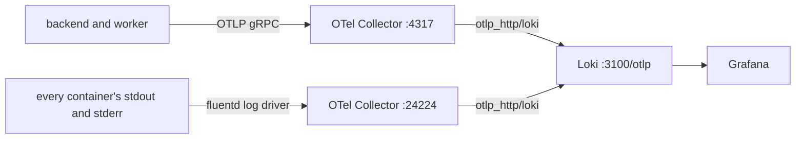

# Log aggregation (Loki)

Loki stores the logs of the backend and the worker, and the output of every container, so you can query them in Grafana across processes and time. It runs only with the `observability` compose profile. Without it, `docker compose logs` still shows each container's output from Docker's local cache.



## Export from Python

`setup_log_exporter` in [`app/core/logging.py`](https://github.com/HardMax71/Integr8sCode/blob/main/backend/app/core/logging.py) builds an OTel `LoggerProvider` with a `BatchLogRecordProcessor` and a gRPC `OTLPLogExporter`, then adds a `LoggingHandler` to the root logger. The handler carries the same `RedactingFilter` as the stderr handler, so only redacted text leaves the process. The backend calls it in `create_app`, and the worker calls it right after `setup_logger` in its `main()`.

The only switch is `OTEL_EXPORTER_OTLP_ENDPOINT`: empty means no export. config.toml sets it to `http://otel-collector:4317`; config.test.toml leaves it unset.

The OTel resource on every record has `service.name` from `SERVICE_NAME` (`integr8scode-backend` for the API, `integr8scode-worker` for the worker), `service.version`, `service.namespace=integr8scode`, `deployment.environment` and `service.instance.id` from `HOSTNAME`.

## Collector

The logs pipeline receives OTLP and container output (`fluent_forward`), runs `memory_limiter`, `filter/app_json_stdout`, `groupbyattrs/container`, `transform/container`, `batch` and `resource`, and exports with `otlp_http/loki` to `http://loki:3100/otlp`. The full config is [`backend/otel-collector-config.yaml`](https://github.com/HardMax71/Integr8sCode/blob/main/backend/otel-collector-config.yaml).

## Container output

Every compose service logs through Docker's `fluentd` log driver (the `x-logging` block in docker-compose.yaml) to the collector's `fluent_forward` receiver on `localhost:24224`, tagged with the container name. That covers what never reaches the Python logger: Mongo, Kafka, Redis, nginx, gunicorn's own lines and a traceback from a crash before logging starts. `groupbyattrs/container` and `transform/container` give each container its own resource with `service.name` set to the container name, so its lines carry `service_name="mongo"`, `service_name="backend"` and so on, next to `integr8scode-backend` and `integr8scode-worker` for the structured logs. `filter/app_json_stdout` drops the backend's and worker's JSON lines from stdout, since the same records arrive over OTLP with their trace ids.

With `fluentd-async` a container starts and buffers its lines while the collector is down or not in the profile, and `docker logs` reads Docker's local copy (3 files of 10 MB per container). The collector's own container keeps Docker's `local` driver, since its debug exporter would otherwise print its own lines back to itself.

Loki 3 accepts OTLP natively. Resource attributes such as `service.name` and `service.namespace` become stream labels (`service_name`, `service_namespace`). The record's `trace_id` and `span_id` become structured metadata. For our own events the log line is the JSON that structlog rendered. Third-party library records arrive as plain text, so `| json` can't pull fields out of them.

## Loki

Single instance with filesystem storage, TSDB index and schema v13. Structured metadata is on, and retention is 30 days, the same as Victoria Metrics.

```yaml
--8<-- "backend/loki/loki-config.yaml"
```

The container has a 256m memory limit, keeps data in the `loki_data` volume and listens on `127.0.0.1:3100`. Its image is distroless, so there's no healthcheck; Grafana and the collector start once the container has started.

## Known problems

One thing doesn't work as intended today ([#294](https://github.com/HardMax71/Integr8sCode/issues/294)). The Loki datasource has a derived field that should link `trace_id` to Jaeger, but its regex is `"trace_id":"(\w+)"` and structlog writes `"trace_id": "..."` with a space after the colon. The link never appears.

## Queries

Open Grafana Explore at `http://localhost:3000/explore` and pick the Loki datasource.

```logql
# everything, from all processes
{service_namespace="integr8scode"}

# the worker only
{service_name="integr8scode-worker"}

# errors
{service_namespace="integr8scode"} | json | level="error"

# one execution
{service_namespace="integr8scode"} | json | execution_id="abc123"

# one trace, through structured metadata
{service_namespace="integr8scode"} | trace_id="0af7651916cd43dd8448eb211c80319c"
```

Until the derived field is fixed, copy the `trace_id` into the Jaeger datasource by hand.
