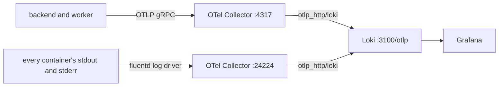

# Log aggregation (Loki)

Loki stores the logs of the backend and the worker, and the output of every container, so you can query them in Grafana across processes and time. It runs only with the `observability` compose profile. Without it, `docker compose logs` still shows each container's output from Docker's local cache.



## Export from Python

`setup_log_exporter` in [`app/core/logging.py`](https://github.com/HardMax71/Integr8sCode/blob/main/backend/app/core/logging.py) builds an OTel `LoggerProvider` with a `BatchLogRecordProcessor` and a gRPC `OTLPLogExporter`, then adds a `LoggingHandler` to the root logger. The handler carries the same `RedactingFilter` as the stderr handler, so only redacted text leaves the process. The backend calls it in `create_app`, and the worker calls it right after `setup_logger` in its `main()`.

The only switch is `OTEL_EXPORTER_OTLP_ENDPOINT`: empty means no export. config.toml sets it to `http://otel-collector:4317`; config.test.toml leaves it unset.

The OTel resource on every record has `service.name` from `SERVICE_NAME` (`integr8scode-backend` for the API, `integr8scode-worker` for the worker), `service.version`, `service.namespace=integr8scode`, `deployment.environment` and `service.instance.id` from `HOSTNAME`.

## Collector

The logs pipeline receives OTLP and container output (`fluent_forward`), runs `memory_limiter`, `filter/app_json_stdout`, `filter/mongo_info`, `groupbyattrs/container`, `transform/container`, `transform/level`, `batch` and `resource`, and exports with `otlp_http/loki` to `http://loki:3100/otlp`. It also hands every line to `forward/search`, the pipeline that indexes the same lines in [OpenSearch](opensearch.md). The full config is [`backend/otel-collector-config.yaml`](https://github.com/HardMax71/Integr8sCode/blob/main/backend/otel-collector-config.yaml).

The browser's records come in on a pipeline of their own, `logs/browser`. Its receiver, `otlp/browser`, takes OTLP over HTTP on port 4319 with bodies up to 64 KB, and only nginx's `/otlp/v1/logs` reaches it ([Frontend logging](logging.md#frontend)). The browser sends every level, and `filter/browser` is where lines get dropped: below `warning` when the collector's `ENVIRONMENT` is `production`, none anywhere else. Anyone can post to that path, so `transform/browser` drops whatever resource a record arrives with and sets `service.name` to `browser`: a posted record can't pass as the backend or any other service. The Errors dashboard and the error-lines alert group by `service_name`, so `browser` shows up there like any container.

## Container output

Every compose service logs through Docker's `fluentd` log driver (the `x-logging` block in docker-compose.yaml) to the collector's `fluent_forward` receiver on `localhost:24224`, tagged with the container name. That covers what never reaches the Python logger: Mongo, Kafka, Redis, nginx, gunicorn's own lines and a traceback from a crash before logging starts. `groupbyattrs/container` and `transform/container` give each container its own resource with `service.name` set to the container name, so its lines carry `service_name="mongo"`, `service_name="backend"` and so on, next to `integr8scode-backend` and `integr8scode-worker` for the structured logs. `filter/app_json_stdout` drops the backend's and worker's JSON lines from stdout, since the same records arrive over OTLP with their trace ids. `filter/mongo_info` drops Mongo's info lines (`"s":"I"`) and keeps its warnings and errors: Mongo logs every connection, its metadata and each login, and in prod those were 1.24 million of 1.87 million lines over ten days, 85% of the bytes a search had to read.

Docker's lines arrive without a level, and Loki's own guess marks Mongo's and Redis's info lines as errors, so `transform/level` gives each one from its format before Loki sees it: a JSON or logfmt `level`, Mongo's `"s"`, a zap tab-separated level, nginx's `[error]`, then a level word such as log4j's or gunicorn's `ERROR`, a traceback's first line and Redis's marker after the time, and only then a plain `error` or `warn` word. Records that already have a level, like the backend's and worker's over OTLP, keep theirs. The [Errors dashboard](grafana-integration.md#dashboards) and the error-lines alert read the result through `detected_level`.

With `fluentd-async` a container starts and buffers its lines while the collector is down or not in the profile, and `docker logs` reads Docker's local copy (3 files of 10 MB per container). The collector's own container keeps Docker's `local` driver, since its debug exporter would otherwise print its own lines back to itself.

Loki 3 accepts OTLP natively. Resource attributes such as `service.name` and `service.namespace` become stream labels (`service_name`, `service_namespace`). The record's `trace_id` and `span_id` become structured metadata. For our own events the log line is the JSON that structlog rendered. Third-party library records arrive as plain text, so `| json` can't pull fields out of them.

## Loki

Single instance with filesystem storage, TSDB index and schema v13. Structured metadata is on, and retention is 30 days, the same as Victoria Metrics.

```yaml
--8<-- "backend/loki/loki-config.yaml"
```

The container has a 512m memory limit (a 30-day search took it to 207 MiB), keeps data in the `loki_data` volume and listens on `127.0.0.1:3100`. Its image is distroless, so there's no healthcheck; Grafana and the collector start once the container has started.

## Queries

Open Grafana Explore at `http://localhost:3000/explore` and pick the Loki datasource.

```logql
# everything, from all processes
{service_namespace="integr8scode"}

# the worker only
{service_name="integr8scode-worker"}

# errors
{service_namespace="integr8scode"} | json | level="error"

# one execution
{service_namespace="integr8scode"} | json | execution_id="abc123"

# one trace, through structured metadata
{service_namespace="integr8scode"} | trace_id="0af7651916cd43dd8448eb211c80319c"
```

Expand a line logged inside a span and its Links section has a `TraceID` button that opens the trace in Jaeger. The datasource's derived field reads the `trace_id` structured metadata, not the JSON line, so third-party records logged inside a span get the link too.
