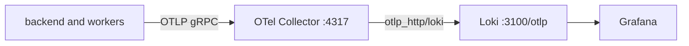

# Log aggregation (Loki)

Loki stores the logs of the backend and all six workers so you can query them in Grafana across processes and time. It runs only with the `observability` compose profile. Without it, logs stay on container stderr for `docker compose logs`.



## Export from Python

`setup_log_exporter` in [`app/core/logging.py`](https://github.com/HardMax71/Integr8sCode/blob/main/backend/app/core/logging.py) builds an OTel `LoggerProvider` with a `BatchLogRecordProcessor` and a gRPC `OTLPLogExporter`, then adds a `LoggingHandler` to the root logger. The handler carries the same `RedactingFilter` as the stderr handler, so only redacted text leaves the process. The backend calls it in `create_app`, and each worker calls it right after `setup_logger` in its `main()`.

The only switch is `OTEL_EXPORTER_OTLP_ENDPOINT`: empty means no export. config.toml sets it to `http://otel-collector:4317`; config.test.toml leaves it unset.

The OTel resource on every record has `service.name` from `SERVICE_NAME`, `service.version`, `service.namespace=integr8scode`, `deployment.environment` and `service.instance.id` from `HOSTNAME`.

## Collector

The logs pipeline receives OTLP, runs `memory_limiter`, `batch` and `resource`, and exports with `otlp_http/loki` to `http://loki:3100/otlp`. The full config is [`backend/otel-collector-config.yaml`](https://github.com/HardMax71/Integr8sCode/blob/main/backend/otel-collector-config.yaml).

Loki 3 accepts OTLP natively. Resource attributes such as `service.name` and `service.namespace` become stream labels (`service_name`, `service_namespace`). The record's `trace_id` and `span_id` become structured metadata. For our own events the log line is the JSON that structlog rendered. Third-party library records arrive as plain text, so `| json` can't pull fields out of them.

## Loki

Single instance with filesystem storage, TSDB index and schema v13. Structured metadata is on, and retention is 30 days, the same as Victoria Metrics.

```yaml
--8<-- "backend/loki/loki-config.yaml"
```

The container has a 256m memory limit, keeps data in the `loki_data` volume and listens on `127.0.0.1:3100`. Its image is distroless, so there's no healthcheck; Grafana and the collector start once the container has started.

## Known problems

Two things don't work as intended today ([#294](https://github.com/HardMax71/Integr8sCode/issues/294)).

Every process logs as `service_name="integr8scode-backend"`. The per-worker `config.<worker>.toml` files only override `TRACING_SERVICE_NAME`, not `SERVICE_NAME`, and the collector's `resource` processor copies from a `service_name` attribute that doesn't exist. So the API and all six workers share one `service_name` label (Loki tells their streams apart by `service_instance_id`), and a selector such as `{service_name="integr8scode-saga-orchestrator"}` returns nothing.

The Loki datasource has a derived field that should link `trace_id` to Jaeger, but its regex is `"trace_id":"(\w+)"` and structlog writes `"trace_id": "..."` with a space after the colon. The link never appears.

## Queries

Open Grafana Explore at `http://localhost:3000/explore` and pick the Loki datasource.

```logql
# everything, from all processes
{service_namespace="integr8scode"}

# errors
{service_namespace="integr8scode"} | json | level="error"

# one execution
{service_namespace="integr8scode"} | json | execution_id="abc123"

# one trace, through structured metadata
{service_namespace="integr8scode"} | trace_id="0af7651916cd43dd8448eb211c80319c"
```

Until the derived field is fixed, copy the `trace_id` into the Jaeger datasource by hand.
