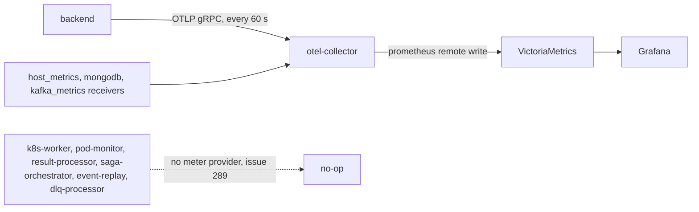

# Metrics Reference

Only the backend (API) process exports metrics today. It pushes them over OTLP to the OpenTelemetry Collector every 60 seconds, and the collector writes them to VictoriaMetrics. The six workers record into the same metric classes but never install a meter provider, so their numbers never leave the process ([#289](https://github.com/HardMax71/Integr8sCode/issues/289)). Every table below says which process records a metric, so you can tell which panels stay empty until that lands.

## Export path



`create_app` calls `setup_metrics` (`app/core/middlewares/metrics.py`) once. It installs a global `MeterProvider` whose `PeriodicExportingMetricReader` exports every 60 000 ms through an OTLP gRPC exporter. The exporter targets `OTEL_EXPORTER_OTLP_ENDPOINT`, which `config.toml` sets to `http://otel-collector:4317`. Without an endpoint it returns early and the no-op provider stays. Each metrics class takes its meter from the global provider when DI builds it, which is why a worker that skips `setup_metrics` records into nothing:

```python
--8<-- "backend/app/core/metrics/base.py:init"
```

The collector's metrics pipeline (`backend/otel-collector-config.yaml`) reads the `otlp`, `host_metrics`, `kafka_metrics` and `mongodb` receivers, runs `memory_limiter`, `batch` and `resource`, and exports with `prometheus_remote_write` to `http://victoria-metrics:8428/api/v1/write`. VictoriaMetrics keeps 30 days. The collector, VictoriaMetrics and Grafana sit in the `observability` compose profile, so none of this runs unless you start the stack with `./deploy.sh dev --observability`.

## Names and labels in VictoriaMetrics

Code names instruments with dots, and they arrive with underscores. The collector's Prometheus translator also changes three things:

- It appends the unit: `s` becomes `_seconds`, `%` becomes `_percent`, `event/s` becomes `_event_per_second`, and `MiB` and `x` go on unchanged. Unit `1` and `{key}` add nothing. A unit that is already a word of the name isn't repeated, so `http_requests_active` keeps its name.
- Counters end in exactly one `_total`, so `sse.messages.sent.total` becomes `sse_messages_sent_total`.
- Histograms split into `_bucket`, `_sum` and `_count`. The tables list the name before those suffixes.

The contract test `backend/tests/contract/test_grafana_metrics.py` applies the same rule. It fails when a dashboard or alert queries a name nothing emits, and when code defines a metric that no dashboard uses.

Resource attributes become labels on every series: `job` (`integr8scode/integr8scode-backend`), `service_name`, `service_namespace`, `service_version`, `deployment_environment`, the `telemetry_sdk_*` set, and `instance` with `service_instance_id`, a fresh UUID each time the process starts. `otel_scope_name` names the metrics class, such as `KubernetesMetrics`. Since `instance` changes on every restart, wrap queries in `sum` or `max` instead of reading single series.

Gauges listed as "in process" are up-down counters the process keeps itself. They start at zero when the process starts, whatever the real state is.

## Application metrics

### HTTP and host (backend)

`MetricsMiddleware` and `create_system_metrics` in `app/core/middlewares/metrics.py`. `path` is the request path with UUIDs, numeric IDs and ObjectIds replaced by `{id}`.

| Metric | Type | Labels | Notes |
|--------|------|--------|-------|
| `http_requests_total` | counter | method, path, status | |
| `http_request_duration_seconds` | histogram | method, path, status | |
| `http_request_size_bytes` | histogram | method, path | requests that send Content-Length |
| `http_response_size_bytes` | histogram | method, path, status | responses that send Content-Length |
| `http_requests_active` | gauge, in process | method, path | |
| `system_memory_bytes` | gauge | type: used, available, percent | psutil, host memory as the container sees it |
| `system_cpu_percent` | gauge | none | psutil |
| `process_metrics_mixed` | gauge | type: rss, vms, cpu, threads | the API process itself |

### Executions and queue

| Metric | Type | Labels | Recorded in |
|--------|------|--------|-------------|
| `script_executions_total` | counter | status, lang_and_version | `ExecutionService.execute_script` in backend (queued, error); `ResultProcessor` in result-processor (completed, failed, timeout) |
| `script_submission_duration_seconds` | histogram | lang_and_version | `ExecutionService.execute_script` in backend: persisting the execution and publishing the request |
| `script_errors_total` | counter | error_type | `ExecutionService` in backend when the publish fails; `ResultProcessor` in result-processor |
| `script_execution_duration_seconds` | histogram | lang_and_version | `ResultProcessor` in result-processor: wall time from the pod's resource usage, or the timeout for timed out runs |
| `script_memory_usage_MiB` | histogram | lang_and_version | `ResultProcessor` in result-processor: peak memory |
| `script_memory_utilization_percent` | histogram | lang_and_version | `ResultProcessor` in result-processor: peak memory over `K8S_POD_MEMORY_LIMIT` |
| `queue_depth` | gauge, in process | none | `ExecutionQueueService` in saga-orchestrator: enqueued minus scheduled |
| `queue_active` | gauge, in process | none | `ExecutionQueueService` in saga-orchestrator: scheduled minus released |
| `queue_enqueue_total` | counter | none | `ExecutionQueueService.enqueue` in saga-orchestrator |
| `queue_schedule_total` | counter | none | `ExecutionQueueService.try_schedule` in saga-orchestrator |
| `queue_wait_time_seconds` | histogram | priority | `ExecutionQueueService.try_schedule` in saga-orchestrator: enqueue to schedule |
| `queue_event_data_lost_total` | counter | none | `ExecutionQueueService.try_schedule` in saga-orchestrator, when the queued event expired in Redis |

The queue itself lives in Redis, so after a saga-orchestrator restart `queue_depth` and `queue_active` read zero while work is still queued.

### Events and idempotency

| Metric | Type | Labels | Recorded in |
|--------|------|--------|-------------|
| `events_published_total` | counter | event_type, event_category | `KafkaEventService.publish_event`: pod lifecycle events in pod-monitor, notification and user settings events in backend |
| `event_processing_duration_seconds` | histogram | event_type | the same call: persisting the event and publishing it |
| `event_processing_errors_total` | counter | topic, event_type, consumer_group, error_type | `_track_consumed` in `app/events/handlers.py`, in every consumer: backend (notifications), k8s-worker, result-processor, saga-orchestrator |
| `idempotency_cache_hits_total` | counter | event_type, operation | `IdempotencyManager.check_and_reserve` |
| `idempotency_cache_misses_total` | counter | event_type, operation | `IdempotencyManager.check_and_reserve` |
| `idempotency_duplicates_blocked_total` | counter | event_type | `IdempotencyManager`, when the key is already completed or still processing |
| `idempotency_check_duration_seconds` | histogram | operation | `IdempotencyManager.check_and_reserve` |
| `idempotency_processing_duration_seconds` | histogram | event_type, status | `IdempotencyManager`: reserving the key to marking it completed or failed |
| `idempotency_keys_active` | gauge, observed at export | none | `IdempotencyMetrics` scans `idempotency:*` in Redis |

Other publishers call the producer directly, so `events_published_total` is a subset. Every Kafka publish shows up in `messaging_publish_messages_message_total`. `event_category` equals `event_type` for the current event names, and `topic` on the error counter holds the event type. `IdempotencyManager` runs in backend for `Idempotency-Key` requests and in the k8s-worker, result-processor and saga-orchestrator consumers.

### Server-sent events (backend)

`SSERedisBus.listen_execution`, `listen_notifications` and `listen_replay`.

| Metric | Type | Labels | Notes |
|--------|------|--------|-------|
| `sse_connections_active` | gauge, in process | endpoint: executions, notifications, replay | |
| `sse_connection_duration_seconds` | histogram | endpoint | recorded when the stream closes |
| `sse_messages_sent_total` | counter | endpoint, event_type | each message relayed from Redis; `event_type` is the execution event type, `notification` or `replay_status` |

The status snapshot a stream sends first comes from the database, not Redis, and isn't counted.

### Kubernetes pods

| Metric | Type | Labels | Recorded in |
|--------|------|--------|-------------|
| `pod_creations_total` | counter | status: success, failed; language | `KubernetesWorker` in k8s-worker |
| `pod_creation_duration_seconds` | histogram | language | `KubernetesWorker` in k8s-worker: ConfigMap, pod and `PodCreated` publish, successful creations only |
| `pod_creations_active` | gauge, in process | none | `KubernetesWorker` in k8s-worker |
| `configmaps_created_total` | counter | status: success, already_exists, failed | `KubernetesWorker` in k8s-worker |
| `pods_by_phase` | gauge | phase | `PodMonitor` in pod-monitor: executor pods seen through LIST and watch; a relist rebuilds it |
| `pod_lifetime_seconds` | histogram | final_phase, language | `PodMonitor` in pod-monitor: pod creation to the terminal event, recorded when the monitor deletes the pod |
| `pod_monitor_events_total` | counter | event_type, pod_phase | `PodMonitor` in pod-monitor: each application event it publishes |
| `pod_monitor_processing_duration_seconds` | histogram | event_type: ADDED, MODIFIED, DELETED | `PodMonitor` in pod-monitor: mapping and publishing one watch event |
| `pod_monitor_reconciliations_total` | counter | none | `PodMonitor` in pod-monitor: each full LIST, on start and after 410 Gone |
| `pod_monitor_watch_errors_total` | counter | error_type: resource_version_expired, api_error, unexpected, processing_error | `PodMonitor` and `workers/run_pod_monitor.py` in pod-monitor |
| `pod_monitor_watch_reconnects_total` | counter | none | `workers/run_pod_monitor.py` in pod-monitor, after a failed watch cycle |

### Notifications (backend)

`NotificationService`. Direct and scheduled delivery both run in backend. `category` is the notification's first tag, such as `execution` or `system`, or `unknown` without tags.

| Metric | Type | Labels | Notes |
|--------|------|--------|-------|
| `notifications_sent_total` | counter | category | delivered |
| `notifications_by_channel_total` | counter | channel, category | delivered, by channel |
| `notifications_by_severity_total` | counter | severity, category | delivered, by severity |
| `notification_delivery_time_seconds` | histogram | category | delivery attempts including backoff waits |
| `notification_channel_delivery_time_seconds` | histogram | channel, category | the same value split by channel |
| `notifications_failed_total` | counter | category, error | `error` is the exception type of the last attempt |
| `notification_channel_failures_total` | counter | channel, error | |
| `notification_retries_total` | counter | category, channel | each failed attempt that backoff retries |
| `notifications_throttled_total` | counter | category: general, system | per-user throttle; `system` for system broadcasts |
| `notification_subscription_changes_total` | counter | channel, action: enabled, disabled, updated | |

### Event replay (backend)

`EventReplayService`. The replay routes drive it inside backend. The event-replay worker only runs session cleanup against its own session map, which stays empty.

| Metric | Type | Labels | Notes |
|--------|------|--------|-------|
| `replay_sessions_created_total` | counter | replay_type, target | |
| `replay_sessions_active` | gauge, in process | none | running or paused sessions |
| `replay_sessions_by_status` | gauge, in process | status | sessions held in memory |
| `replay_status_changes_total` | counter | from_status, to_status | |
| `replay_events_processed_total` | counter | replay_type, event_type | |
| `replay_events_failed_total` | counter | replay_type, event_type | |
| `replay_event_processing_time_seconds` | histogram | event_type | dispatching one event |
| `replay_duration_seconds` | histogram | replay_type | completed sessions only |
| `replay_throughput_event_per_second` | histogram | replay_type | events over duration, completed sessions only |
| `replay_batch_size` | histogram | replay_type | |
| `replay_by_target_total` | counter | target, success | |
| `replay_target_errors_total` | counter | target | |
| `replay_speed_multiplier_x` | histogram | replay_type | one sample per session start |
| `replay_delay_applied_seconds` | histogram | none | one sample per delayed event |
| `replay_queue_size` | gauge, in process | session_id | events left in the loaded batch |

### Authentication and authorization (backend)

| Metric | Type | Labels | Recorded in |
|--------|------|--------|-------------|
| `authentication_attempts_total` | counter | method, success | `AuthService.login` through `track_authentication`; method is `login` |
| `authentication_failures_total` | counter | method | the same |
| `authentication_duration_seconds` | histogram | method | the same |
| `accounts_locked_total` | counter | reason: brute_force | `AuthService`, when a failed login triggers the lockout |
| `brute_force_attempts_total` | counter | none | `AuthService.login`, a login against an account that is already locked |
| `weak_password_attempts_total` | counter | weakness_type: too_short | `AuthService.register` |
| `token_validation_failures_total` | counter | reason: expired, invalid_signature, invalid, missing_subject | `SecurityService.decode_token` |
| `csrf_validation_failures_total` | counter | reason: missing_header, token_mismatch, invalid_signature | `SecurityService.validate_csrf_from_request` |
| `authorization_checks_total` | counter | resource, action, allowed, user_role | `AuthService.get_admin`, on every admin route |
| `authorization_denials_total` | counter | resource, action, user_role | the same |
| `password_reset_requests_total` | counter | method: admin | `AdminUserService` |

### Rate limiting (backend)

`RateLimitService.check_rate_limit`, called from `RateLimitMiddleware`. `endpoint` is the path with UUIDs and numeric IDs replaced by `*`.

| Metric | Type | Labels | Notes |
|--------|------|--------|-------|
| `rate_limit_requests_total` | counter | endpoint, authenticated, algorithm | the matched rule's algorithm, or `bypassed` and `no_limit` |
| `rate_limit_allowed_total` | counter | endpoint, group | |
| `rate_limit_rejected_total` | counter | endpoint, group | |
| `rate_limit_bypass_total` | counter | endpoint | users with `bypass_rate_limit` |

### Dead letter queue (dlq-processor)

`DLQManager`, driven by APScheduler every 10 seconds.

| Metric | Type | Labels | Notes |
|--------|------|--------|-------|
| `dlq_queue_size` | gauge | original_topic | message count per topic, read from MongoDB each cycle |
| `dlq_messages_retried_total` | counter | original_topic, event_type, result | |
| `dlq_messages_discarded_total` | counter | original_topic, event_type, reason | |
| `dlq_processing_duration_seconds` | histogram | operation: handle, retry, discard | |
| `dlq_messages_received_total` | counter | original_topic, event_type | `handle_message` |
| `dlq_message_age_seconds` | histogram | none | `handle_message` |
| `dlq_processing_errors_total` | counter | original_topic, event_type, error_type | `retry_messages_batch` |

Nothing calls `handle_message` or `retry_messages_batch` today, so the last three and the `handle` operation stay empty even once workers export.

## FastStream messaging families

`BrokerProvider` puts FastStream's `KafkaTelemetryMiddleware` on every broker, so every process records these. Only backend's leave the process today.

| Metric | Type | Labels |
|--------|------|--------|
| `messaging_publish_messages_message_total` | counter | messaging_system, messaging_destination_name |
| `messaging_publish_duration_seconds` | histogram | messaging_system, messaging_destination_name, error_type on failure |
| `messaging_process_messages_message_total` | counter | messaging_system, messaging_destination_publish_name |
| `messaging_process_duration_seconds` | histogram | messaging_system, messaging_destination_publish_name, error_type on failure |

`messaging_system` is `kafka`. Both topic labels hold the topic name: the publish side calls it `messaging_destination_name`, the consume side `messaging_destination_publish_name`.

## Collector families the dashboards use

Collector receivers write these, not Python, so the contract test accepts them by prefix (`COLLECTOR_PREFIXES`).

`system_memory_utilization_ratio{state}` comes from the `host_metrics` memory scraper with `system.memory.utilization` turned on. The overview's "Memory Saturation" gauge and both host memory alert rules read it. Don't confuse it with the API's own psutil gauges above, which the HTTP dashboard's "CPU" and "Host Memory Used" panels read.

The `mongodb` receiver polls `mongo:27017` every 15 seconds as `MONGO_MONITOR_USER`. Several of these are optional receiver metrics that `otel-collector-config.yaml` turns on. The MongoDB dashboard reads:

| Area | Families |
|------|----------|
| Server | `mongodb_health_ratio`, `mongodb_uptime_milliseconds_total`, `mongodb_session_count`, `mongodb_cursor_count`, `mongodb_cursor_timeout_count`, `mongodb_database_count` |
| Load | `mongodb_active_reads`, `mongodb_active_writes`, `mongodb_operation_latency_time_microseconds`, `mongodb_{commands,queries,inserts,updates,deletes,getmores,flushes}_rate_per_second` |
| Storage, by `db_namespace` | `mongodb_data_size_bytes`, `mongodb_storage_size_bytes_total`, `mongodb_index_size_bytes`, `mongodb_object_count`, `mongodb_collection_count`, `mongodb_index_count`, `mongodb_index_access_count` |
| Memory and cache | `mongodb_memory_usage_bytes`, `mongodb_cache_operations_total` (type hit or miss), `mongodb_page_faults_total`, `mongodb_wtcache_bytes_read_total` |
| Network and locks | `mongodb_network_io_receive_bytes`, `mongodb_network_io_transmit_bytes`, `mongodb_network_request_count`, `mongodb_global_lock_time_milliseconds_total`, `mongodb_lock_acquire_count_total`, `mongodb_lock_acquire_wait_count_total` |

The `kafka_metrics` receiver and the rest of `host_metrics` land in VictoriaMetrics too, but no dashboard reads them yet.

## PromQL examples

These work against what backend exports today.

```promql
# p95 submission latency by runtime
histogram_quantile(0.95, sum by (le, lang_and_version) (rate(script_submission_duration_seconds_bucket[5m])))

# share of API requests answered with a 5xx
sum(rate(http_requests_total{status=~"5.."}[5m])) / sum(rate(http_requests_total[5m]))

# share of rate limit checks rejected
sum(rate(rate_limit_rejected_total[5m])) / sum(rate(rate_limit_requests_total[5m]))

# Kafka messages published per topic, per second
sum by (messaging_destination_name) (rate(messaging_publish_messages_message_total[5m]))

# rejected access tokens by reason
sum by (reason) (rate(token_validation_failures_total[5m]))

# MongoDB cache hit ratio
sum(rate(mongodb_cache_operations_total{type="hit"}[5m])) / sum(rate(mongodb_cache_operations_total[5m]))
```

Once workers export, `sum(pods_by_phase{phase="Pending"})` shows executor pods waiting for a node or a Kueue slot.
