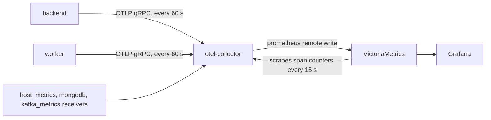

# Metrics Reference

The backend (API) and the worker both push their metrics over OTLP to the OpenTelemetry Collector every 60 seconds, and the collector writes them to VictoriaMetrics. Every resource attribute becomes a label, so a series carries `service_name` (`integr8scode-backend` or `integr8scode-worker`, from `SERVICE_NAME`), `job` (`integr8scode/<service_name>`) and a `service_instance_id` that the OTel SDK generates per process. Every table below says which process records a metric.

## Export path



`create_app` and the worker's `main()` each call `setup_metrics` (`app/core/metrics/base.py`) once. It installs a global `MeterProvider` whose `PeriodicExportingMetricReader` exports every 60 000 ms through an OTLP gRPC exporter. The exporter targets `OTEL_EXPORTER_OTLP_ENDPOINT`, which `config.toml` sets to `http://otel-collector:4317`. It also starts the system metrics instrumentation for the process's own CPU and memory. Without an endpoint it returns early and the no-op provider stays. Each metrics class takes its meter from the global provider when DI builds it, so `setup_metrics` has to run before the container resolves anything:

```python
--8<-- "backend/app/core/metrics/base.py:init"
```

The collector's metrics pipeline (`backend/otel-collector-config.yaml`) reads the `otlp`, `host_metrics`, `kafka_metrics` and `mongodb` receivers, runs `memory_limiter`, `batch` and `resource`, and exports with `prometheus_remote_write` to `http://victoria-metrics:8428/api/v1/write`. VictoriaMetrics keeps 30 days. The collector, VictoriaMetrics and Grafana sit in the `observability` compose profile, so none of this runs unless you start the stack with `./deploy.sh dev --observability`. Counters and histograms made from spans take another way, described next.

## Metrics made from spans

Some metrics have no instrument in the code. A service puts the facts on a span, and the collector's `signaltometrics` connector (alpha in collector v0.162.0) turns them into counters, histograms and gauges, defined under `connectors` in `backend/otel-collector-config.yaml`. The SDK sends every span (`TRACING_SAMPLING_RATE = 1.0`), and the traces pipeline gives each span to the connector before `tail_sampling` decides what Jaeger keeps, so the counts don't depend on sampling. The connector emits a point only when a matching span arrives. Sent straight to VictoriaMetrics, a counter that sees one event every half hour would get one point every half hour, and `increase` and `rate` stop finding the previous point once two points are more than about 8 to 10 minutes apart (measured on v1.153.0): `increase` then counts the whole total again, and `rate` returns nothing. So counters and histograms go another way. `deltatocumulative` adds up the connector's deltas and keeps each total through 24 hours without spans (its default is 5 minutes, after which an idle counter would start again from zero). The collector's `prometheus` exporter serves the totals on `otel-collector:8889`, and VictoriaMetrics scrapes it every 15 seconds (`backend/victoria-metrics/scrape.yaml`, with `honor_labels` so each service's `job` and `instance` stay). A series the exporter hasn't updated for 24 hours drops out until its next span. Gauges still go by remote write, so a gauge goes stale when the job that reports it on a timer stops. Panels wrap counter rates in `or vector(0)` so a series that hasn't started yet reads 0. The execution, pod, queue and dead letter queue metrics work this way so far ([#389](https://github.com/HardMax71/Integr8sCode/issues/389)).

## Names and labels in VictoriaMetrics

Code names instruments with dots, and they arrive with underscores. The collector's Prometheus translator also changes three things:

- It appends the unit: `s` becomes `_seconds`, `%` becomes `_percent`, `event/s` becomes `_event_per_second`, and `MiB` and `x` go on unchanged. Unit `1` and `{key}` add nothing. A unit that is already a word of the name isn't repeated.
- Counters end in exactly one `_total`, so `sse.messages.sent.total` becomes `sse_messages_sent_total`.
- Histograms split into `_bucket`, `_sum` and `_count`. The tables list the name before those suffixes.

The contract test `backend/tests/contract/test_grafana_metrics.py` applies the same rule. It fails when a dashboard or alert queries a name nothing emits, and when code defines a metric that no dashboard uses.

Resource attributes become labels on every series: `job` (`integr8scode/integr8scode-backend`), `service_name`, `service_namespace`, `service_version`, `deployment_environment`, the `telemetry_sdk_*` set, and `instance` with `service_instance_id`, a fresh UUID each time the process starts. `otel_scope_name` names the metrics class, such as `KubernetesMetrics`. Since `instance` changes on every restart, wrap queries in `sum` or `max` instead of reading single series.

Gauges listed as "in process" are up-down counters the process keeps itself. They start at zero when the process starts, whatever the real state is.

## Application metrics

### HTTP and process

The OpenTelemetry FastAPI instrumentation records HTTP in the backend, with the stable semantic convention names since the image sets `OTEL_SEMCONV_STABILITY_OPT_IN=http`. It skips health, metrics, docs and `openapi.json`. `http_route` is FastAPI's route template, such as `/api/v1/executions/{execution_id}`.

| Metric | Type | Labels | Notes |
|--------|------|--------|-------|
| `http_server_request_duration_seconds` | histogram | http_request_method, http_route, http_response_status_code, url_scheme, network_protocol_version | its `_count` is the request rate |
| `http_server_request_body_size_bytes` | histogram | as above | requests with a body |
| `http_server_response_body_size_bytes` | histogram | as above | |
| `http_server_active_requests` | gauge, in process | http_request_method, url_scheme | no route, so open SSE streams can't be told apart |

The system metrics instrumentation records each backend and worker process's own `process_memory_usage_bytes`, `process_memory_virtual_bytes`, `process_cpu_time_seconds_total` (type: user, system), `process_cpu_utilization`, `process_thread_count` and `process_open_file_descriptor_count`. `PROCESS_METRICS` in `app/core/metrics/base.py` picks them; the host's own figures come from the collector.

### Executions and queue

| Metric | Type | Labels | Recorded from |
|--------|------|--------|---------------|
| `script_executions_total` | counter | execution_status, execution_lang_and_version | span `execution.submit` from `ExecutionService.execute_script` in backend (queued, error), and span `execution.result` from `ResultProcessor` in worker (completed, failed, timeout) |
| `script_errors_total` | counter | execution_error_type | the same spans when they carry `execution.error_type`: the publish exception's class at submission, the event's error type or `timeout` at the result |
| `script_execution_duration_seconds` | histogram | execution_lang_and_version | `execution.runtime_seconds` on `execution.result`: wall time from the pod's resource usage, or the timeout for timed out runs |
| `script_memory_usage_MiB` | histogram | execution_lang_and_version | `execution.memory_mib` on `execution.result` for completed runs: peak memory |
| `script_memory_utilization_percent` | histogram | execution_lang_and_version | `execution.memory_percent` on the same spans: peak memory over the effective memory limit for the language (admin setting or TOML, raised to the language minimum) |
| `queue_depth` | gauge | none | span `queue.schedule_pending` from the worker's scheduler job, every 10 s: pending executions in Redis |
| `queue_active` | gauge | none | the same span: running slots in Redis |
| `queue_enqueue_total` | counter | none | span `queue.enqueue` from `ExecutionQueueService.enqueue` in worker |
| `queue_schedule_total` | counter | none | span `queue.schedule` with `queue.outcome` `scheduled` |
| `queue_wait_time_seconds` | histogram | queue_priority | `queue.wait_seconds` on those spans: enqueue to schedule |
| `queue_event_data_lost_total` | counter | none | span `queue.schedule` with `queue.outcome` `event_data_lost`: the queued event had expired in Redis |

All of these come from spans (see [Metrics made from spans](#metrics-made-from-spans)). Both queue gauges read Redis on each run of the job, so they stay right across worker restarts. The execution dashboard's submission latency reads `http_server_request_duration_seconds` for the execute and retry routes.

### Events and idempotency

| Metric | Type | Labels | Recorded in |
|--------|------|--------|-------------|
| `events_published_total` | counter | event_type, event_category | `UnifiedProducer.produce`, after the event is stored and published, in every process that publishes |
| `event_processing_duration_seconds` | histogram | event_type | the same call: persisting the event and publishing it |
| `idempotency_cache_hits_total` | counter | event_type, operation | `IdempotencyManager.check_and_reserve` |
| `idempotency_cache_misses_total` | counter | event_type, operation | `IdempotencyManager.check_and_reserve` |
| `idempotency_duplicates_blocked_total` | counter | event_type | `IdempotencyManager`, when the key is already completed or still processing |
| `idempotency_check_duration_seconds` | histogram | operation | `IdempotencyManager.check_and_reserve` |
| `idempotency_processing_duration_seconds` | histogram | event_type, status | `IdempotencyManager`: reserving the key to marking it completed or failed |
| `idempotency_keys_active` | gauge, observed at export | none | `IdempotencyMetrics` scans `idempotency:*` in Redis |

Every Kafka publish also shows up in `messaging_publish_messages_message_total`; a publish that fails is marked on the stored event and not counted here. `event_category` equals `event_type` for the current event names. A handler that raises has no counter of its own: it's a `messaging_process_duration_seconds` sample with an `error_type` label, in the FastStream families below. `IdempotencyManager` runs in backend for `Idempotency-Key` requests and in the worker's k8s worker, result processor and saga orchestrator consumers.

### Server-sent events (backend)

`SSERedisBus.listen_execution`, `listen_notifications` and `listen_replay`.

| Metric | Type | Labels | Notes |
|--------|------|--------|-------|
| `sse_connections_active` | gauge, in process | endpoint: executions, notifications, replay | |
| `sse_connection_duration_seconds` | histogram | endpoint | recorded when the stream closes |
| `sse_messages_sent_total` | counter | endpoint, event_type | each message relayed from Redis; `event_type` is the execution event type, `notification` or `replay_status` |

The status snapshot a stream sends first comes from the database, not Redis, and isn't counted.

### Kubernetes pods

| Metric | Type | Labels | Recorded from |
|--------|------|--------|---------------|
| `pod_creations_total` | counter | pod_creation_result: success, failed; pod_language | span `pod.create` from `KubernetesWorker` in worker |
| `pod_creation_duration_seconds` | histogram | pod_language | the length of `pod.create` for successful creations: ConfigMap, pod and `PodCreated` publish |
| `pod_creations_active` | gauge | none | `pod.active_creations` on `pod.create`, reported as each creation ends |
| `configmaps_created_total` | counter | pod_configmap_result: success, already_exists, failed | span `pod.create_configmap` |
| `pods_by_phase` | gauge | pod_phase | span `pod_monitor.pods`, one per phase with zeros included, at the end of each `PodMonitor.watch_cycle` in worker (at most 35 s apart): executor pods seen through LIST and watch; a relist rebuilds the counts |
| `pod_lifetime_seconds` | histogram | pod_phase, pod_language | `pod.lifetime_seconds` on `pod_monitor.event` for the event that finished the execution: pod creation to that event |
| `pod_monitor_events_total` | counter | pod_monitor_watch_event, pod_phase | `pod_monitor.published` on span `pod_monitor.event`: the application events one watch event produced |
| `pod_monitor_processing_duration_seconds` | histogram | pod_monitor_watch_event: ADDED, MODIFIED, DELETED | the length of `pod_monitor.event`: mapping and publishing one watch event |
| `pod_monitor_reconciliations_total` | counter | none | span `pod_monitor.list`: each full LIST, on start and after 410 Gone |
| `pod_monitor_watch_errors_total` | counter | pod_monitor_error_type: resource_version_expired, api_error, unexpected, processing_error | `pod_monitor.watch` and `pod_monitor.event` spans that carry `pod_monitor.error_type` |
| `pod_monitor_watch_reconnects_total` | counter | none | `pod_monitor.watch` spans that carry `pod_monitor.error_type` |

### Notifications (backend)

`NotificationService`. Direct and scheduled delivery both run in backend. `category` is the notification's first tag, such as `execution` or `system`, or `unknown` without tags.

| Metric | Type | Labels | Notes |
|--------|------|--------|-------|
| `notifications_sent_total` | counter | category | delivered |
| `notifications_by_channel_total` | counter | channel, category | delivered, by channel |
| `notifications_by_severity_total` | counter | severity, category | delivered, by severity |
| `notification_delivery_time_seconds` | histogram | category | delivery attempts including backoff waits |
| `notification_channel_delivery_time_seconds` | histogram | channel, category | the same value split by channel |
| `notifications_failed_total` | counter | category, error | `error` is the exception type of the last attempt |
| `notification_channel_failures_total` | counter | channel, error | |
| `notification_retries_total` | counter | category, channel | each failed attempt that backoff retries |
| `notifications_throttled_total` | counter | category: general, system | per-user throttle; `system` for system broadcasts |
| `notification_subscription_changes_total` | counter | channel, action: enabled, disabled, updated | |

### Event replay (backend)

`EventReplayService`. The replay routes drive it inside backend. A TTL index in MongoDB drops finished sessions, so nothing outside the API touches them.

| Metric | Type | Labels | Notes |
|--------|------|--------|-------|
| `replay_sessions_created_total` | counter | replay_type, target | |
| `replay_sessions_active` | gauge, in process | none | running or paused sessions |
| `replay_sessions_by_status` | gauge, in process | status | sessions held in memory |
| `replay_status_changes_total` | counter | from_status, to_status | |
| `replay_events_processed_total` | counter | replay_type, event_type | |
| `replay_events_failed_total` | counter | replay_type, event_type | |
| `replay_event_processing_time_seconds` | histogram | event_type | dispatching one event |
| `replay_duration_seconds` | histogram | replay_type | completed sessions only |
| `replay_throughput_event_per_second` | histogram | replay_type | events over duration, completed sessions only |
| `replay_batch_size` | histogram | replay_type | |
| `replay_by_target_total` | counter | target, success | |
| `replay_target_errors_total` | counter | target | |
| `replay_speed_multiplier_x` | histogram | replay_type | one sample per session start |
| `replay_delay_applied_seconds` | histogram | none | one sample per delayed event |
| `replay_queue_size` | gauge, in process | session_id | events left in the loaded batch |

### Authentication and authorization (backend)

| Metric | Type | Labels | Recorded in |
|--------|------|--------|-------------|
| `authentication_attempts_total` | counter | method, success | `AuthService.login` through `track_authentication`; method is `login` |
| `authentication_failures_total` | counter | method | the same |
| `authentication_duration_seconds` | histogram | method | the same |
| `accounts_locked_total` | counter | reason: brute_force | `AuthService`, when a failed login triggers the lockout |
| `brute_force_attempts_total` | counter | none | `AuthService.login`, a login against an account that is already locked |
| `weak_password_attempts_total` | counter | weakness_type: too_short | `AuthService.register` |
| `token_validation_failures_total` | counter | reason: expired, invalid_signature, invalid, missing_subject | `SecurityService.decode_token` |
| `csrf_validation_failures_total` | counter | reason: missing_header, token_mismatch, invalid_signature | `SecurityService.validate_csrf_from_request` |
| `authorization_checks_total` | counter | resource, action, allowed, user_role | `AuthService.get_admin`, on every admin route |
| `authorization_denials_total` | counter | resource, action, user_role | the same |
| `password_reset_requests_total` | counter | method: admin | `AdminUserService` |

### Rate limiting (backend)

`RateLimitService.check_rate_limit`, called from `RateLimitMiddleware`. `endpoint` is the path with UUIDs and any segment of 20 or more letters and digits replaced by `*`. Shorter IDs such as `/42` stay as they are.

| Metric | Type | Labels | Notes |
|--------|------|--------|-------|
| `rate_limit_requests_total` | counter | endpoint, authenticated, algorithm | the matched rule's algorithm, or `bypassed` and `no_limit` |
| `rate_limit_allowed_total` | counter | endpoint, group | |
| `rate_limit_rejected_total` | counter | endpoint, group | |
| `rate_limit_bypass_total` | counter | endpoint | users with `bypass_rate_limit` |

### Dead letter queue

`DLQManager` puts each step on a span. `handle_message` runs wherever a router's `DeadLetterMiddleware` catches a failure: the backend for notifications, and the k8s worker, result processor and saga orchestrator groups in the worker. Scheduled retries and the size report run from the worker's APScheduler job every 10 seconds.

| Metric | Type | Labels | Recorded from |
|--------|------|--------|---------------|
| `dlq_messages_received_total` | counter | dlq_original_topic, dlq_event_type | span `dlq.handle` with `dlq.outcome` `stored` |
| `dlq_message_age_seconds` | histogram | none | `dlq.message_age_seconds` on those spans: from the failure to the save |
| `dlq_messages_retried_total` | counter | dlq_original_topic, dlq_event_type, dlq_retry_result: success, failed | span `dlq.retry` |
| `dlq_processing_errors_total` | counter | dlq_original_topic, dlq_event_type, dlq_error_type | span `dlq.retry` with `dlq.retry_result` `failed`; the error type is the publish exception's class |
| `dlq_messages_discarded_total` | counter | dlq_original_topic, dlq_event_type, dlq_discard_reason | span `dlq.discard` |
| `dlq_processing_duration_seconds` | histogram | dlq_operation: handle, retry, discard | the length of those three spans |
| `dlq_queue_size` | gauge | dlq_original_topic | span `dlq.queue_size` from the scheduled job, one per topic with pending or scheduled rows |

A `handle` span contains the discard or immediate retry it starts, so its duration includes them. A topic with no pending or scheduled rows gets no `dlq.queue_size` span, so its gauge stops getting points.

## FastStream messaging families

`BrokerProvider` puts FastStream's `KafkaTelemetryMiddleware` on every broker, so both processes record these.

| Metric | Type | Labels |
|--------|------|--------|
| `messaging_publish_messages_message_total` | counter | messaging_system, messaging_destination_name |
| `messaging_publish_duration_seconds` | histogram | messaging_system, messaging_destination_name, error_type on failure |
| `messaging_process_messages_message_total` | counter | messaging_system, messaging_destination_publish_name |
| `messaging_process_duration_seconds` | histogram | messaging_system, messaging_destination_publish_name, error_type on failure |

`messaging_system` is `kafka`. Both topic labels hold the topic name: the publish side calls it `messaging_destination_name`, the consume side `messaging_destination_publish_name`.

## Collector families the dashboards use

Collector receivers write these, not Python, so the contract test accepts them by prefix (`COLLECTOR_PREFIXES`).

`system_memory_utilization_ratio{state}` comes from the `host_metrics` memory scraper with `system.memory.utilization` turned on. The overview's "Memory Saturation" gauge and both host memory alert rules read it. The HTTP dashboard's "CPU" panel reads `system_cpu_utilization_ratio{state}`, from the cpu scraper with `system.cpu.utilization` turned on, and "Host Memory Used" reads `system_memory_usage_bytes{state="used"}`.

The `mongodb` receiver polls `mongo:27017` every 15 seconds as `MONGO_MONITOR_USER`. Several of these are optional receiver metrics that `otel-collector-config.yaml` turns on. The MongoDB dashboard reads:

| Area | Families |
|------|----------|
| Server | `mongodb_health_ratio`, `mongodb_uptime_milliseconds_total`, `mongodb_session_count`, `mongodb_cursor_count`, `mongodb_cursor_timeout_count`, `mongodb_database_count` |
| Load | `mongodb_active_reads`, `mongodb_active_writes`, `mongodb_operation_latency_time_microseconds`, `mongodb_{commands,queries,inserts,updates,deletes,getmores,flushes}_rate_per_second` |
| Storage, by `db_namespace` | `mongodb_data_size_bytes`, `mongodb_storage_size_bytes_total`, `mongodb_index_size_bytes`, `mongodb_object_count`, `mongodb_collection_count`, `mongodb_index_count`, `mongodb_index_access_count` |
| Memory and cache | `mongodb_memory_usage_bytes`, `mongodb_cache_operations_total` (type hit or miss), `mongodb_page_faults_total`, `mongodb_wtcache_bytes_read_total` |
| Network and locks | `mongodb_network_io_receive_bytes`, `mongodb_network_io_transmit_bytes`, `mongodb_network_request_count`, `mongodb_global_lock_time_milliseconds_total`, `mongodb_lock_acquire_count_total`, `mongodb_lock_acquire_wait_count_total` |

The `kafka_metrics` receiver and the rest of `host_metrics` land in VictoriaMetrics too, but no dashboard reads them yet.

## PromQL examples

These work against what backend exports today.

```promql
# p95 execution time by runtime
histogram_quantile(0.95, sum by (le, execution_lang_and_version) (rate(script_execution_duration_seconds_bucket[5m])))

# share of API requests answered with a 5xx
sum(rate(http_server_request_duration_seconds_count{http_response_status_code=~"5.."}[5m])) / sum(rate(http_server_request_duration_seconds_count[5m]))

# share of rate limit checks rejected
sum(rate(rate_limit_rejected_total[5m])) / sum(rate(rate_limit_requests_total[5m]))

# Kafka messages published per topic, per second
sum by (messaging_destination_name) (rate(messaging_publish_messages_message_total[5m]))

# rejected access tokens by reason
sum by (reason) (rate(token_validation_failures_total[5m]))

# MongoDB cache hit ratio
sum(rate(mongodb_cache_operations_total{type="hit"}[5m])) / sum(rate(mongodb_cache_operations_total[5m]))
```

`sum(pods_by_phase{pod_phase="Pending"})` shows executor pods waiting for a node or a Kueue slot.
