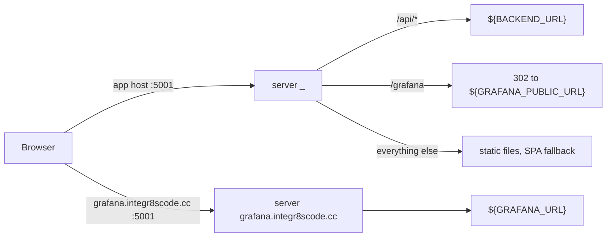

# Nginx configuration

The frontend container is nginx. It serves the Svelte build, proxies `/api/` to the backend, and has a second server block that proxies Grafana on its own hostname. The config is [`frontend/nginx.conf.template`](https://github.com/HardMax71/Integr8sCode/blob/main/frontend/nginx.conf.template).



## App server

```nginx
--8<-- "frontend/nginx.conf.template:server_block"
```

Both server blocks listen on `5001 ssl` with the cert and key that cert-generator writes into `frontend/certs`. Compose publishes the port as `5001:5001`.

### Nonce injection

```nginx
--8<-- "frontend/nginx.conf.template:nonce_injection"
```

index.html carries the literal `**CSP_NONCE**` in four places: a `<meta name="csp-nonce">` tag, the inline `<style>`, the loader `<script>`, and the module `<script>` that Rollup injects for the hashed bundle. `sub_filter` swaps each one for `$request_id`, which nginx generates per request, and the CSP header uses the same value. CodeMirror reads the meta tag so the `<style>` tags it injects at runtime carry the nonce too.

### Security headers

```nginx
--8<-- "frontend/nginx.conf.template:security_headers"
```

There are six headers: CSP, HSTS, `X-Frame-Options`, `X-Content-Type-Options`, `Referrer-Policy` and `Permissions-Policy`. Only HSTS has `always`, so it's the only one nginx also sends on 4xx and 5xx responses.

The CSP locks scripts and `<style>` elements to the nonce. `style-src-elem` also allows `https://fonts.googleapis.com`, and `font-src` allows `https://fonts.gstatic.com`, because index.html loads Inter and Fira Code from Google Fonts. `style-src-attr 'unsafe-inline'` allows `style=""` attributes, which Svelte transitions and CodeMirror set at runtime and which nonces can't cover. That doesn't reopen the CSS exfiltration path through injected `<style>` tags, since those still need the nonce. Scanners that only know CSP Level 2 flag the `'unsafe-inline'` anyway.

No `location` block uses `add_header`. That's on purpose: one `add_header` inside a location drops every `add_header` inherited from the `server` block, so the security headers would disappear from that location. If a location ever needs its own response header, it has to repeat all six. `proxy_set_header` has the same all-or-nothing inheritance, which is why the SSE location repeats the proxy headers of `/api/`.

### Compression

```nginx
--8<-- "frontend/nginx.conf.template:compression"
```

Text types only. Images other than SVG and icons are already compressed.

### API proxy and SSE

```nginx
--8<-- "frontend/nginx.conf.template:api_proxy"
```

```nginx
--8<-- "frontend/nginx.conf.template:sse_proxy"
```

`proxy_ssl_verify off` is fine here because the backend sits on the internal compose network with a self-signed cert. Don't copy it to a proxy that leaves the host.

The SSE location under `/api/v1/events/` speaks HTTP/1.1 with an empty `Connection` header, turns off buffering and caching, and raises both timeouts to 24 hours so long-lived streams aren't cut after the default 60 seconds. `proxy_buffering off` alone is enough to pass each event through as it arrives.

### Static files and SPA routing

```nginx
--8<-- "frontend/nginx.conf.template:static_caching"
```

Rollup writes the bundle as `build/[name]-[hash].js` and `build/bundle-<hash>.css`, so a year of caching is safe. HTML gets `expires -1` so the browser always fetches the current asset names. Everything that isn't a file falls through to `location /`, which serves index.html and lets the Svelte router handle the path.

`location = /grafana` returns a 302 to `${GRAFANA_PUBLIC_URL}`. There's no `/grafana/` subpath proxy.

## Grafana server

```nginx
--8<-- "frontend/nginx.conf.template:grafana_proxy"
```

Grafana gets its own hostname, `grafana.integr8scode.cc`, and is proxied at the root. grafana.ini sets no `root_url`; compose passes `GF_SERVER_ROOT_URL` from `GRAFANA_ROOT_URL`. `/api/live/` is the Grafana Live websocket, so it gets the `Upgrade` and `Connection` headers.

The upstream goes through a variable with Docker's resolver (`127.0.0.11`), so nginx resolves `grafana` per request instead of at startup. Without that, nginx would refuse to start when the observability profile is off. In that case the Grafana host just returns 502. This server block sets no security headers.

## Environment variables

The nginx image runs `envsubst` on `/etc/nginx/templates/*.template` at startup and only replaces variables that are set, so nginx's own `$host` or `$request_id` stay intact.

```dockerfile
--8<-- "frontend/Dockerfile:production_stage"
```

| Variable             | Compose value                                     | Used for                     |
|----------------------|---------------------------------------------------|------------------------------|
| `BACKEND_URL`        | `https://backend:443`                             | `/api/` proxy                |
| `GRAFANA_URL`        | `${GRAFANA_URL:-http://grafana:3000}`             | Grafana server upstream      |
| `GRAFANA_PUBLIC_URL` | `${GRAFANA_ROOT_URL:-http://localhost:3000/}`     | `/grafana` redirect target   |

## Applying changes

The template is baked into the image, so rebuild and recreate:

```bash
docker compose up -d --build frontend
```

`docker compose restart frontend` keeps the old container and the old image, so it doesn't pick up a change. With pre-built images, `docker compose pull frontend` followed by `docker compose up -d frontend` does the same.

## Troubleshooting

| Issue                                  | Likely cause                                  |
|----------------------------------------|-----------------------------------------------|
| SSE events arrive in batches or stop   | SSE location missing `proxy_buffering off` or the 24h timeouts |
| CSP blocks a resource                  | Source missing from the policy; the browser console names the directive |
| 502 on `/api/`                         | Backend down: `docker compose logs backend`   |
| 502 on the Grafana host                | Observability profile not running             |
| Security headers missing on a route    | An `add_header` in that location; check with `curl -kI` |
