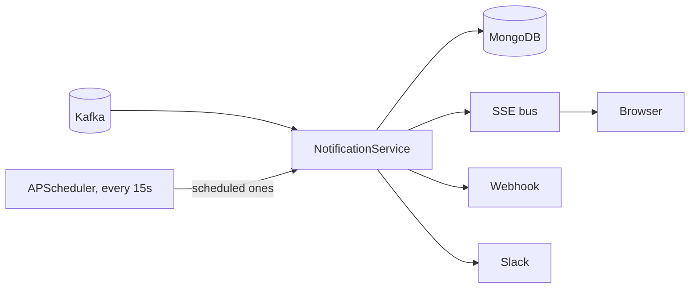

# Notifications

`NotificationService` creates notifications from execution results and delivers them in-app over SSE, or to a user's webhook or Slack. It lives in the backend API process, not in a worker.



## Where they come from

`dishka_lifespan` calls `register_notification_subscriber`, which subscribes to `execution_completed`, `execution_failed` and `execution_timeout` in the consumer group `notification-service`, starting from the latest offset. Each handler turns the event into a notification for the execution's owner.

| Event                 | Subject                         | Severity | Tags                                                           |
|-----------------------|---------------------------------|----------|----------------------------------------------------------------|
| `execution_completed` | `Execution Completed: <id>`     | medium   | `execution`, `completed`, `entity:execution`, `exec:<id>`      |
| `execution_failed`    | `Execution Failed: <id>`        | high     | `execution`, `failed`, `entity:execution`, `exec:<id>`         |
| `execution_timeout`   | `Execution Timeout: <id>`       | high     | `execution`, `timeout`, `entity:execution`, `exec:<id>`        |

The tag pattern is the convention for any producer: a category, an outcome, an `entity:` tag and a reference such as `exec:<id>`. The UI filters and links on them.

## Fields and statuses

| Field      | Values                                                                 |
|------------|------------------------------------------------------------------------|
| `channel`  | `in_app`, `webhook`, `slack`                                           |
| `severity` | `low`, `medium`, `high`, `urgent`                                      |
| `status`   | `pending`, `queued`, `sending`, `delivered`, `failed`, `skipped`, `read`, `clicked` |

Besides those, a notification has `subject`, `body`, `action_url`, `tags`, an optional `scheduled_for` and a `metadata` dict.

A new notification is `pending`. Delivery claims it atomically by moving it to `sending`, then it ends as `delivered`, `failed` or `skipped`. Marking it read sets `read`. `queued` and `clicked` exist in the enum, but no code sets them today.

## Delivery

A notification without `scheduled_for` is delivered right away. A scheduled one stays `pending` until the backend's APScheduler job picks it up. The job runs every 15 seconds and delivers at most 50 due notifications per run. `scheduled_for` must be in the future and at most `NOTIF_MAX_SCHEDULE_DAYS` (25) days ahead.

Before delivery the service loads the user's subscription for that channel. A user without one gets an enabled default. The subscription can switch the channel off or filter by severity and tags:

```python
--8<-- "backend/app/services/notification_service.py:should_skip_notification"
```

Then the channel handler runs:

```python
--8<-- "backend/app/services/notification_service.py:channel_handlers"
```

In-app delivery publishes to the SSE bus. Webhook and Slack send an HTTP POST with httpx2. Every handler is retried with exponential backoff, up to `max_retries` (3) attempts and at most 30 seconds apart, before the notification is marked `failed`.

## Throttling

Creation is throttled per user and severity, `NOTIF_THROTTLE_MAX_PER_HOUR` (5) per `NOTIF_THROTTLE_WINDOW_HOURS` (1). Past the limit `create_notification` raises `NotificationThrottledError`. That check is off when `ENVIRONMENT` is `test`.

`create_system_notification` checks the same cache once more before it calls `create_notification`, unless the severity is `high` or `urgent`. That extra check runs in `test` too, and outside `test` a `low` or `medium` system notification counts twice against the limit.

```python
--8<-- "backend/app/services/notification_service.py:ThrottleCache"
```

The cache lives in memory, so each gunicorn worker counts on its own and a restart resets it.
