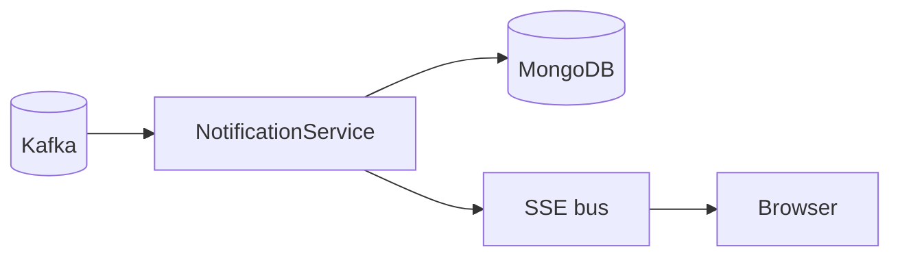

# Notifications

`NotificationService` turns execution results into in-app notifications. It stores each one in MongoDB and pushes it to the user's open notification streams over SSE. It lives in the backend API process, not in the worker.



## Where they come from

`dishka_lifespan` includes `notification_router`, which subscribes to `execution_completed`, `execution_failed` and `execution_timeout` in the consumer group `notification-service`, starting from the latest offset. Each handler turns the event into a notification for the execution's owner, unless the owner switched it off in their settings: `execution_completed` covers completed runs, and `execution_failed` covers failed and timed-out ones.

| Event                 | Subject                         | Severity | Tags                                                           |
|-----------------------|---------------------------------|----------|----------------------------------------------------------------|
| `execution_completed` | `Execution Completed: <id>`     | medium   | `execution`, `completed`, `entity:execution`, `exec:<id>`      |
| `execution_failed`    | `Execution Failed: <id>`        | high     | `execution`, `failed`, `entity:execution`, `exec:<id>`         |
| `execution_timeout`   | `Execution Timeout: <id>`       | high     | `execution`, `timeout`, `entity:execution`, `exec:<id>`        |

The tag pattern is the convention for any producer: a category, an outcome, an `entity:` tag and a reference such as `exec:<id>`. The UI filters and links on them.

## Fields and statuses

| Field      | Values                                                                 |
|------------|------------------------------------------------------------------------|
| `severity` | `low`, `medium`, `high`, `urgent`                                      |
| `status`   | `pending`, `queued`, `sending`, `delivered`, `failed`, `read`, `clicked` |

Besides those, a notification has `subject`, `body`, `action_url`, `tags` and a `metadata` dict.

A new notification is `pending`. Delivery claims it atomically by moving it to `sending`, then it ends as `delivered` or `failed`. Marking it read sets `read`. `queued` and `clicked` exist in the enum, but no code sets them today.

## Delivery

A notification is delivered right after it's stored. The service publishes it to the SSE bus on `sse:notif:{user_id}`, and every open notification stream of that user gets it. A failed publish is retried with exponential backoff, up to `max_retries` (3) attempts and at most 30 seconds apart, before the notification is marked `failed`. It stays in the user's list either way, since the list reads MongoDB.

## Throttling

Creation is throttled per user and severity, `NOTIF_THROTTLE_MAX_PER_HOUR` (5) per `NOTIF_THROTTLE_WINDOW_HOURS` (1). Past the limit `create_notification` raises `NotificationThrottledError`. That check is off when `ENVIRONMENT` is `test`.

```python
--8<-- "backend/app/services/notification_service.py:ThrottleCache"
```

The cache lives in memory, so each gunicorn worker counts on its own and a restart resets it.
