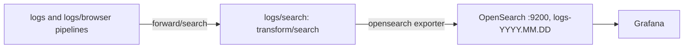

# Log search (OpenSearch)

OpenSearch holds the same log lines as [Loki](loki.md), with every field indexed, so a search by execution id, user id or error text over 30 days answers in milliseconds instead of reading every chunk. Loki stays for now: the plan in [#373](https://github.com/HardMax71/Integr8sCode/issues/373) is to run both on real traffic, compare, and then drop one. OpenSearch runs with the `observability` compose profile, next to Loki.



## Collector

Both log pipelines in [`backend/otel-collector-config.yaml`](https://github.com/HardMax71/Integr8sCode/blob/main/backend/otel-collector-config.yaml) send their lines to Loki and to the `forward/search` connector, so OpenSearch gets exactly what Loki gets, after the same filters. The `logs/search` pipeline runs `transform/search`, which parses the JSON body of the backend's and worker's records into attributes (`execution_id`, `user_id`, `event` and the rest of structlog's keys), and the `opensearch` exporter writes one index a day, `logs-2026.10.22`, in the exporter's default SS4O document shape:

```json
{
  "@timestamp": "2026-10-22T19:00:59.756Z",
  "body": "{\"execution_id\": \"7f3c2a10-1111-4abc-9def-0123456789ab\", \"event\": \"Pod failed\", \"level\": \"error\", \"error\": \"ImagePullBackOff\"}",
  "attributes": { "execution_id": "7f3c2a10-1111-4abc-9def-0123456789ab", "event": "Pod failed", "level": "error", "error": "ImagePullBackOff" },
  "resource": { "service.name": "integr8scode-backend", "service.namespace": "integr8scode" },
  "severity": { "text": "ERROR", "number": 17 },
  "traceId": "7f08c4fb897b5f96bfa811daf69f6821",
  "spanId": "a1b2c3d4e5f60718"
}
```

The exporter treats a refused connection as a permanent error and doesn't retry it ([log_bulk_indexer.go#L48-L51](https://github.com/open-telemetry/opentelemetry-collector-contrib/blob/4be375e49b4d0b46733447f58e1e7a3e731ae576/exporter/opensearchexporter/log_bulk_indexer.go#L48-L51)), so lines sent while OpenSearch starts or restarts are dropped from OpenSearch. Loki still has them.

## OpenSearch

Single node, OpenSearch 3.9, security plugin off, listening on `127.0.0.1:9200` and on the compose network, like Loki. `node.store.allow_mmap=false` means the host's `vm.max_map_count` stays as it is. The heap is 512m and the container limit 1536m: 30 days at prod's volume sit near 1.1 GiB. Data lives in the `opensearch_data` volume, about 1.1 GB for 30 days.

The container's entrypoint is [`backend/opensearch/start.sh`](https://github.com/HardMax71/Integr8sCode/blob/main/backend/opensearch/start.sh). It starts OpenSearch, waits for the cluster, and then applies two things through the API: the index template and the retention policy. The healthcheck passes only once the template exists.

```json
--8<-- "backend/opensearch/logs-template.json"
```

`attributes` and `resource` are `flat_object` fields. Every key under them is searchable by its dotted path, but they add no fields to the mapping, so a key that's a number in one line and a string in another (`status: 500`, `status: "running"`) can't make OpenSearch reject a line.

```json
--8<-- "backend/opensearch/logs-retention-policy.json"
```

The policy deletes each daily index 30 days after it was created, the same retention as Loki. A stored policy is never overwritten, so a changed policy needs a new id.

The collector starts writing as soon as OpenSearch answers, a moment before start.sh has put the template in. So compose starts OpenSearch with `action.auto_create_index=-logs-*,+*`: until then a write gets `index_not_found_exception` and is dropped (Loki has it), instead of creating a `logs-` index with default mappings. Once the template and the policy exist, start.sh allows auto-creation with a persistent cluster setting, so a restart needs no setup before writes go through. The cluster reports yellow even so: the retention plugin's own `.opendistro-ism-config` index asks for a replica that a single node can't place.

## Grafana

The datasource is the [grafana-opensearch-datasource](https://grafana.com/grafana/plugins/grafana-opensearch-datasource/) plugin, installed by `preinstall_sync` in grafana.ini. Its index is the daily pattern `[logs-]YYYY.MM.DD`, so a query reads only the days in its time range. The message field is `body`, the level field `severity.text`, and a `traceId` data link opens the trace in Jaeger.

## Queries

Open Grafana Explore at `http://localhost:3000/explore`, pick the OpenSearch datasource and the Logs query type, and write Lucene:

```text
# one execution, across every service
attributes.execution_id:"7f3c2a10-1111-4abc-9def-0123456789ab"

# one user's failures
attributes.user_id:"u-42" AND severity.text:ERROR

# error text anywhere in a line
"ImagePullBackOff"

# one service
resource.service.name:"integr8scode-worker"
```

Measured locally on 1.94 million synthetic app lines spread over 31 daily indices, prod's volume once Mongo's info lines are dropped: a search by `attributes.execution_id` took 6 to 8 ms in OpenSearch (624 ms for the first query after a restart) and 25 to 75 ms through Grafana. The same search in Loki on prod's 10 days took 3.4 s, and 8.2 s with `| json`.
