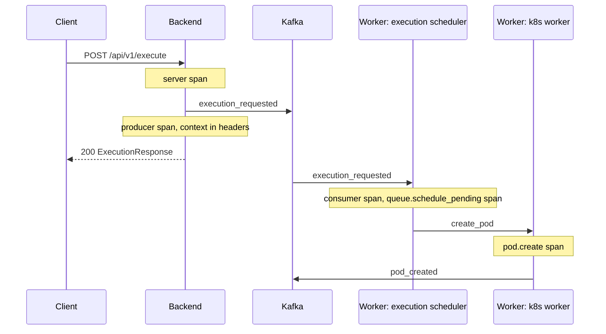

# Tracing

The backend and the worker export OpenTelemetry traces to the OpenTelemetry Collector, which samples them and passes them on to Jaeger. A request to the API and the Kafka messages it causes show up as one trace, as long as each hop runs inside a span.

## Setup

[`Tracer`](https://github.com/HardMax71/Integr8sCode/blob/main/backend/app/core/tracing/tracer.py) is a DI-managed class that does all the work in its constructor:

- builds a `TracerProvider` with `service.name` from `SERVICE_NAME`, plus version, environment, `service.namespace=integr8scode` and `service.instance.id`
- picks the sampler from `TRACING_SAMPLING_RATE`: `ALWAYS_OFF` at 0 or below, `ALWAYS_ON` at 1 or above, `ParentBased(TraceIdRatioBased(rate))` in between
- adds a `BatchSpanProcessor` with a gRPC OTLP exporter when `OTLP_TRACES_ENDPOINT` is set
- sets the W3C TraceContext propagator
- instruments HTTPX through `HTTPX2ClientInstrumentor` (the backend uses httpx2), PyMongo, and stdlib logging

`create_app` instruments FastAPI with `FastAPIInstrumentor`, skipping `health`, `metrics`, `docs` and openapi.json. It has to happen there, before Starlette builds the middleware stack on its first call, which is the lifespan's. The backend then resolves `Tracer` in `dishka_lifespan`, and the instrumentation's spans go to the provider it installs. The worker never asks for it directly, but the broker provider depends on it, so every process that builds a `KafkaBroker` sets up tracing first.

config.toml sends traces to `http://otel-collector:4317` with a sampling rate of 1.0, so every span reaches the collector. Its traces pipeline waits 10 seconds per trace (`tail_sampling`) and keeps a trace that has an error, takes longer than 1 second, or falls in a 10 % random sample. Only those reach Jaeger, 10 to 20 seconds after the trace ends, once the batch processor flushes. config.test.toml leaves the endpoint empty, so tests create spans and export nothing, and pytest sets `OTEL_SDK_DISABLED=true` on top.

`config.worker.toml` sets `SERVICE_NAME` to `integr8scode-worker`, so Jaeger lists two services, `integr8scode-backend` and `integr8scode-worker`. Logs and metrics use the same name.

## Kafka propagation

The broker is created with FastStream's `KafkaTelemetryMiddleware`. On publish it opens a producer span and writes the trace context into the message headers. On consume it reads the headers and opens a consumer span as a child. There's no custom consumer code involved.

A message published with no active span starts a new trace. That happens in three places: pod monitor events, which come from the Kubernetes watch; DLQ retries, which the DLQ processor publishes from an APScheduler job; and queued executions that the 10 second scheduler job starts. A queued execution started while the scheduler handles a request joins that request's trace instead.

## Spans and attributes

Beyond the automatic HTTP, Mongo, outbound HTTPX and Kafka spans:

| Where                                   | What                                                                 |
|-----------------------------------------|----------------------------------------------------------------------|
| `POST /api/v1/execute`                  | language, language version, script length, `user.id`, `client.address` on the server span |
| `EventRepository.store_event`           | `event.type`, `event.id`, `execution.id` on the current span         |
| `UnifiedProducer.produce`               | a `publish_event` span with `event.type` and `aggregate.id`          |
| `ExecutionScheduler`                    | a `queue.schedule_pending` span per pass, and a `pod.create` span per pod the k8s worker creates |
| Webhook and Slack notifications         | `notification.id`, `notification.channel` (and webhook host) on the current span |

## An execution, end to end

The API stores the event in MongoDB, publishes `execution_requested` and answers 200. The execution scheduler picks it up in a consumer span that continues the same trace and, when a slot is free, has the k8s worker create the pod in a `pod.create` span of the same trace. Its calls to the Kubernetes API go through kubernetes_asyncio, which isn't instrumented, so they don't show up as spans. From there, pod monitor events start fresh traces, as described above.

## Jaeger

Jaeger runs as `jaegertracing/jaeger:2.20.0` under the `observability` profile, with in-memory storage and the UI on `http://localhost:16686`. OTLP ports 4317 and 4318 stay on the compose network. Grafana also has a Jaeger datasource. Jaeger is pinned below 2.21 because 2.21 removed the search API that datasource calls ([grafana/grafana#112336](https://github.com/grafana/grafana/issues/112336)), so trace search in Grafana would stop working.

To turn tracing off, set `TRACING_SAMPLING_RATE = 0`. Leaving `OTLP_TRACES_ENDPOINT` empty only stops the export; spans are still recorded in process, so log lines keep their `trace_id`.
