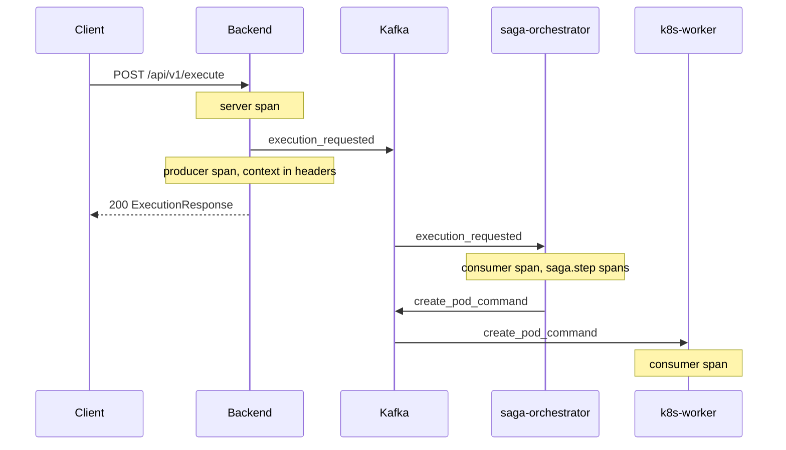

# Tracing

The backend and every worker export OpenTelemetry traces straight to Jaeger. A request to the API and the Kafka messages it causes show up as one trace, as long as each hop runs inside a span.

## Setup

[`Tracer`](https://github.com/HardMax71/Integr8sCode/blob/main/backend/app/core/tracing/tracer.py) is a DI-managed class that does all the work in its constructor:

- builds a `TracerProvider` with `service.name` from `TRACING_SERVICE_NAME`, plus version, environment, `service.namespace=integr8scode` and `service.instance.id`
- picks the sampler from `TRACING_SAMPLING_RATE`: `ALWAYS_OFF` at 0 or below, `ALWAYS_ON` at 1 or above, `ParentBased(TraceIdRatioBased(rate))` in between
- adds a `BatchSpanProcessor` with a gRPC OTLP exporter when `OTLP_TRACES_ENDPOINT` is set
- sets the W3C TraceContext propagator
- instruments HTTPX through `HTTPX2ClientInstrumentor` (the backend uses httpx2), PyMongo, and stdlib logging

The backend resolves `Tracer` in `dishka_lifespan` and then instruments FastAPI with `FastAPIInstrumentor`, skipping `health`, `metrics`, `docs` and openapi.json. Workers never ask for it directly, but the broker provider depends on it, so every process that builds a `KafkaBroker` sets up tracing first.

config.toml sends traces to `http://jaeger:4317` with a sampling rate of 1.0. The collector also has a traces pipeline (with tail sampling) into Jaeger, but the app doesn't use it. config.test.toml leaves the endpoint empty, so tests create spans and export nothing, and pytest sets `OTEL_SDK_DISABLED=true` on top.

Each worker's `config.<worker>.toml` overrides `TRACING_SERVICE_NAME`, so Jaeger lists `integr8scode-backend`, `k8s-worker`, `pod-monitor`, `result-processor`, `saga-orchestrator`, `event-replay` and `dlq-processor` as separate services.

## Kafka propagation

The broker is created with FastStream's `KafkaTelemetryMiddleware`. On publish it opens a producer span and writes the trace context into the message headers. On consume it reads the headers and opens a consumer span as a child. There's no custom consumer code involved.

A message published with no active span starts a new trace. That happens in three places: pod monitor events, which come from the Kubernetes watch; DLQ retries, which the DLQ processor publishes from an APScheduler job; and queued sagas that the scheduler job starts. A queued saga started while the orchestrator handles another event, such as another execution's completion, joins that event's trace instead.

## Spans and attributes

Beyond the automatic HTTP, Mongo, outbound HTTPX and Kafka spans:

| Where                                   | What                                                                 |
|-----------------------------------------|----------------------------------------------------------------------|
| `POST /api/v1/execute`                  | language, language version, script length, `user.id`, `client.address` on the server span |
| `EventRepository.store_event`           | `event.type`, `event.id`, `execution.id` on the current span         |
| `KafkaEventService.publish_event`       | a `publish_event` span with `event.type` and `aggregate.id`          |
| `SagaOrchestrator`                      | a `saga.step` span per step with saga name, id, step and execution id |
| Webhook and Slack notifications         | `notification.id`, `notification.channel` (and webhook host) on the current span |

## An execution, end to end

The API stores the event in MongoDB, publishes `execution_requested` and answers 200. The saga orchestrator picks it up in a consumer span that continues the same trace, runs its steps as `saga.step` spans and publishes `create_pod_command`. The k8s worker's consumer span joins the trace too. Its calls to the Kubernetes API go through kubernetes_asyncio, which isn't instrumented, so they don't show up as spans. From there, pod monitor events start fresh traces, as described above.

## Jaeger

Jaeger runs as `jaegertracing/jaeger:2.20.0` under the `observability` profile, with in-memory storage and the UI on `http://localhost:16686`. OTLP ports 4317 and 4318 stay on the compose network. Grafana also has a Jaeger datasource. Jaeger is pinned below 2.21 because 2.21 removed the search API that datasource calls ([grafana/grafana#112336](https://github.com/grafana/grafana/issues/112336)), so trace search in Grafana would stop working.

To turn tracing off, set `TRACING_SAMPLING_RATE = 0`. Leaving `OTLP_TRACES_ENDPOINT` empty only stops the export; spans are still recorded in process, so log lines keep their `trace_id`.
